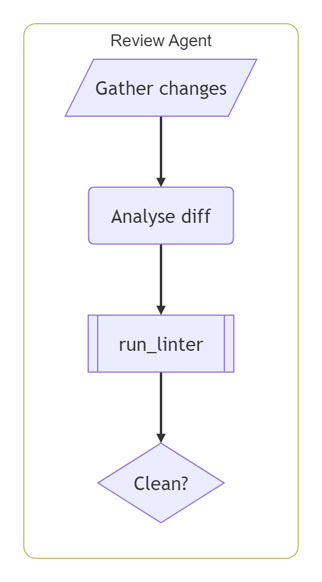
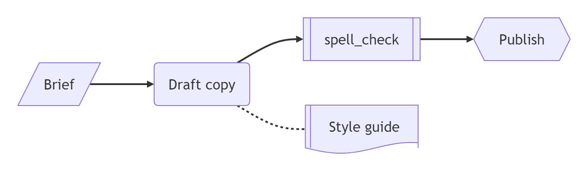
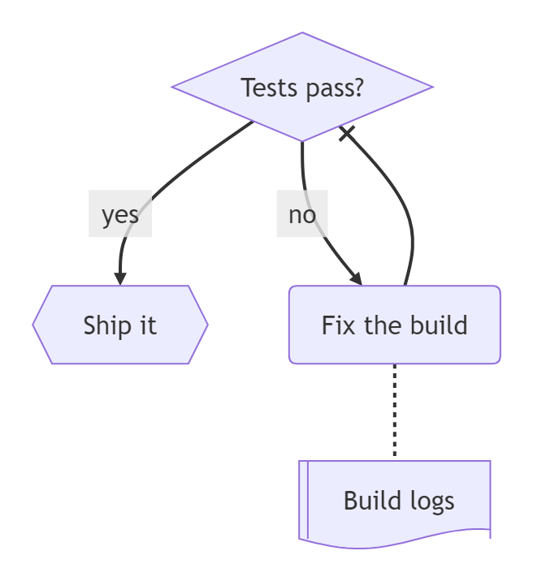
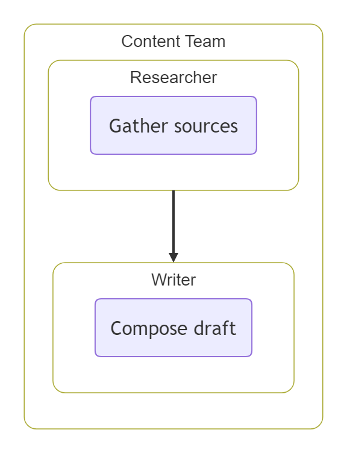
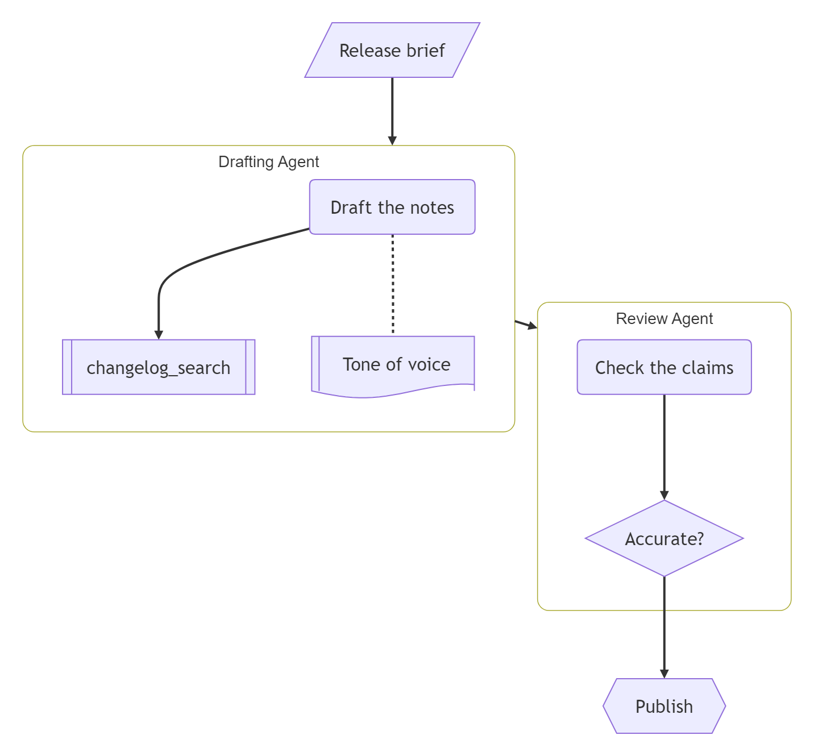
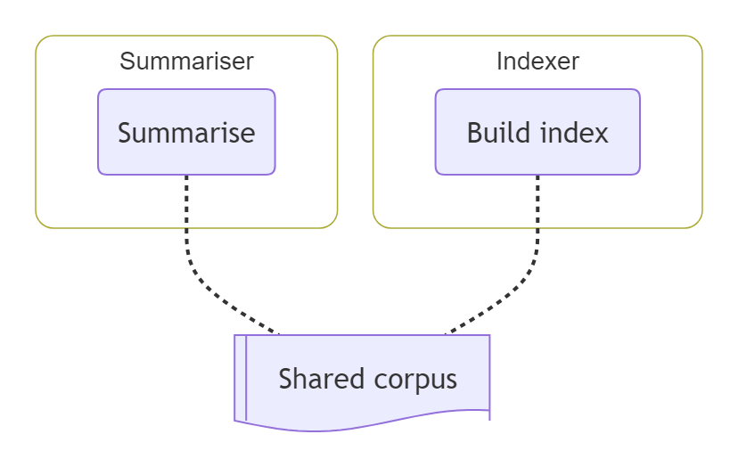
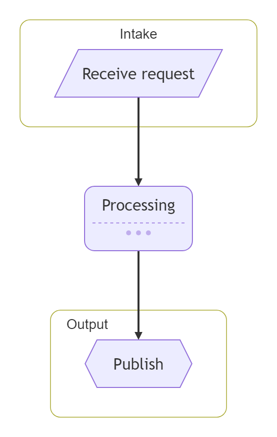
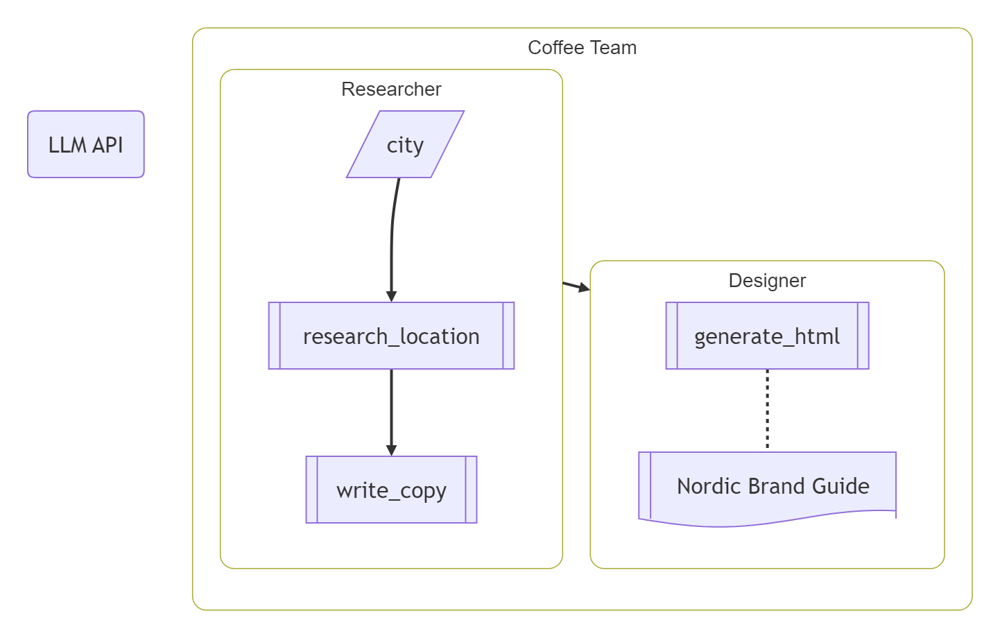
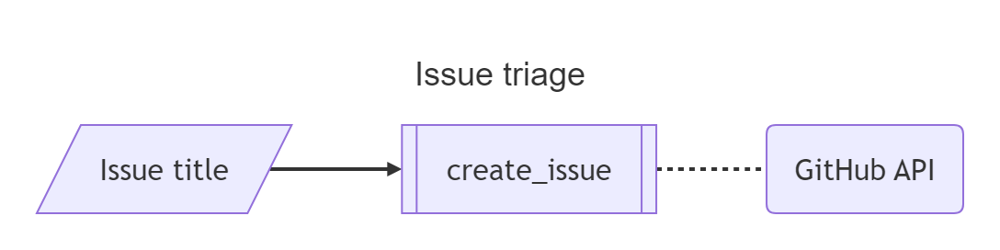
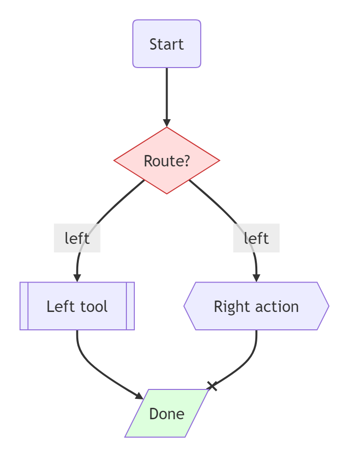

# AgentFlow

## Basic

**Input:**
```
agentflow-beta TB
  flow reviewer["Review Agent"]
    changes["Gather changes"]@{ shape: input }
    analyse["Analyse diff"]@{ shape: task }
    lint["run_linter"]@{ shape: tool }
    ok["Clean?"]@{ shape: decision }

    changes --> analyse --> lint --> ok
  end
```
**Rendered by Naiad:**

<p align="center">
  
</p>

**Rendered by Mermaid:**
```mermaid
agentflow-beta TB
  flow reviewer["Review Agent"]
    changes["Gather changes"]@{ shape: input }
    analyse["Analyse diff"]@{ shape: task }
    lint["run_linter"]@{ shape: tool }
    ok["Clean?"]@{ shape: decision }

    changes --> analyse --> lint --> ok
  end
```

[Open in Mermaid Live](https://mermaid.live/edit#base64:eyJjb2RlIjoiYWdlbnRmbG93LWJldGEgVEJcbiAgZmxvdyByZXZpZXdlcltcdTAwMjJSZXZpZXcgQWdlbnRcdTAwMjJdXG4gICAgY2hhbmdlc1tcdTAwMjJHYXRoZXIgY2hhbmdlc1x1MDAyMl1AeyBzaGFwZTogaW5wdXQgfVxuICAgIGFuYWx5c2VbXHUwMDIyQW5hbHlzZSBkaWZmXHUwMDIyXUB7IHNoYXBlOiB0YXNrIH1cbiAgICBsaW50W1x1MDAyMnJ1bl9saW50ZXJcdTAwMjJdQHsgc2hhcGU6IHRvb2wgfVxuICAgIG9rW1x1MDAyMkNsZWFuP1x1MDAyMl1AeyBzaGFwZTogZGVjaXNpb24gfVxuXG4gICAgY2hhbmdlcyAtLVx1MDAzRSBhbmFseXNlIC0tXHUwMDNFIGxpbnQgLS1cdTAwM0Ugb2tcbiAgZW5kIiwibWVybWFpZCI6eyJ0aGVtZSI6ImRlZmF1bHQifX0=)

## Shapes

**Input:**
```
agentflow-beta LR
  brief["Brief"]@{ shape: input }
  draft["Draft copy"]@{ shape: task }
  spellcheck["spell_check"]@{ shape: tool }
  guide["Style guide"]@{ shape: refdoc }
  publish["Publish"]@{ shape: action }

  brief --> draft --> spellcheck --> publish
  draft -.- guide
```
**Rendered by Naiad:**

<p align="center">
  
</p>

**Rendered by Mermaid:**
```mermaid
agentflow-beta LR
  brief["Brief"]@{ shape: input }
  draft["Draft copy"]@{ shape: task }
  spellcheck["spell_check"]@{ shape: tool }
  guide["Style guide"]@{ shape: refdoc }
  publish["Publish"]@{ shape: action }

  brief --> draft --> spellcheck --> publish
  draft -.- guide
```

[Open in Mermaid Live](https://mermaid.live/edit#base64:eyJjb2RlIjoiYWdlbnRmbG93LWJldGEgTFJcbiAgYnJpZWZbXHUwMDIyQnJpZWZcdTAwMjJdQHsgc2hhcGU6IGlucHV0IH1cbiAgZHJhZnRbXHUwMDIyRHJhZnQgY29weVx1MDAyMl1AeyBzaGFwZTogdGFzayB9XG4gIHNwZWxsY2hlY2tbXHUwMDIyc3BlbGxfY2hlY2tcdTAwMjJdQHsgc2hhcGU6IHRvb2wgfVxuICBndWlkZVtcdTAwMjJTdHlsZSBndWlkZVx1MDAyMl1AeyBzaGFwZTogcmVmZG9jIH1cbiAgcHVibGlzaFtcdTAwMjJQdWJsaXNoXHUwMDIyXUB7IHNoYXBlOiBhY3Rpb24gfVxuXG4gIGJyaWVmIC0tXHUwMDNFIGRyYWZ0IC0tXHUwMDNFIHNwZWxsY2hlY2sgLS1cdTAwM0UgcHVibGlzaFxuICBkcmFmdCAtLi0gZ3VpZGUiLCJtZXJtYWlkIjp7InRoZW1lIjoiZGVmYXVsdCJ9fQ==)

## Edges

**Input:**
```
agentflow-beta TB
  check["Tests pass?"]@{ shape: decision }
  ship["Ship it"]@{ shape: action }
  fix["Fix the build"]@{ shape: task }
  logs["Build logs"]@{ shape: refdoc }

  check -- yes --> ship
  check -- no --> fix
  fix --x check
  fix -.- logs
```
**Rendered by Naiad:**

<p align="center">
  
</p>

**Rendered by Mermaid:**
```mermaid
agentflow-beta TB
  check["Tests pass?"]@{ shape: decision }
  ship["Ship it"]@{ shape: action }
  fix["Fix the build"]@{ shape: task }
  logs["Build logs"]@{ shape: refdoc }

  check -- yes --> ship
  check -- no --> fix
  fix --x check
  fix -.- logs
```

[Open in Mermaid Live](https://mermaid.live/edit#base64:eyJjb2RlIjoiYWdlbnRmbG93LWJldGEgVEJcbiAgY2hlY2tbXHUwMDIyVGVzdHMgcGFzcz9cdTAwMjJdQHsgc2hhcGU6IGRlY2lzaW9uIH1cbiAgc2hpcFtcdTAwMjJTaGlwIGl0XHUwMDIyXUB7IHNoYXBlOiBhY3Rpb24gfVxuICBmaXhbXHUwMDIyRml4IHRoZSBidWlsZFx1MDAyMl1AeyBzaGFwZTogdGFzayB9XG4gIGxvZ3NbXHUwMDIyQnVpbGQgbG9nc1x1MDAyMl1AeyBzaGFwZTogcmVmZG9jIH1cblxuICBjaGVjayAtLSB5ZXMgLS1cdTAwM0Ugc2hpcFxuICBjaGVjayAtLSBubyAtLVx1MDAzRSBmaXhcbiAgZml4IC0teCBjaGVja1xuICBmaXggLS4tIGxvZ3MiLCJtZXJtYWlkIjp7InRoZW1lIjoiZGVmYXVsdCJ9fQ==)

## NestedContainers

**Input:**
```
agentflow-beta TB
  flow team["Content Team"]
    flow researcher["Researcher"]
      gather["Gather sources"]@{ shape: task }
    end

    flow writer["Writer"]
      compose["Compose draft"]@{ shape: task }
    end

    researcher --> writer
  end
```
**Rendered by Naiad:**

<p align="center">
  
</p>

**Rendered by Mermaid:**
```mermaid
agentflow-beta TB
  flow team["Content Team"]
    flow researcher["Researcher"]
      gather["Gather sources"]@{ shape: task }
    end

    flow writer["Writer"]
      compose["Compose draft"]@{ shape: task }
    end

    researcher --> writer
  end
```

[Open in Mermaid Live](https://mermaid.live/edit#base64:eyJjb2RlIjoiYWdlbnRmbG93LWJldGEgVEJcbiAgZmxvdyB0ZWFtW1x1MDAyMkNvbnRlbnQgVGVhbVx1MDAyMl1cbiAgICBmbG93IHJlc2VhcmNoZXJbXHUwMDIyUmVzZWFyY2hlclx1MDAyMl1cbiAgICAgIGdhdGhlcltcdTAwMjJHYXRoZXIgc291cmNlc1x1MDAyMl1AeyBzaGFwZTogdGFzayB9XG4gICAgZW5kXG5cbiAgICBmbG93IHdyaXRlcltcdTAwMjJXcml0ZXJcdTAwMjJdXG4gICAgICBjb21wb3NlW1x1MDAyMkNvbXBvc2UgZHJhZnRcdTAwMjJdQHsgc2hhcGU6IHRhc2sgfVxuICAgIGVuZFxuXG4gICAgcmVzZWFyY2hlciAtLVx1MDAzRSB3cml0ZXJcbiAgZW5kIiwibWVybWFpZCI6eyJ0aGVtZSI6ImRlZmF1bHQifX0=)

## ReleaseNotes

**Input:**
```
agentflow-beta TB
  brief["Release brief"]@{ shape: input }
  flow writer["Drafting Agent"]
    draft["Draft the notes"]@{ shape: task }
    lookup["changelog_search"]@{ shape: tool }
    guide["Tone of voice"]@{ shape: refdoc }
    draft --> lookup
    draft -.- guide
  end
  flow reviewer["Review Agent"]
    check["Check the claims"]@{ shape: task }
    ok["Accurate?"]@{ shape: decision }
    check --> ok
  end
  publish["Publish"]@{ shape: action }
  brief --> writer
  writer --> reviewer
  ok --> publish
```
**Rendered by Naiad:**

<p align="center">
  
</p>

**Rendered by Mermaid:**
```mermaid
agentflow-beta TB
  brief["Release brief"]@{ shape: input }
  flow writer["Drafting Agent"]
    draft["Draft the notes"]@{ shape: task }
    lookup["changelog_search"]@{ shape: tool }
    guide["Tone of voice"]@{ shape: refdoc }
    draft --> lookup
    draft -.- guide
  end
  flow reviewer["Review Agent"]
    check["Check the claims"]@{ shape: task }
    ok["Accurate?"]@{ shape: decision }
    check --> ok
  end
  publish["Publish"]@{ shape: action }
  brief --> writer
  writer --> reviewer
  ok --> publish
```

[Open in Mermaid Live](https://mermaid.live/edit#base64:eyJjb2RlIjoiYWdlbnRmbG93LWJldGEgVEJcbiAgYnJpZWZbXHUwMDIyUmVsZWFzZSBicmllZlx1MDAyMl1AeyBzaGFwZTogaW5wdXQgfVxuICBmbG93IHdyaXRlcltcdTAwMjJEcmFmdGluZyBBZ2VudFx1MDAyMl1cbiAgICBkcmFmdFtcdTAwMjJEcmFmdCB0aGUgbm90ZXNcdTAwMjJdQHsgc2hhcGU6IHRhc2sgfVxuICAgIGxvb2t1cFtcdTAwMjJjaGFuZ2Vsb2dfc2VhcmNoXHUwMDIyXUB7IHNoYXBlOiB0b29sIH1cbiAgICBndWlkZVtcdTAwMjJUb25lIG9mIHZvaWNlXHUwMDIyXUB7IHNoYXBlOiByZWZkb2MgfVxuICAgIGRyYWZ0IC0tXHUwMDNFIGxvb2t1cFxuICAgIGRyYWZ0IC0uLSBndWlkZVxuICBlbmRcbiAgZmxvdyByZXZpZXdlcltcdTAwMjJSZXZpZXcgQWdlbnRcdTAwMjJdXG4gICAgY2hlY2tbXHUwMDIyQ2hlY2sgdGhlIGNsYWltc1x1MDAyMl1AeyBzaGFwZTogdGFzayB9XG4gICAgb2tbXHUwMDIyQWNjdXJhdGU/XHUwMDIyXUB7IHNoYXBlOiBkZWNpc2lvbiB9XG4gICAgY2hlY2sgLS1cdTAwM0Ugb2tcbiAgZW5kXG4gIHB1Ymxpc2hbXHUwMDIyUHVibGlzaFx1MDAyMl1AeyBzaGFwZTogYWN0aW9uIH1cbiAgYnJpZWYgLS1cdTAwM0Ugd3JpdGVyXG4gIHdyaXRlciAtLVx1MDAzRSByZXZpZXdlclxuICBvayAtLVx1MDAzRSBwdWJsaXNoIiwibWVybWFpZCI6eyJ0aGVtZSI6ImRlZmF1bHQifX0=)

## GlobalBlock

**Input:**
```
agentflow-beta TB
  global
    corpus["Shared corpus"]@{ shape: refdoc }
  end

  flow summariser["Summariser"]
    summarise["Summarise"]@{ shape: task }
    summarise -.- corpus
  end

  flow indexer["Indexer"]
    index["Build index"]@{ shape: task }
    index -.- corpus
  end
```
**Rendered by Naiad:**

<p align="center">
  
</p>

**Rendered by Mermaid:**
```mermaid
agentflow-beta TB
  global
    corpus["Shared corpus"]@{ shape: refdoc }
  end

  flow summariser["Summariser"]
    summarise["Summarise"]@{ shape: task }
    summarise -.- corpus
  end

  flow indexer["Indexer"]
    index["Build index"]@{ shape: task }
    index -.- corpus
  end
```

[Open in Mermaid Live](https://mermaid.live/edit#base64:eyJjb2RlIjoiYWdlbnRmbG93LWJldGEgVEJcbiAgZ2xvYmFsXG4gICAgY29ycHVzW1x1MDAyMlNoYXJlZCBjb3JwdXNcdTAwMjJdQHsgc2hhcGU6IHJlZmRvYyB9XG4gIGVuZFxuXG4gIGZsb3cgc3VtbWFyaXNlcltcdTAwMjJTdW1tYXJpc2VyXHUwMDIyXVxuICAgIHN1bW1hcmlzZVtcdTAwMjJTdW1tYXJpc2VcdTAwMjJdQHsgc2hhcGU6IHRhc2sgfVxuICAgIHN1bW1hcmlzZSAtLi0gY29ycHVzXG4gIGVuZFxuXG4gIGZsb3cgaW5kZXhlcltcdTAwMjJJbmRleGVyXHUwMDIyXVxuICAgIGluZGV4W1x1MDAyMkJ1aWxkIGluZGV4XHUwMDIyXUB7IHNoYXBlOiB0YXNrIH1cbiAgICBpbmRleCAtLi0gY29ycHVzXG4gIGVuZCIsIm1lcm1haWQiOnsidGhlbWUiOiJkZWZhdWx0In19)

## Collapsed

**Input:**
```
agentflow-beta TB
  flow intake["Intake"]
    receive["Receive request"]@{ shape: input }
  end

  flow processing["Processing"]
    validate["Validate"]@{ shape: task }
    enrich["Enrich"]@{ shape: task }
    validate --> enrich
  end
  processing@{ view: "collapsed" }

  flow output["Output"]
    publish["Publish"]@{ shape: action }
  end

  receive --> validate
  enrich --> publish
```
**Rendered by Naiad:**

<p align="center">
  
</p>

**Rendered by Mermaid:**
```mermaid
agentflow-beta TB
  flow intake["Intake"]
    receive["Receive request"]@{ shape: input }
  end

  flow processing["Processing"]
    validate["Validate"]@{ shape: task }
    enrich["Enrich"]@{ shape: task }
    validate --> enrich
  end
  processing@{ view: "collapsed" }

  flow output["Output"]
    publish["Publish"]@{ shape: action }
  end

  receive --> validate
  enrich --> publish
```

[Open in Mermaid Live](https://mermaid.live/edit#base64:eyJjb2RlIjoiYWdlbnRmbG93LWJldGEgVEJcbiAgZmxvdyBpbnRha2VbXHUwMDIySW50YWtlXHUwMDIyXVxuICAgIHJlY2VpdmVbXHUwMDIyUmVjZWl2ZSByZXF1ZXN0XHUwMDIyXUB7IHNoYXBlOiBpbnB1dCB9XG4gIGVuZFxuXG4gIGZsb3cgcHJvY2Vzc2luZ1tcdTAwMjJQcm9jZXNzaW5nXHUwMDIyXVxuICAgIHZhbGlkYXRlW1x1MDAyMlZhbGlkYXRlXHUwMDIyXUB7IHNoYXBlOiB0YXNrIH1cbiAgICBlbnJpY2hbXHUwMDIyRW5yaWNoXHUwMDIyXUB7IHNoYXBlOiB0YXNrIH1cbiAgICB2YWxpZGF0ZSAtLVx1MDAzRSBlbnJpY2hcbiAgZW5kXG4gIHByb2Nlc3NpbmdAeyB2aWV3OiBcdTAwMjJjb2xsYXBzZWRcdTAwMjIgfVxuXG4gIGZsb3cgb3V0cHV0W1x1MDAyMk91dHB1dFx1MDAyMl1cbiAgICBwdWJsaXNoW1x1MDAyMlB1Ymxpc2hcdTAwMjJdQHsgc2hhcGU6IGFjdGlvbiB9XG4gIGVuZFxuXG4gIHJlY2VpdmUgLS1cdTAwM0UgdmFsaWRhdGVcbiAgZW5yaWNoIC0tXHUwMDNFIHB1Ymxpc2giLCJtZXJtYWlkIjp7InRoZW1lIjoiZGVmYXVsdCJ9fQ==)

## WorkedExample

**Input:**
```
agentflow-beta TB
  connector llm["LLM API"]
  llm@{ protocol: "http", endpoint: "https://api.example.com/chat" }

  flow coffee_team["Coffee Team"]
    city["city"]@{ shape: input, value: "Stockholm" }

    flow researcher["Researcher"]
      research["research_location"]@{ shape: tool, params: "city :: String", returns: "Report" }
      write["write_copy"]@{ shape: tool, connectorRef: "llm.chat", returns: "CoffeeCopy" }
      city --> research --> write
    end
    researcher@{ instruction: "Research the city and draft English coffee copy citing sources." }

    flow designer["Designer"]
      render["generate_html"]@{ shape: tool, connectorRef: "llm.chat", returns: "String" }
      brand["Nordic Brand Guide"]@{ shape: refdoc }
      render -.- brand
    end

    researcher --> designer
  end
```
**Rendered by Naiad:**

<p align="center">
  
</p>

**Rendered by Mermaid:**
```mermaid
agentflow-beta TB
  connector llm["LLM API"]
  llm@{ protocol: "http", endpoint: "https://api.example.com/chat" }

  flow coffee_team["Coffee Team"]
    city["city"]@{ shape: input, value: "Stockholm" }

    flow researcher["Researcher"]
      research["research_location"]@{ shape: tool, params: "city :: String", returns: "Report" }
      write["write_copy"]@{ shape: tool, connectorRef: "llm.chat", returns: "CoffeeCopy" }
      city --> research --> write
    end
    researcher@{ instruction: "Research the city and draft English coffee copy citing sources." }

    flow designer["Designer"]
      render["generate_html"]@{ shape: tool, connectorRef: "llm.chat", returns: "String" }
      brand["Nordic Brand Guide"]@{ shape: refdoc }
      render -.- brand
    end

    researcher --> designer
  end
```

[Open in Mermaid Live](https://mermaid.live/edit#base64:eyJjb2RlIjoiYWdlbnRmbG93LWJldGEgVEJcbiAgY29ubmVjdG9yIGxsbVtcdTAwMjJMTE0gQVBJXHUwMDIyXVxuICBsbG1AeyBwcm90b2NvbDogXHUwMDIyaHR0cFx1MDAyMiwgZW5kcG9pbnQ6IFx1MDAyMmh0dHBzOi8vYXBpLmV4YW1wbGUuY29tL2NoYXRcdTAwMjIgfVxuXG4gIGZsb3cgY29mZmVlX3RlYW1bXHUwMDIyQ29mZmVlIFRlYW1cdTAwMjJdXG4gICAgY2l0eVtcdTAwMjJjaXR5XHUwMDIyXUB7IHNoYXBlOiBpbnB1dCwgdmFsdWU6IFx1MDAyMlN0b2NraG9sbVx1MDAyMiB9XG5cbiAgICBmbG93IHJlc2VhcmNoZXJbXHUwMDIyUmVzZWFyY2hlclx1MDAyMl1cbiAgICAgIHJlc2VhcmNoW1x1MDAyMnJlc2VhcmNoX2xvY2F0aW9uXHUwMDIyXUB7IHNoYXBlOiB0b29sLCBwYXJhbXM6IFx1MDAyMmNpdHkgOjogU3RyaW5nXHUwMDIyLCByZXR1cm5zOiBcdTAwMjJSZXBvcnRcdTAwMjIgfVxuICAgICAgd3JpdGVbXHUwMDIyd3JpdGVfY29weVx1MDAyMl1AeyBzaGFwZTogdG9vbCwgY29ubmVjdG9yUmVmOiBcdTAwMjJsbG0uY2hhdFx1MDAyMiwgcmV0dXJuczogXHUwMDIyQ29mZmVlQ29weVx1MDAyMiB9XG4gICAgICBjaXR5IC0tXHUwMDNFIHJlc2VhcmNoIC0tXHUwMDNFIHdyaXRlXG4gICAgZW5kXG4gICAgcmVzZWFyY2hlckB7IGluc3RydWN0aW9uOiBcdTAwMjJSZXNlYXJjaCB0aGUgY2l0eSBhbmQgZHJhZnQgRW5nbGlzaCBjb2ZmZWUgY29weSBjaXRpbmcgc291cmNlcy5cdTAwMjIgfVxuXG4gICAgZmxvdyBkZXNpZ25lcltcdTAwMjJEZXNpZ25lclx1MDAyMl1cbiAgICAgIHJlbmRlcltcdTAwMjJnZW5lcmF0ZV9odG1sXHUwMDIyXUB7IHNoYXBlOiB0b29sLCBjb25uZWN0b3JSZWY6IFx1MDAyMmxsbS5jaGF0XHUwMDIyLCByZXR1cm5zOiBcdTAwMjJTdHJpbmdcdTAwMjIgfVxuICAgICAgYnJhbmRbXHUwMDIyTm9yZGljIEJyYW5kIEd1aWRlXHUwMDIyXUB7IHNoYXBlOiByZWZkb2MgfVxuICAgICAgcmVuZGVyIC0uLSBicmFuZFxuICAgIGVuZFxuXG4gICAgcmVzZWFyY2hlciAtLVx1MDAzRSBkZXNpZ25lclxuICBlbmQiLCJtZXJtYWlkIjp7InRoZW1lIjoiZGVmYXVsdCJ9fQ==)

## TitleAndConnector

**Input:**
```
---
title: Issue triage
---
agentflow-beta LR
  connector github["GitHub API"]
  github@{ protocol: "http", endpoint: "https://api.github.com" }

  title["Issue title"]@{ shape: input }
  create["create_issue"]@{
    shape: tool
    connectorRef: "github.create_issue"
  }

  title --> create
  create -.- github
```
**Rendered by Naiad:**

<p align="center">
  
</p>

**Rendered by Mermaid:**
```mermaid
---
title: Issue triage
---
agentflow-beta LR
  connector github["GitHub API"]
  github@{ protocol: "http", endpoint: "https://api.github.com" }

  title["Issue title"]@{ shape: input }
  create["create_issue"]@{
    shape: tool
    connectorRef: "github.create_issue"
  }

  title --> create
  create -.- github
```

[Open in Mermaid Live](https://mermaid.live/edit#base64:eyJjb2RlIjoiLS0tXG50aXRsZTogSXNzdWUgdHJpYWdlXG4tLS1cbmFnZW50Zmxvdy1iZXRhIExSXG4gIGNvbm5lY3RvciBnaXRodWJbXHUwMDIyR2l0SHViIEFQSVx1MDAyMl1cbiAgZ2l0aHViQHsgcHJvdG9jb2w6IFx1MDAyMmh0dHBcdTAwMjIsIGVuZHBvaW50OiBcdTAwMjJodHRwczovL2FwaS5naXRodWIuY29tXHUwMDIyIH1cblxuICB0aXRsZVtcdTAwMjJJc3N1ZSB0aXRsZVx1MDAyMl1AeyBzaGFwZTogaW5wdXQgfVxuICBjcmVhdGVbXHUwMDIyY3JlYXRlX2lzc3VlXHUwMDIyXUB7XG4gICAgc2hhcGU6IHRvb2xcbiAgICBjb25uZWN0b3JSZWY6IFx1MDAyMmdpdGh1Yi5jcmVhdGVfaXNzdWVcdTAwMjJcbiAgfVxuXG4gIHRpdGxlIC0tXHUwMDNFIGNyZWF0ZVxuICBjcmVhdGUgLS4tIGdpdGh1YiIsIm1lcm1haWQiOnsidGhlbWUiOiJkZWZhdWx0In19)

## FlowchartForms

**Input:**
```
agentflow-beta TB
  %% Bracket forms map onto agent flow's shapes.
  start(Start) --> pick{Route?}
  pick -->|left| left[[Left tool]] & right{{Right action}}
  left --> done[/Done/]
  right --x done
  classDef hot fill:#fdd,stroke:#c33
  class pick hot
  style done fill:#dfd
```
**Rendered by Naiad:**

<p align="center">
  
</p>

**Rendered by Mermaid:**
```mermaid
agentflow-beta TB
  %% Bracket forms map onto agent flow's shapes.
  start(Start) --> pick{Route?}
  pick -->|left| left[[Left tool]] & right{{Right action}}
  left --> done[/Done/]
  right --x done
  classDef hot fill:#fdd,stroke:#c33
  class pick hot
  style done fill:#dfd
```

[Open in Mermaid Live](https://mermaid.live/edit#base64:eyJjb2RlIjoiYWdlbnRmbG93LWJldGEgVEJcbiAgJSUgQnJhY2tldCBmb3JtcyBtYXAgb250byBhZ2VudCBmbG93XHUwMDI3cyBzaGFwZXMuXG4gIHN0YXJ0KFN0YXJ0KSAtLVx1MDAzRSBwaWNre1JvdXRlP31cbiAgcGljayAtLVx1MDAzRXxsZWZ0fCBsZWZ0W1tMZWZ0IHRvb2xdXSBcdTAwMjYgcmlnaHR7e1JpZ2h0IGFjdGlvbn19XG4gIGxlZnQgLS1cdTAwM0UgZG9uZVsvRG9uZS9dXG4gIHJpZ2h0IC0teCBkb25lXG4gIGNsYXNzRGVmIGhvdCBmaWxsOiNmZGQsc3Ryb2tlOiNjMzNcbiAgY2xhc3MgcGljayBob3RcbiAgc3R5bGUgZG9uZSBmaWxsOiNkZmQiLCJtZXJtYWlkIjp7InRoZW1lIjoiZGVmYXVsdCJ9fQ==)

