# Block

## Simple

**Input:**
```
block-beta
    columns 3
    a["Block A"] b["Block B"] c["Block C"]
```
**Rendered by Naiad:**

<p align="center">
  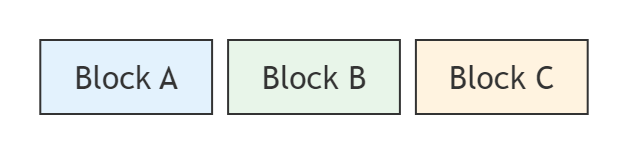
</p>


[Open in Mermaid Live](https://mermaid.live/edit#base64:eyJjb2RlIjoiYmxvY2stYmV0YVxuICAgIGNvbHVtbnMgM1xuICAgIGFbXHUwMDIyQmxvY2sgQVx1MDAyMl0gYltcdTAwMjJCbG9jayBCXHUwMDIyXSBjW1x1MDAyMkJsb2NrIENcdTAwMjJdIiwibWVybWFpZCI6eyJ0aGVtZSI6ImRlZmF1bHQifX0=)

## Span

**Input:**
```
block-beta
    columns 3
    a["Wide Block"]:2 b["Normal"]
    c["Full Width"]:3
```
**Rendered by Naiad:**

<p align="center">
  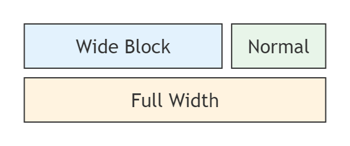
</p>


[Open in Mermaid Live](https://mermaid.live/edit#base64:eyJjb2RlIjoiYmxvY2stYmV0YVxuICAgIGNvbHVtbnMgM1xuICAgIGFbXHUwMDIyV2lkZSBCbG9ja1x1MDAyMl06MiBiW1x1MDAyMk5vcm1hbFx1MDAyMl1cbiAgICBjW1x1MDAyMkZ1bGwgV2lkdGhcdTAwMjJdOjMiLCJtZXJtYWlkIjp7InRoZW1lIjoiZGVmYXVsdCJ9fQ==)

## DifferentShapes

**Input:**
```
block-beta
    columns 3
    a["Rectangle"] b("Rounded") c(["Stadium"])
    d(("Circle")) e{"Diamond"} f{{"Hexagon"}}
```
**Rendered by Naiad:**

<p align="center">
  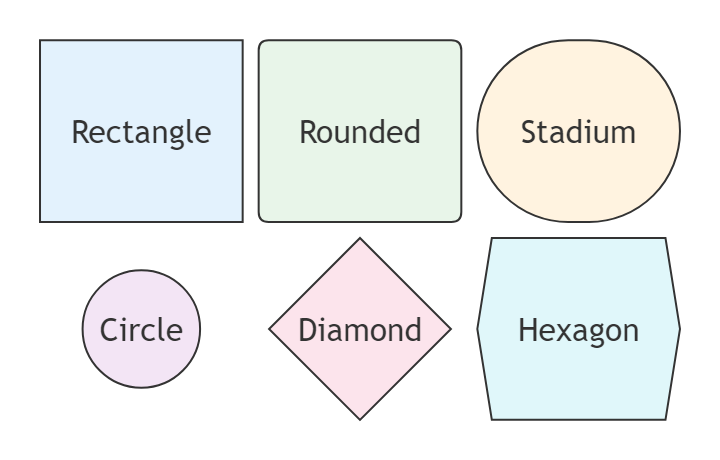
</p>


[Open in Mermaid Live](https://mermaid.live/edit#base64:eyJjb2RlIjoiYmxvY2stYmV0YVxuICAgIGNvbHVtbnMgM1xuICAgIGFbXHUwMDIyUmVjdGFuZ2xlXHUwMDIyXSBiKFx1MDAyMlJvdW5kZWRcdTAwMjIpIGMoW1x1MDAyMlN0YWRpdW1cdTAwMjJdKVxuICAgIGQoKFx1MDAyMkNpcmNsZVx1MDAyMikpIGV7XHUwMDIyRGlhbW9uZFx1MDAyMn0gZnt7XHUwMDIySGV4YWdvblx1MDAyMn19IiwibWVybWFpZCI6eyJ0aGVtZSI6ImRlZmF1bHQifX0=)

## AllShapes

**Input:**
```
block
    columns 4
    a["Rectangle"] b("Rounded") c(["Stadium"]) d[["Subroutine"]]
    e[("Database")] f(("Circle")) g((("Double"))) h>"Asymmetric"]
    i{"Rhombus"} j{{"Hexagon"}} k[/"Lean right"/] l[\"Lean left"\]
    m[/"Trapezoid"\] n[\"Inverted"/] o
```
**Rendered by Naiad:**

<p align="center">
  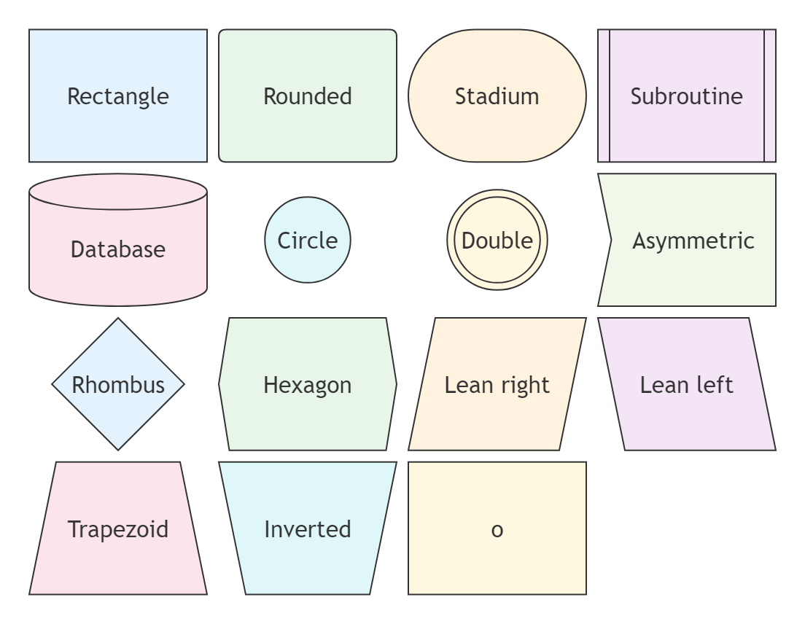
</p>


[Open in Mermaid Live](https://mermaid.live/edit#base64:eyJjb2RlIjoiYmxvY2tcbiAgICBjb2x1bW5zIDRcbiAgICBhW1x1MDAyMlJlY3RhbmdsZVx1MDAyMl0gYihcdTAwMjJSb3VuZGVkXHUwMDIyKSBjKFtcdTAwMjJTdGFkaXVtXHUwMDIyXSkgZFtbXHUwMDIyU3Vicm91dGluZVx1MDAyMl1dXG4gICAgZVsoXHUwMDIyRGF0YWJhc2VcdTAwMjIpXSBmKChcdTAwMjJDaXJjbGVcdTAwMjIpKSBnKCgoXHUwMDIyRG91YmxlXHUwMDIyKSkpIGhcdTAwM0VcdTAwMjJBc3ltbWV0cmljXHUwMDIyXVxuICAgIGl7XHUwMDIyUmhvbWJ1c1x1MDAyMn0gant7XHUwMDIySGV4YWdvblx1MDAyMn19IGtbL1x1MDAyMkxlYW4gcmlnaHRcdTAwMjIvXSBsW1xcXHUwMDIyTGVhbiBsZWZ0XHUwMDIyXFxdXG4gICAgbVsvXHUwMDIyVHJhcGV6b2lkXHUwMDIyXFxdIG5bXFxcdTAwMjJJbnZlcnRlZFx1MDAyMi9dIG8iLCJtZXJtYWlkIjp7InRoZW1lIjoiZGVmYXVsdCJ9fQ==)

## BlockArrows

**Input:**
```
block
  blockArrowId<["Label"]>(right)
  blockArrowId2<["Label"]>(left)
  blockArrowId3<["Label"]>(up)
  blockArrowId4<["Label"]>(down)
  blockArrowId5<["Label"]>(x)
  blockArrowId6<["Label"]>(y)
  blockArrowId7<["Label"]>(x, down)
```
**Rendered by Naiad:**

<p align="center">
  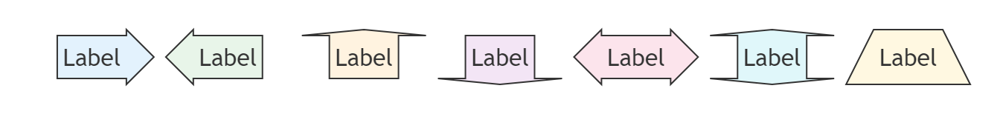
</p>


[Open in Mermaid Live](https://mermaid.live/edit#base64:eyJjb2RlIjoiYmxvY2tcbiAgYmxvY2tBcnJvd0lkXHUwMDNDW1x1MDAyMkxhYmVsXHUwMDIyXVx1MDAzRShyaWdodClcbiAgYmxvY2tBcnJvd0lkMlx1MDAzQ1tcdTAwMjJMYWJlbFx1MDAyMl1cdTAwM0UobGVmdClcbiAgYmxvY2tBcnJvd0lkM1x1MDAzQ1tcdTAwMjJMYWJlbFx1MDAyMl1cdTAwM0UodXApXG4gIGJsb2NrQXJyb3dJZDRcdTAwM0NbXHUwMDIyTGFiZWxcdTAwMjJdXHUwMDNFKGRvd24pXG4gIGJsb2NrQXJyb3dJZDVcdTAwM0NbXHUwMDIyTGFiZWxcdTAwMjJdXHUwMDNFKHgpXG4gIGJsb2NrQXJyb3dJZDZcdTAwM0NbXHUwMDIyTGFiZWxcdTAwMjJdXHUwMDNFKHkpXG4gIGJsb2NrQXJyb3dJZDdcdTAwM0NbXHUwMDIyTGFiZWxcdTAwMjJdXHUwMDNFKHgsIGRvd24pIiwibWVybWFpZCI6eyJ0aGVtZSI6ImRlZmF1bHQifX0=)

## LongLabelWidensColumns

**Input:**
```
block
  columns 3
  a["A label that is much longer than the others"] b c
  d e:2
```
**Rendered by Naiad:**

<p align="center">
  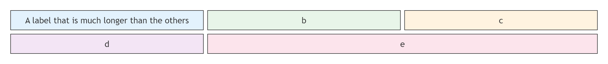
</p>


[Open in Mermaid Live](https://mermaid.live/edit#base64:eyJjb2RlIjoiYmxvY2tcbiAgY29sdW1ucyAzXG4gIGFbXHUwMDIyQSBsYWJlbCB0aGF0IGlzIG11Y2ggbG9uZ2VyIHRoYW4gdGhlIG90aGVyc1x1MDAyMl0gYiBjXG4gIGQgZToyIiwibWVybWFpZCI6eyJ0aGVtZSI6ImRlZmF1bHQifX0=)

## Column

**Input:**
```
block-beta
    columns 1
    a["First"]
    b["Second"]
    c["Third"]
```
**Rendered by Naiad:**

<p align="center">
  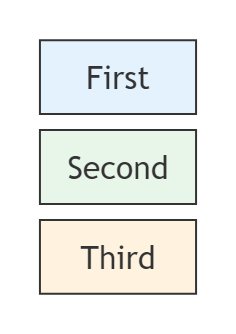
</p>


[Open in Mermaid Live](https://mermaid.live/edit#base64:eyJjb2RlIjoiYmxvY2stYmV0YVxuICAgIGNvbHVtbnMgMVxuICAgIGFbXHUwMDIyRmlyc3RcdTAwMjJdXG4gICAgYltcdTAwMjJTZWNvbmRcdTAwMjJdXG4gICAgY1tcdTAwMjJUaGlyZFx1MDAyMl0iLCJtZXJtYWlkIjp7InRoZW1lIjoiZGVmYXVsdCJ9fQ==)

## ManyColumns

**Input:**
```
block-beta
    columns 5
    a b c d e
```
**Rendered by Naiad:**

<p align="center">
  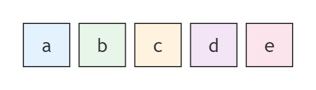
</p>


[Open in Mermaid Live](https://mermaid.live/edit#base64:eyJjb2RlIjoiYmxvY2stYmV0YVxuICAgIGNvbHVtbnMgNVxuICAgIGEgYiBjIGQgZSIsIm1lcm1haWQiOnsidGhlbWUiOiJkZWZhdWx0In19)

## MixedLayout

**Input:**
```
block-beta
    columns 4
    header["Header"]:4
    nav["Nav"] content["Content"]:2 side["Sidebar"]
    footer["Footer"]:4
```
**Rendered by Naiad:**

<p align="center">
  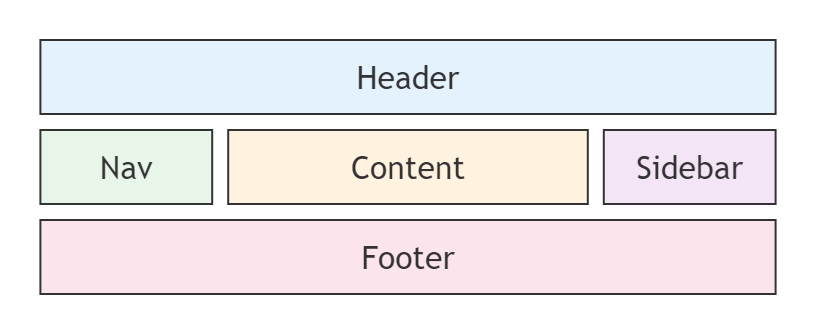
</p>


[Open in Mermaid Live](https://mermaid.live/edit#base64:eyJjb2RlIjoiYmxvY2stYmV0YVxuICAgIGNvbHVtbnMgNFxuICAgIGhlYWRlcltcdTAwMjJIZWFkZXJcdTAwMjJdOjRcbiAgICBuYXZbXHUwMDIyTmF2XHUwMDIyXSBjb250ZW50W1x1MDAyMkNvbnRlbnRcdTAwMjJdOjIgc2lkZVtcdTAwMjJTaWRlYmFyXHUwMDIyXVxuICAgIGZvb3RlcltcdTAwMjJGb290ZXJcdTAwMjJdOjQiLCJtZXJtYWlkIjp7InRoZW1lIjoiZGVmYXVsdCJ9fQ==)

## SingleRowByDefault

**Input:**
```
block-beta
    a["First"] space b["Second"]
    c["Third"] space:2 d["Fourth"]
```
**Rendered by Naiad:**

<p align="center">
  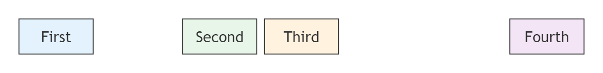
</p>


[Open in Mermaid Live](https://mermaid.live/edit#base64:eyJjb2RlIjoiYmxvY2stYmV0YVxuICAgIGFbXHUwMDIyRmlyc3RcdTAwMjJdIHNwYWNlIGJbXHUwMDIyU2Vjb25kXHUwMDIyXVxuICAgIGNbXHUwMDIyVGhpcmRcdTAwMjJdIHNwYWNlOjIgZFtcdTAwMjJGb3VydGhcdTAwMjJdIiwibWVybWFpZCI6eyJ0aGVtZSI6ImRlZmF1bHQifX0=)

## NestedBlock

**Input:**
```
block
    block
      D
    end
    A["A: I am a wide one"]
```
**Rendered by Naiad:**

<p align="center">
  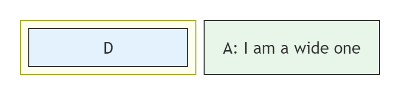
</p>


[Open in Mermaid Live](https://mermaid.live/edit#base64:eyJjb2RlIjoiYmxvY2tcbiAgICBibG9ja1xuICAgICAgRFxuICAgIGVuZFxuICAgIEFbXHUwMDIyQTogSSBhbSBhIHdpZGUgb25lXHUwMDIyXSIsIm1lcm1haWQiOnsidGhlbWUiOiJkZWZhdWx0In19)

## CompositeWidths

**Input:**
```
block
  columns 3
  a:3
  block:group1:2
    columns 2
    h i j k
  end
  g
  block:group2:3
    %% columns auto (default)
    l m n o p q r
  end
```
**Rendered by Naiad:**

<p align="center">
  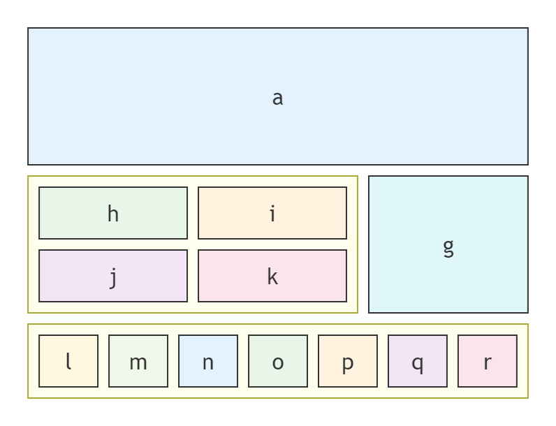
</p>


[Open in Mermaid Live](https://mermaid.live/edit#base64:eyJjb2RlIjoiYmxvY2tcbiAgY29sdW1ucyAzXG4gIGE6M1xuICBibG9jazpncm91cDE6MlxuICAgIGNvbHVtbnMgMlxuICAgIGggaSBqIGtcbiAgZW5kXG4gIGdcbiAgYmxvY2s6Z3JvdXAyOjNcbiAgICAlJSBjb2x1bW5zIGF1dG8gKGRlZmF1bHQpXG4gICAgbCBtIG4gbyBwIHEgclxuICBlbmQiLCJtZXJtYWlkIjp7InRoZW1lIjoiZGVmYXVsdCJ9fQ==)

## StackedInComposite

**Input:**
```
block
  block
    columns 1
    a["A label"] b c d
  end
```
**Rendered by Naiad:**

<p align="center">
  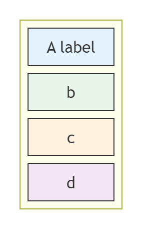
</p>


[Open in Mermaid Live](https://mermaid.live/edit#base64:eyJjb2RlIjoiYmxvY2tcbiAgYmxvY2tcbiAgICBjb2x1bW5zIDFcbiAgICBhW1x1MDAyMkEgbGFiZWxcdTAwMjJdIGIgYyBkXG4gIGVuZCIsIm1lcm1haWQiOnsidGhlbWUiOiJkZWZhdWx0In19)

## Links

**Input:**
```
block
  columns 5
  A space B space C
  A-->B
  B-- "X" -->C
  D space E space F
  D --- E
  E -.-> F
```
**Rendered by Naiad:**

<p align="center">
  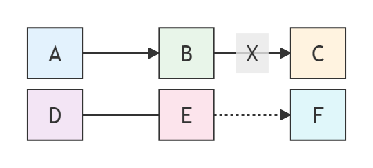
</p>


[Open in Mermaid Live](https://mermaid.live/edit#base64:eyJjb2RlIjoiYmxvY2tcbiAgY29sdW1ucyA1XG4gIEEgc3BhY2UgQiBzcGFjZSBDXG4gIEEtLVx1MDAzRUJcbiAgQi0tIFx1MDAyMlhcdTAwMjIgLS1cdTAwM0VDXG4gIEQgc3BhY2UgRSBzcGFjZSBGXG4gIEQgLS0tIEVcbiAgRSAtLi1cdTAwM0UgRiIsIm1lcm1haWQiOnsidGhlbWUiOiJkZWZhdWx0In19)

## CompositeLinksAndStyles

**Input:**
```
block
columns 1
  db(("DB"))
  blockArrowId6<["&nbsp;&nbsp;&nbsp;"]>(down)
  block:ID
    A
    B["A wide one in the middle"]
    C
  end
  space
  D
  ID --> D
  C --> D
  style B fill:#969,stroke:#333,stroke-width:4px
```
**Rendered by Naiad:**

<p align="center">
  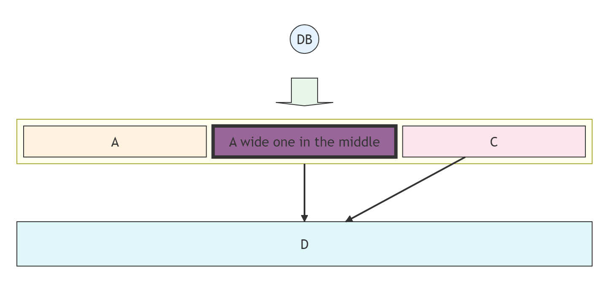
</p>


[Open in Mermaid Live](https://mermaid.live/edit#base64:eyJjb2RlIjoiYmxvY2tcbmNvbHVtbnMgMVxuICBkYigoXHUwMDIyREJcdTAwMjIpKVxuICBibG9ja0Fycm93SWQ2XHUwMDNDW1x1MDAyMlx1MDAyNm5ic3A7XHUwMDI2bmJzcDtcdTAwMjZuYnNwO1x1MDAyMl1cdTAwM0UoZG93bilcbiAgYmxvY2s6SURcbiAgICBBXG4gICAgQltcdTAwMjJBIHdpZGUgb25lIGluIHRoZSBtaWRkbGVcdTAwMjJdXG4gICAgQ1xuICBlbmRcbiAgc3BhY2VcbiAgRFxuICBJRCAtLVx1MDAzRSBEXG4gIEMgLS1cdTAwM0UgRFxuICBzdHlsZSBCIGZpbGw6Izk2OSxzdHJva2U6IzMzMyxzdHJva2Utd2lkdGg6NHB4IiwibWVybWFpZCI6eyJ0aGVtZSI6ImRlZmF1bHQifX0=)

## Styles

**Input:**
```
block
  A space B space id1 space id2
  A-->B
  id1("Start")-->id2("Stop")
  classDef blue fill:#6e6ce6,stroke:#333,stroke-width:4px;
  class A blue
  style B fill:#bbf,stroke:#f66,stroke-width:2px,color:#fff,stroke-dasharray: 5 5
  style id1 fill:#636,stroke:#333,stroke-width:4px
  style id2 fill:#bbf,stroke:#f66,stroke-width:2px,color:#fff,stroke-dasharray: 5 5
```
**Rendered by Naiad:**

<p align="center">
  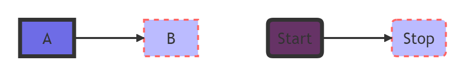
</p>


[Open in Mermaid Live](https://mermaid.live/edit#base64:eyJjb2RlIjoiYmxvY2tcbiAgQSBzcGFjZSBCIHNwYWNlIGlkMSBzcGFjZSBpZDJcbiAgQS0tXHUwMDNFQlxuICBpZDEoXHUwMDIyU3RhcnRcdTAwMjIpLS1cdTAwM0VpZDIoXHUwMDIyU3RvcFx1MDAyMilcbiAgY2xhc3NEZWYgYmx1ZSBmaWxsOiM2ZTZjZTYsc3Ryb2tlOiMzMzMsc3Ryb2tlLXdpZHRoOjRweDtcbiAgY2xhc3MgQSBibHVlXG4gIHN0eWxlIEIgZmlsbDojYmJmLHN0cm9rZTojZjY2LHN0cm9rZS13aWR0aDoycHgsY29sb3I6I2ZmZixzdHJva2UtZGFzaGFycmF5OiA1IDVcbiAgc3R5bGUgaWQxIGZpbGw6IzYzNixzdHJva2U6IzMzMyxzdHJva2Utd2lkdGg6NHB4XG4gIHN0eWxlIGlkMiBmaWxsOiNiYmYsc3Ryb2tlOiNmNjYsc3Ryb2tlLXdpZHRoOjJweCxjb2xvcjojZmZmLHN0cm9rZS1kYXNoYXJyYXk6IDUgNSIsIm1lcm1haWQiOnsidGhlbWUiOiJkZWZhdWx0In19)

## SystemArchitecture

**Input:**
```
block
  columns 3
  Frontend blockArrowId6<[" "]>(right) Backend
  space:2 down<[" "]>(down)
  Disk left<[" "]>(left) Database[("Database")]

  classDef front fill:#696,stroke:#333;
  classDef back fill:#969,stroke:#333;
  class Frontend front
  class Backend,Database back
```
**Rendered by Naiad:**

<p align="center">
  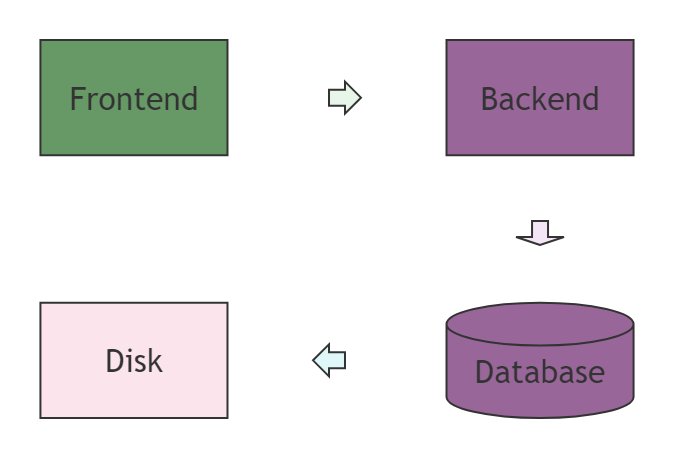
</p>


[Open in Mermaid Live](https://mermaid.live/edit#base64:eyJjb2RlIjoiYmxvY2tcbiAgY29sdW1ucyAzXG4gIEZyb250ZW5kIGJsb2NrQXJyb3dJZDZcdTAwM0NbXHUwMDIyIFx1MDAyMl1cdTAwM0UocmlnaHQpIEJhY2tlbmRcbiAgc3BhY2U6MiBkb3duXHUwMDNDW1x1MDAyMiBcdTAwMjJdXHUwMDNFKGRvd24pXG4gIERpc2sgbGVmdFx1MDAzQ1tcdTAwMjIgXHUwMDIyXVx1MDAzRShsZWZ0KSBEYXRhYmFzZVsoXHUwMDIyRGF0YWJhc2VcdTAwMjIpXVxuXG4gIGNsYXNzRGVmIGZyb250IGZpbGw6IzY5NixzdHJva2U6IzMzMztcbiAgY2xhc3NEZWYgYmFjayBmaWxsOiM5Njksc3Ryb2tlOiMzMzM7XG4gIGNsYXNzIEZyb250ZW5kIGZyb250XG4gIGNsYXNzIEJhY2tlbmQsRGF0YWJhc2UgYmFjayIsIm1lcm1haWQiOnsidGhlbWUiOiJkZWZhdWx0In19)

## BusinessProcessFlow

**Input:**
```
block
  columns 3
  Start(("Start")) space:2
  down<[" "]>(down) space:2
  Decision{{"Make Decision"}} right<["Yes"]>(right) Process1["Process A"]
  downAgain<["No"]>(down) space r3<["Done"]>(down)
  Process2["Process B"] r2<["Done"]>(right) End(("End"))

  style Start fill:#969;
  style End fill:#696;
```
**Rendered by Naiad:**

<p align="center">
  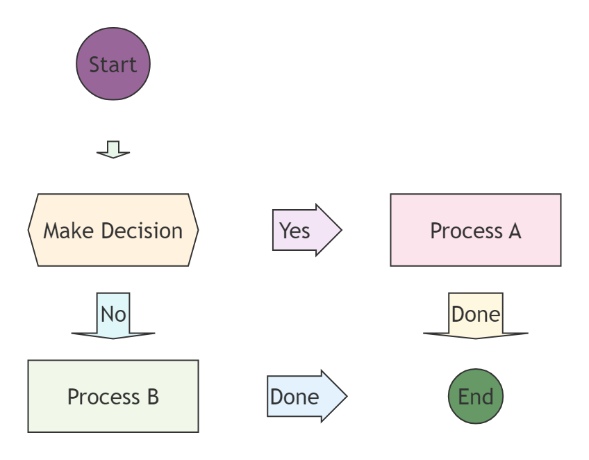
</p>


[Open in Mermaid Live](https://mermaid.live/edit#base64:eyJjb2RlIjoiYmxvY2tcbiAgY29sdW1ucyAzXG4gIFN0YXJ0KChcdTAwMjJTdGFydFx1MDAyMikpIHNwYWNlOjJcbiAgZG93blx1MDAzQ1tcdTAwMjIgXHUwMDIyXVx1MDAzRShkb3duKSBzcGFjZToyXG4gIERlY2lzaW9ue3tcdTAwMjJNYWtlIERlY2lzaW9uXHUwMDIyfX0gcmlnaHRcdTAwM0NbXHUwMDIyWWVzXHUwMDIyXVx1MDAzRShyaWdodCkgUHJvY2VzczFbXHUwMDIyUHJvY2VzcyBBXHUwMDIyXVxuICBkb3duQWdhaW5cdTAwM0NbXHUwMDIyTm9cdTAwMjJdXHUwMDNFKGRvd24pIHNwYWNlIHIzXHUwMDNDW1x1MDAyMkRvbmVcdTAwMjJdXHUwMDNFKGRvd24pXG4gIFByb2Nlc3MyW1x1MDAyMlByb2Nlc3MgQlx1MDAyMl0gcjJcdTAwM0NbXHUwMDIyRG9uZVx1MDAyMl1cdTAwM0UocmlnaHQpIEVuZCgoXHUwMDIyRW5kXHUwMDIyKSlcblxuICBzdHlsZSBTdGFydCBmaWxsOiM5Njk7XG4gIHN0eWxlIEVuZCBmaWxsOiM2OTY7IiwibWVybWFpZCI6eyJ0aGVtZSI6ImRlZmF1bHQifX0=)

