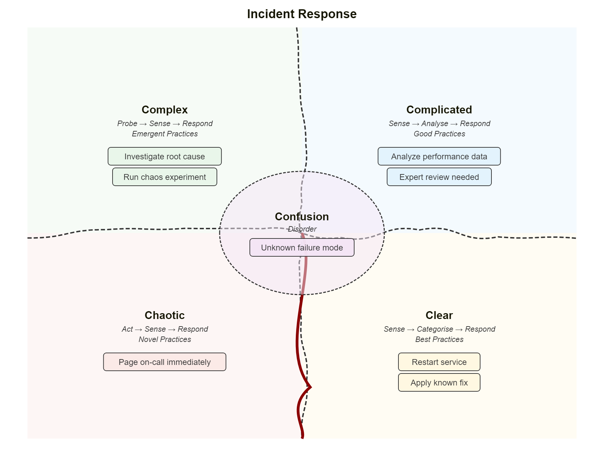
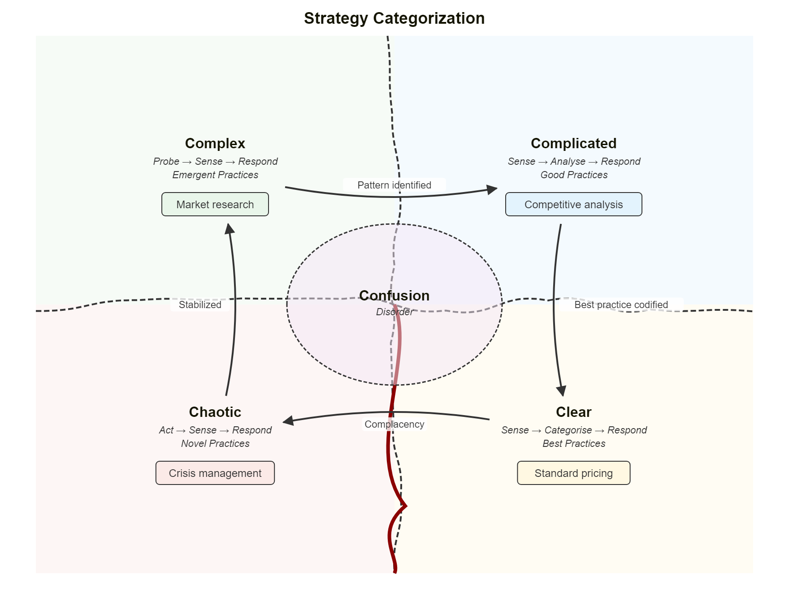
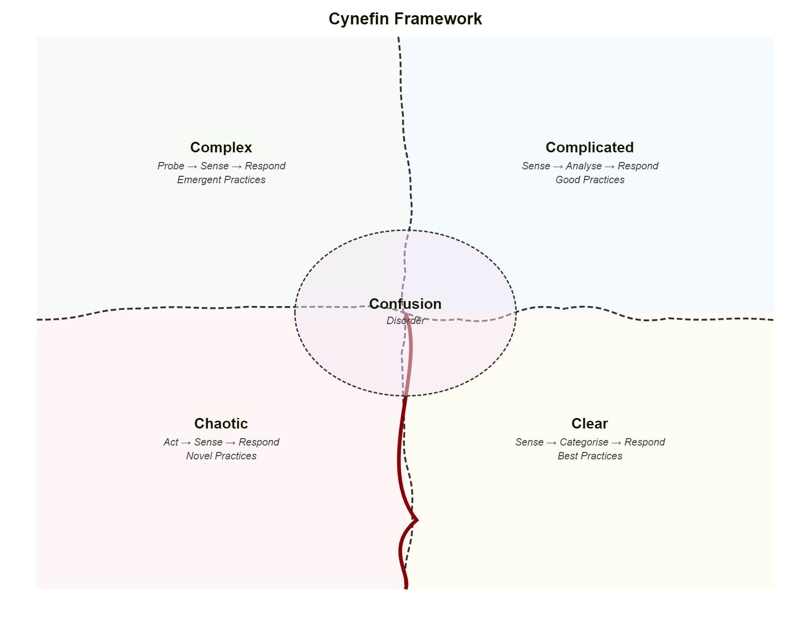
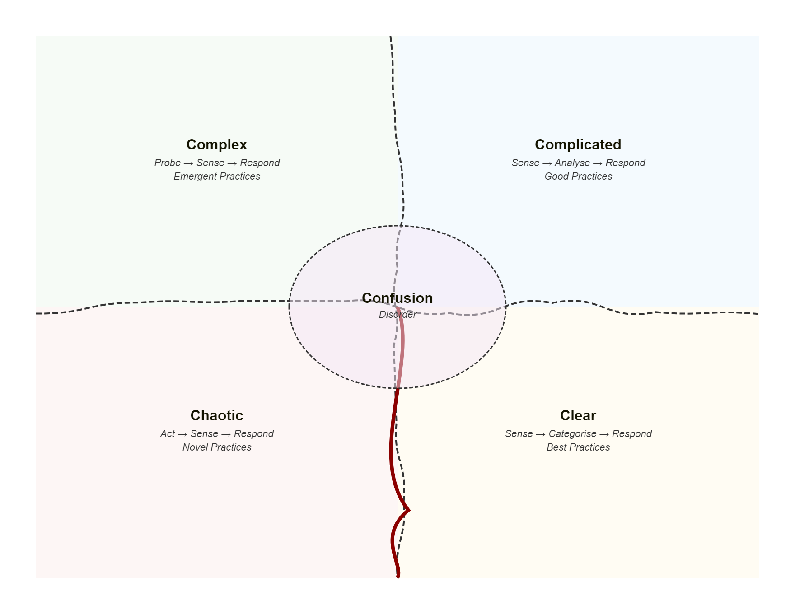
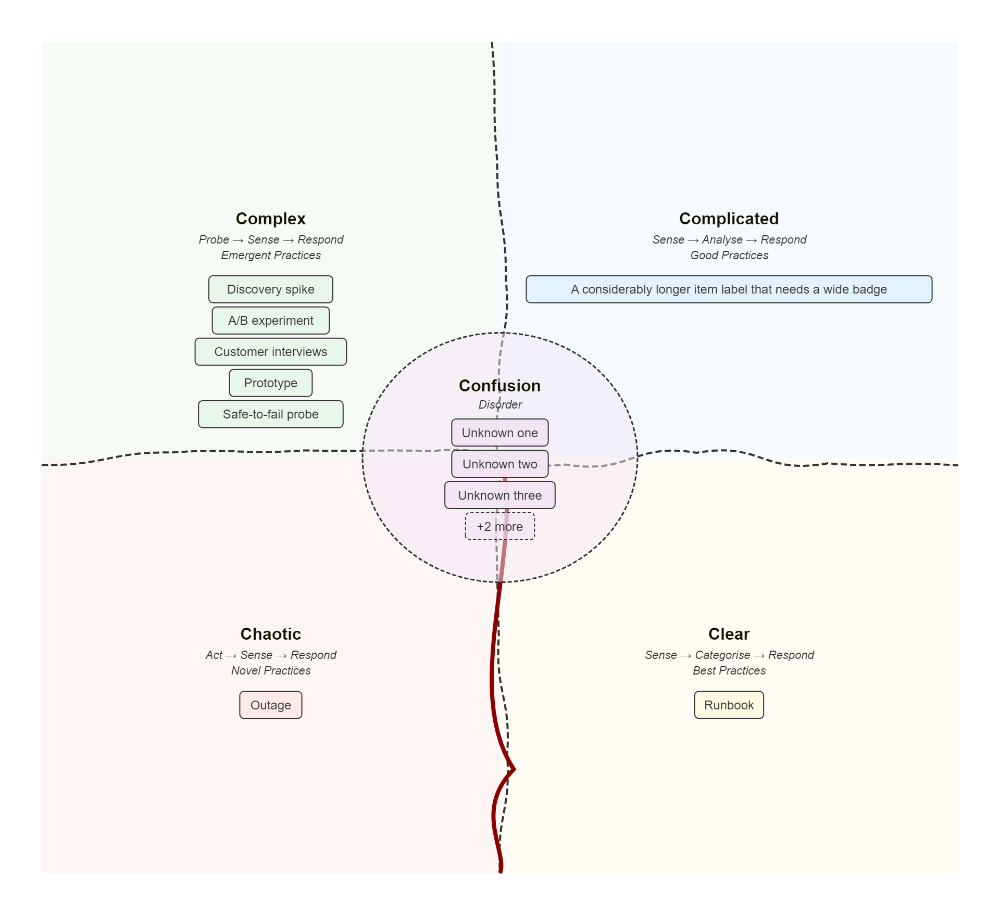
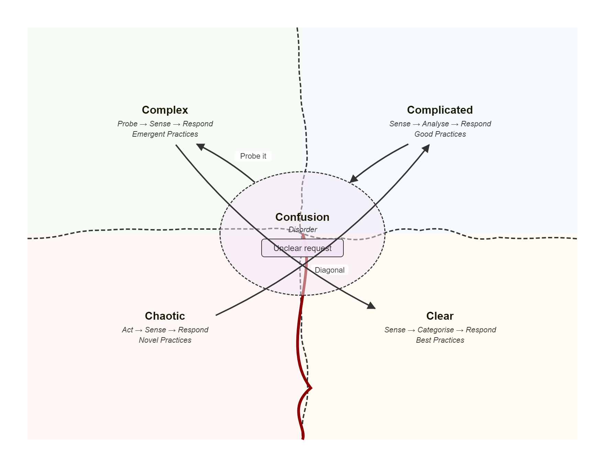

# Cynefin

## Simple

**Input:**
```
cynefin-beta
  title Incident Response

  complex
    "Investigate root cause"
    "Run chaos experiment"

  complicated
    "Analyze performance data"
    "Expert review needed"

  clear
    "Restart service"
    "Apply known fix"

  chaotic
    "Page on-call immediately"

  confusion
    "Unknown failure mode"
```
**Rendered by Naiad:**

<p align="center">
  
</p>


[Open in Mermaid Live](https://mermaid.live/edit#base64:eyJjb2RlIjoiY3luZWZpbi1iZXRhXG4gIHRpdGxlIEluY2lkZW50IFJlc3BvbnNlXG5cbiAgY29tcGxleFxuICAgIFx1MDAyMkludmVzdGlnYXRlIHJvb3QgY2F1c2VcdTAwMjJcbiAgICBcdTAwMjJSdW4gY2hhb3MgZXhwZXJpbWVudFx1MDAyMlxuXG4gIGNvbXBsaWNhdGVkXG4gICAgXHUwMDIyQW5hbHl6ZSBwZXJmb3JtYW5jZSBkYXRhXHUwMDIyXG4gICAgXHUwMDIyRXhwZXJ0IHJldmlldyBuZWVkZWRcdTAwMjJcblxuICBjbGVhclxuICAgIFx1MDAyMlJlc3RhcnQgc2VydmljZVx1MDAyMlxuICAgIFx1MDAyMkFwcGx5IGtub3duIGZpeFx1MDAyMlxuXG4gIGNoYW90aWNcbiAgICBcdTAwMjJQYWdlIG9uLWNhbGwgaW1tZWRpYXRlbHlcdTAwMjJcblxuICBjb25mdXNpb25cbiAgICBcdTAwMjJVbmtub3duIGZhaWx1cmUgbW9kZVx1MDAyMiIsIm1lcm1haWQiOnsidGhlbWUiOiJkZWZhdWx0In19)

## Transitions

**Input:**
```
cynefin-beta
  title Strategy Categorization

  complex
    "Market research"

  complicated
    "Competitive analysis"

  clear
    "Standard pricing"

  chaotic
    "Crisis management"

  complex --> complicated : "Pattern identified"
  complicated --> clear : "Best practice codified"
  clear --> chaotic : "Complacency"
  chaotic --> complex : "Stabilized"
```
**Rendered by Naiad:**

<p align="center">
  
</p>


[Open in Mermaid Live](https://mermaid.live/edit#base64:eyJjb2RlIjoiY3luZWZpbi1iZXRhXG4gIHRpdGxlIFN0cmF0ZWd5IENhdGVnb3JpemF0aW9uXG5cbiAgY29tcGxleFxuICAgIFx1MDAyMk1hcmtldCByZXNlYXJjaFx1MDAyMlxuXG4gIGNvbXBsaWNhdGVkXG4gICAgXHUwMDIyQ29tcGV0aXRpdmUgYW5hbHlzaXNcdTAwMjJcblxuICBjbGVhclxuICAgIFx1MDAyMlN0YW5kYXJkIHByaWNpbmdcdTAwMjJcblxuICBjaGFvdGljXG4gICAgXHUwMDIyQ3Jpc2lzIG1hbmFnZW1lbnRcdTAwMjJcblxuICBjb21wbGV4IC0tXHUwMDNFIGNvbXBsaWNhdGVkIDogXHUwMDIyUGF0dGVybiBpZGVudGlmaWVkXHUwMDIyXG4gIGNvbXBsaWNhdGVkIC0tXHUwMDNFIGNsZWFyIDogXHUwMDIyQmVzdCBwcmFjdGljZSBjb2RpZmllZFx1MDAyMlxuICBjbGVhciAtLVx1MDAzRSBjaGFvdGljIDogXHUwMDIyQ29tcGxhY2VuY3lcdTAwMjJcbiAgY2hhb3RpYyAtLVx1MDAzRSBjb21wbGV4IDogXHUwMDIyU3RhYmlsaXplZFx1MDAyMiIsIm1lcm1haWQiOnsidGhlbWUiOiJkZWZhdWx0In19)

## EmptyFramework

**Input:**
```
cynefin-beta
  title Cynefin Framework

  complex
  complicated
  clear
  chaotic
```
**Rendered by Naiad:**

<p align="center">
  
</p>


[Open in Mermaid Live](https://mermaid.live/edit#base64:eyJjb2RlIjoiY3luZWZpbi1iZXRhXG4gIHRpdGxlIEN5bmVmaW4gRnJhbWV3b3JrXG5cbiAgY29tcGxleFxuICBjb21wbGljYXRlZFxuICBjbGVhclxuICBjaGFvdGljIiwibWVybWFpZCI6eyJ0aGVtZSI6ImRlZmF1bHQifX0=)

## KeywordOnly

**Input:**
```
cynefin-beta
```
**Rendered by Naiad:**

<p align="center">
  
</p>


[Open in Mermaid Live](https://mermaid.live/edit#base64:eyJjb2RlIjoiY3luZWZpbi1iZXRhIiwibWVybWFpZCI6eyJ0aGVtZSI6ImRlZmF1bHQifX0=)

## CrowdedDomains

**Input:**
```
cynefin-beta
  complex
    "Discovery spike"
    "A/B experiment"
    "Customer interviews"
    "Prototype"
    "Safe-to-fail probe"
  complicated
    "A considerably longer item label that needs a wide badge"
  clear
    "Runbook"
  chaotic
    "Outage"
  confusion
    "Unknown one"
    "Unknown two"
    "Unknown three"
    "Unknown four"
    "Unknown five"
```
**Rendered by Naiad:**

<p align="center">
  
</p>


[Open in Mermaid Live](https://mermaid.live/edit#base64:eyJjb2RlIjoiY3luZWZpbi1iZXRhXG4gIGNvbXBsZXhcbiAgICBcdTAwMjJEaXNjb3Zlcnkgc3Bpa2VcdTAwMjJcbiAgICBcdTAwMjJBL0IgZXhwZXJpbWVudFx1MDAyMlxuICAgIFx1MDAyMkN1c3RvbWVyIGludGVydmlld3NcdTAwMjJcbiAgICBcdTAwMjJQcm90b3R5cGVcdTAwMjJcbiAgICBcdTAwMjJTYWZlLXRvLWZhaWwgcHJvYmVcdTAwMjJcbiAgY29tcGxpY2F0ZWRcbiAgICBcdTAwMjJBIGNvbnNpZGVyYWJseSBsb25nZXIgaXRlbSBsYWJlbCB0aGF0IG5lZWRzIGEgd2lkZSBiYWRnZVx1MDAyMlxuICBjbGVhclxuICAgIFx1MDAyMlJ1bmJvb2tcdTAwMjJcbiAgY2hhb3RpY1xuICAgIFx1MDAyMk91dGFnZVx1MDAyMlxuICBjb25mdXNpb25cbiAgICBcdTAwMjJVbmtub3duIG9uZVx1MDAyMlxuICAgIFx1MDAyMlVua25vd24gdHdvXHUwMDIyXG4gICAgXHUwMDIyVW5rbm93biB0aHJlZVx1MDAyMlxuICAgIFx1MDAyMlVua25vd24gZm91clx1MDAyMlxuICAgIFx1MDAyMlVua25vd24gZml2ZVx1MDAyMiIsIm1lcm1haWQiOnsidGhlbWUiOiJkZWZhdWx0In19)

## TransitionsThroughConfusion

**Input:**
```
cynefin-beta
  confusion
    "Unclear request"
  confusion --> complex : "Probe it"
  complicated --> confusion
  chaotic --> complicated : "Diagonal"
  complex --> clear
```
**Rendered by Naiad:**

<p align="center">
  
</p>


[Open in Mermaid Live](https://mermaid.live/edit#base64:eyJjb2RlIjoiY3luZWZpbi1iZXRhXG4gIGNvbmZ1c2lvblxuICAgIFx1MDAyMlVuY2xlYXIgcmVxdWVzdFx1MDAyMlxuICBjb25mdXNpb24gLS1cdTAwM0UgY29tcGxleCA6IFx1MDAyMlByb2JlIGl0XHUwMDIyXG4gIGNvbXBsaWNhdGVkIC0tXHUwMDNFIGNvbmZ1c2lvblxuICBjaGFvdGljIC0tXHUwMDNFIGNvbXBsaWNhdGVkIDogXHUwMDIyRGlhZ29uYWxcdTAwMjJcbiAgY29tcGxleCAtLVx1MDAzRSBjbGVhciIsIm1lcm1haWQiOnsidGhlbWUiOiJkZWZhdWx0In19)

