# EventModeling

## StateChange

**Input:**
```
eventmodeling

tf 01 ui CartUI
tf 02 cmd AddItem
tf 03 evt ItemAdded
```
**Rendered by Naiad:**

<p align="center">
  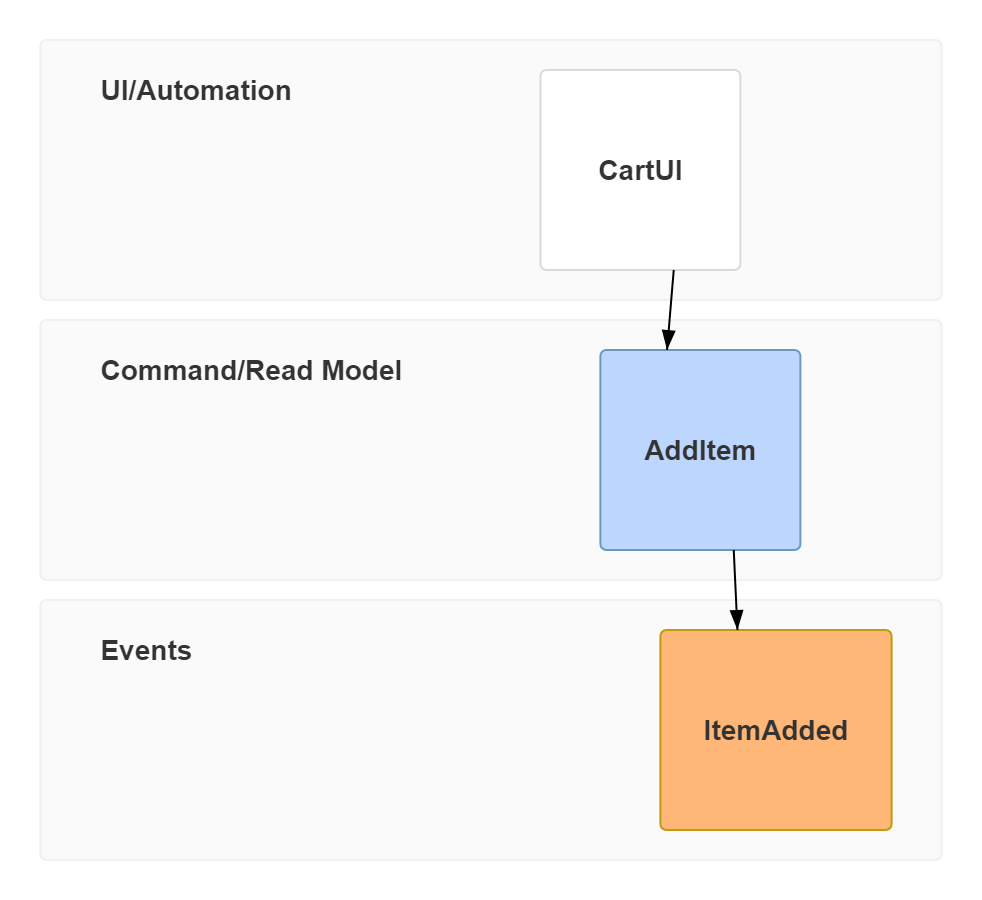
</p>

**Rendered by Mermaid:**
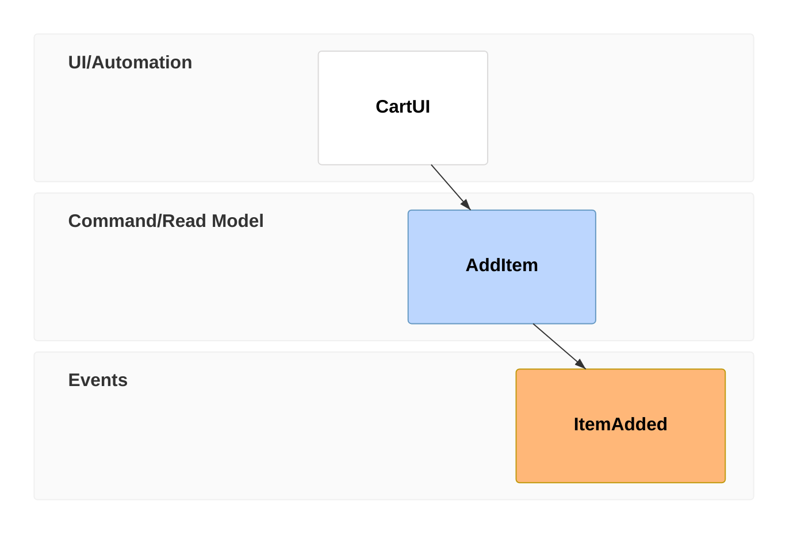

[Open in Mermaid Live](https://mermaid.live/edit#base64:eyJjb2RlIjoiZXZlbnRtb2RlbGluZ1xuXG50ZiAwMSB1aSBDYXJ0VUlcbnRmIDAyIGNtZCBBZGRJdGVtXG50ZiAwMyBldnQgSXRlbUFkZGVkIiwibWVybWFpZCI6eyJ0aGVtZSI6ImRlZmF1bHQifX0=)

## RelaxedNotationWithInlineData

**Input:**
```
eventmodeling

timeframe 01 ui CartUI
timeframe 02 command AddItem { description: string }
timeframe 03 event ItemAdded { description: string }
```
**Rendered by Naiad:**

<p align="center">
  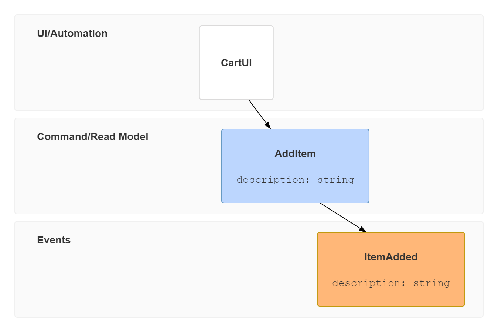
</p>

**Rendered by Mermaid:**
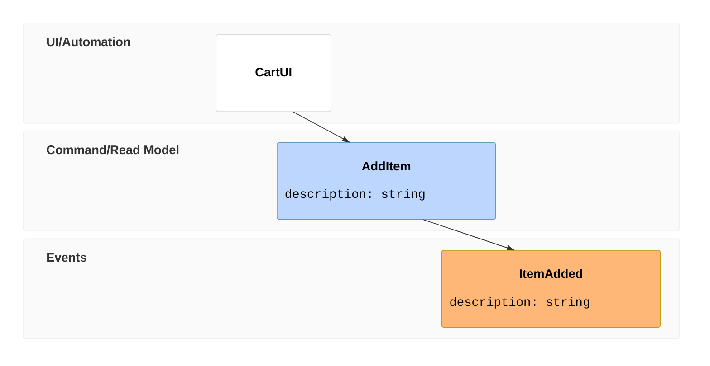

[Open in Mermaid Live](https://mermaid.live/edit#base64:eyJjb2RlIjoiZXZlbnRtb2RlbGluZ1xuXG50aW1lZnJhbWUgMDEgdWkgQ2FydFVJXG50aW1lZnJhbWUgMDIgY29tbWFuZCBBZGRJdGVtIHsgZGVzY3JpcHRpb246IHN0cmluZyB9XG50aW1lZnJhbWUgMDMgZXZlbnQgSXRlbUFkZGVkIHsgZGVzY3JpcHRpb246IHN0cmluZyB9IiwibWVybWFpZCI6eyJ0aGVtZSI6ImRlZmF1bHQifX0=)

## DataBlocks

**Input:**
```
eventmodeling

tf 01 ui CartUI
tf 02 cmd AddItem [[AddItem01]]
tf 03 evt ItemAdded [[ItemAdded]]
tf 04 cmd AddItem [[AddItem02]]
tf 05 evt ItemAdded [[ItemAdded]]

data AddItem01 {
  description: 'john'
  image: 'avatar_john'
  price: 20.4
}

data AddItem02 {
  description: 'jack'
  image: 'avatar_jack'
  price: 12.5
}

data ItemAdded {
  description: string
  image: string
  price: number
}
```
**Rendered by Naiad:**

<p align="center">
  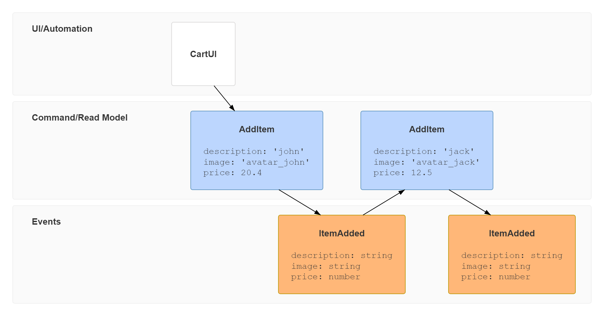
</p>

**Rendered by Mermaid:**
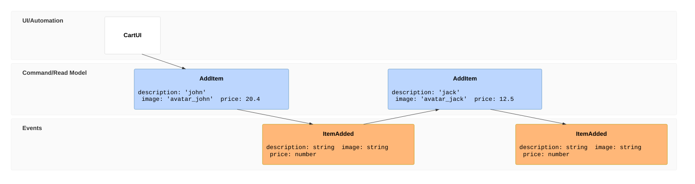

[Open in Mermaid Live](https://mermaid.live/edit#base64:eyJjb2RlIjoiZXZlbnRtb2RlbGluZ1xuXG50ZiAwMSB1aSBDYXJ0VUlcbnRmIDAyIGNtZCBBZGRJdGVtIFtbQWRkSXRlbTAxXV1cbnRmIDAzIGV2dCBJdGVtQWRkZWQgW1tJdGVtQWRkZWRdXVxudGYgMDQgY21kIEFkZEl0ZW0gW1tBZGRJdGVtMDJdXVxudGYgMDUgZXZ0IEl0ZW1BZGRlZCBbW0l0ZW1BZGRlZF1dXG5cbmRhdGEgQWRkSXRlbTAxIHtcbiAgZGVzY3JpcHRpb246IFx1MDAyN2pvaG5cdTAwMjdcbiAgaW1hZ2U6IFx1MDAyN2F2YXRhcl9qb2huXHUwMDI3XG4gIHByaWNlOiAyMC40XG59XG5cbmRhdGEgQWRkSXRlbTAyIHtcbiAgZGVzY3JpcHRpb246IFx1MDAyN2phY2tcdTAwMjdcbiAgaW1hZ2U6IFx1MDAyN2F2YXRhcl9qYWNrXHUwMDI3XG4gIHByaWNlOiAxMi41XG59XG5cbmRhdGEgSXRlbUFkZGVkIHtcbiAgZGVzY3JpcHRpb246IHN0cmluZ1xuICBpbWFnZTogc3RyaW5nXG4gIHByaWNlOiBudW1iZXJcbn0iLCJtZXJtYWlkIjp7InRoZW1lIjoiZGVmYXVsdCJ9fQ==)

## ResetFrame

**Input:**
```
eventmodeling

tf 01 ui CartUI
tf 02 cmd AddItem
tf 03 evt ItemAdded

rf 04 evt External.InventoryChanged
tf 05 pcr InventoryProcessor
tf 06 cmd ChangeInventory
tf 07 evt Cart.InventoryChanged
```
**Rendered by Naiad:**

<p align="center">
  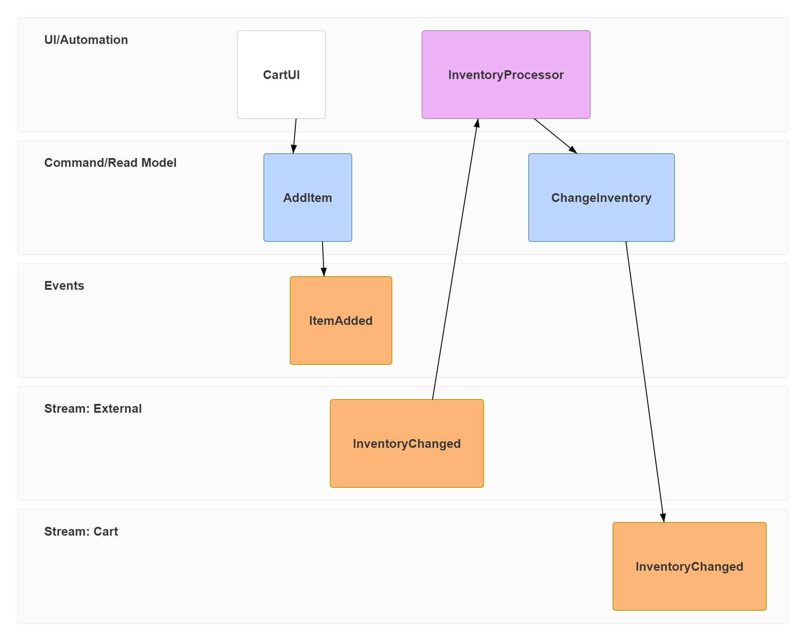
</p>

**Rendered by Mermaid:**
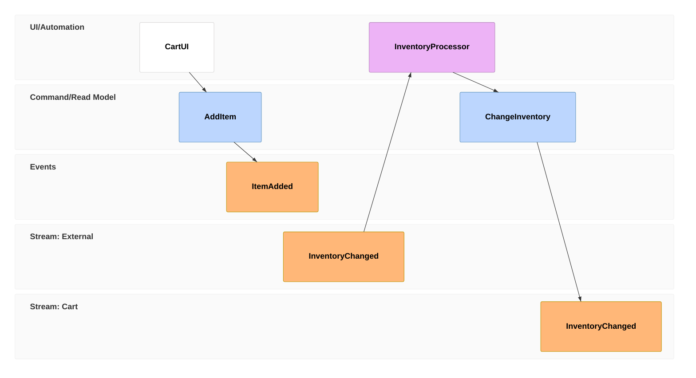

[Open in Mermaid Live](https://mermaid.live/edit#base64:eyJjb2RlIjoiZXZlbnRtb2RlbGluZ1xuXG50ZiAwMSB1aSBDYXJ0VUlcbnRmIDAyIGNtZCBBZGRJdGVtXG50ZiAwMyBldnQgSXRlbUFkZGVkXG5cbnJmIDA0IGV2dCBFeHRlcm5hbC5JbnZlbnRvcnlDaGFuZ2VkXG50ZiAwNSBwY3IgSW52ZW50b3J5UHJvY2Vzc29yXG50ZiAwNiBjbWQgQ2hhbmdlSW52ZW50b3J5XG50ZiAwNyBldnQgQ2FydC5JbnZlbnRvcnlDaGFuZ2VkIiwibWVybWFpZCI6eyJ0aGVtZSI6ImRlZmF1bHQifX0=)

## MultipleRelations

**Input:**
```
eventmodeling

rf 02 evt CartCreated
rf 03 evt ItemAdded
rf 04 evt ItemRemoved
rf 05 evt CartCleared
tf 01 rmo CartUI ->> 02 ->> 03 ->> 04 ->> 05
```
**Rendered by Naiad:**

<p align="center">
  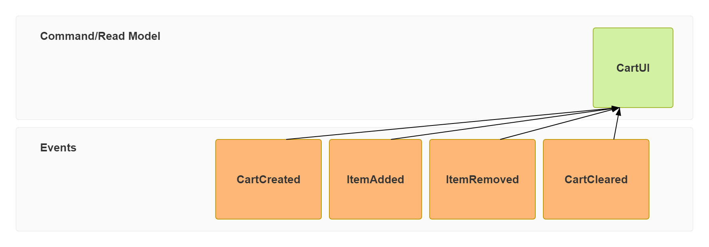
</p>

**Rendered by Mermaid:**
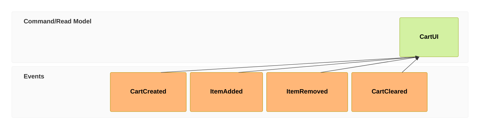

[Open in Mermaid Live](https://mermaid.live/edit#base64:eyJjb2RlIjoiZXZlbnRtb2RlbGluZ1xuXG5yZiAwMiBldnQgQ2FydENyZWF0ZWRcbnJmIDAzIGV2dCBJdGVtQWRkZWRcbnJmIDA0IGV2dCBJdGVtUmVtb3ZlZFxucmYgMDUgZXZ0IENhcnRDbGVhcmVkXG50ZiAwMSBybW8gQ2FydFVJIC1cdTAwM0VcdTAwM0UgMDIgLVx1MDAzRVx1MDAzRSAwMyAtXHUwMDNFXHUwMDNFIDA0IC1cdTAwM0VcdTAwM0UgMDUiLCJtZXJtYWlkIjp7InRoZW1lIjoiZGVmYXVsdCJ9fQ==)

## FullTimelineWithTitle

**Input:**
```
eventmodeling
title Shopping cart
%% A comment between statements.
tf 01 ui CartUI
tf 02 cmd AddItem { description: string, price: number }
tf 03 evt ItemAdded
tf 04 rmo CartItems
tf 05 ui CartUI
tf 06 cmd RemoveItem
tf 07 evt ItemRemoved
tf 08 rmo CartItems ->> 03 ->> 07
tf 09 ui CheckoutUI
```
**Rendered by Naiad:**

<p align="center">
  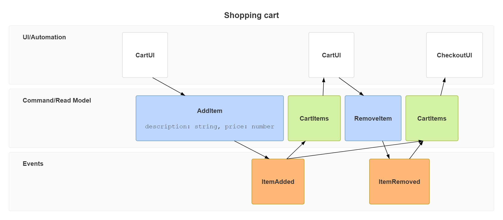
</p>

**Rendered by Mermaid:**


[Open in Mermaid Live](https://mermaid.live/edit#base64:eyJjb2RlIjoiZXZlbnRtb2RlbGluZ1xudGl0bGUgU2hvcHBpbmcgY2FydFxuJSUgQSBjb21tZW50IGJldHdlZW4gc3RhdGVtZW50cy5cbnRmIDAxIHVpIENhcnRVSVxudGYgMDIgY21kIEFkZEl0ZW0geyBkZXNjcmlwdGlvbjogc3RyaW5nLCBwcmljZTogbnVtYmVyIH1cbnRmIDAzIGV2dCBJdGVtQWRkZWRcbnRmIDA0IHJtbyBDYXJ0SXRlbXNcbnRmIDA1IHVpIENhcnRVSVxudGYgMDYgY21kIFJlbW92ZUl0ZW1cbnRmIDA3IGV2dCBJdGVtUmVtb3ZlZFxudGYgMDggcm1vIENhcnRJdGVtcyAtXHUwMDNFXHUwMDNFIDAzIC1cdTAwM0VcdTAwM0UgMDdcbnRmIDA5IHVpIENoZWNrb3V0VUkiLCJtZXJtYWlkIjp7InRoZW1lIjoiZGVmYXVsdCJ9fQ==)

## Namespaces

**Input:**
```
eventmodeling

rf 01 evt Inventory.InventoryChanged
rf 02 evt External.InventoryChanged
tf 03 pcr Inventory.Restocker
tf 04 cmd Inventory.Restock
tf 05 evt Inventory.Restocked
tf 06 evt Inventory.InventoryChanged
```
**Rendered by Naiad:**

<p align="center">
  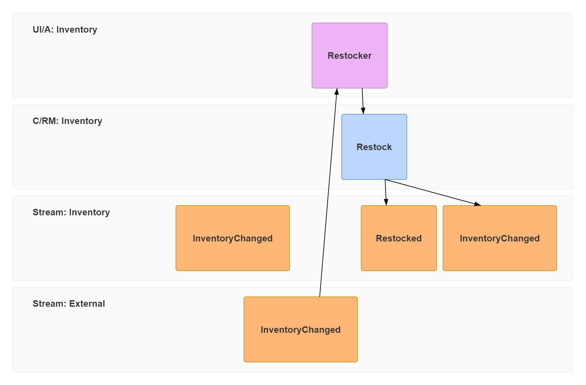
</p>

**Rendered by Mermaid:**
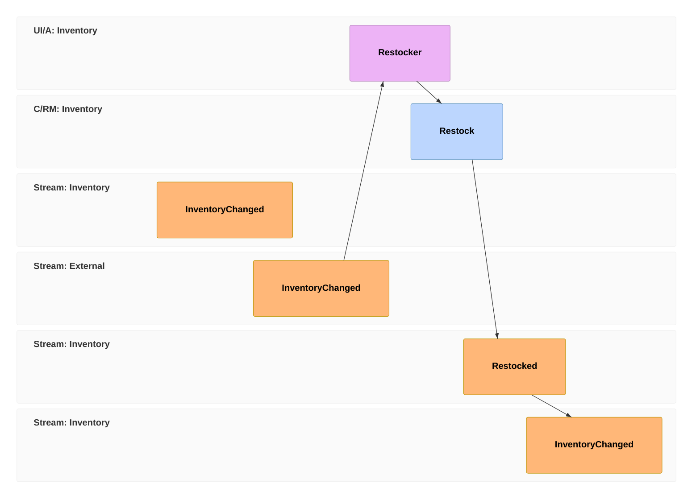

[Open in Mermaid Live](https://mermaid.live/edit#base64:eyJjb2RlIjoiZXZlbnRtb2RlbGluZ1xuXG5yZiAwMSBldnQgSW52ZW50b3J5LkludmVudG9yeUNoYW5nZWRcbnJmIDAyIGV2dCBFeHRlcm5hbC5JbnZlbnRvcnlDaGFuZ2VkXG50ZiAwMyBwY3IgSW52ZW50b3J5LlJlc3RvY2tlclxudGYgMDQgY21kIEludmVudG9yeS5SZXN0b2NrXG50ZiAwNSBldnQgSW52ZW50b3J5LlJlc3RvY2tlZFxudGYgMDYgZXZ0IEludmVudG9yeS5JbnZlbnRvcnlDaGFuZ2VkIiwibWVybWFpZCI6eyJ0aGVtZSI6ImRlZmF1bHQifX0=)

## LongNamesAndJsonData

**Input:**
```
eventmodeling

tf 01 ui ACustomerFacingCheckoutScreenWithAVeryLongNameThatHasToWrapSomewhere
tf 02 cmd PlaceOrder [[Order]]
tf 03 evt OrderPlaced

data Order `json`{
  "customer": {
    "name": "Alice",
    "email": "alice@example.com"
  },
  "items": 3
}
```
**Rendered by Naiad:**

<p align="center">
  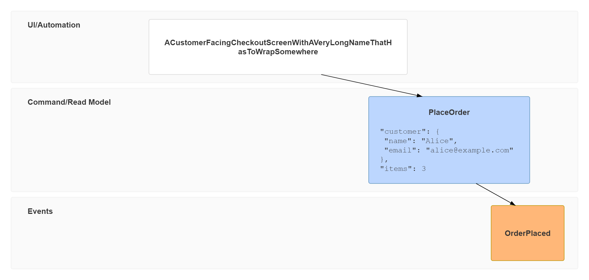
</p>

**Rendered by Mermaid:**
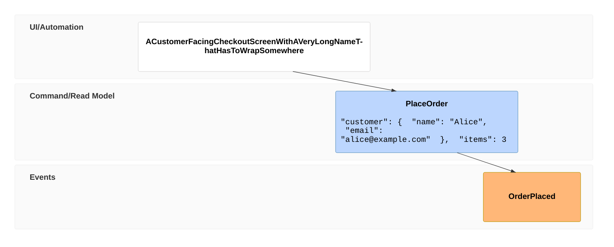

[Open in Mermaid Live](https://mermaid.live/edit#base64:eyJjb2RlIjoiZXZlbnRtb2RlbGluZ1xuXG50ZiAwMSB1aSBBQ3VzdG9tZXJGYWNpbmdDaGVja291dFNjcmVlbldpdGhBVmVyeUxvbmdOYW1lVGhhdEhhc1RvV3JhcFNvbWV3aGVyZVxudGYgMDIgY21kIFBsYWNlT3JkZXIgW1tPcmRlcl1dXG50ZiAwMyBldnQgT3JkZXJQbGFjZWRcblxuZGF0YSBPcmRlciBcdTAwNjBqc29uXHUwMDYwe1xuICBcdTAwMjJjdXN0b21lclx1MDAyMjoge1xuICAgIFx1MDAyMm5hbWVcdTAwMjI6IFx1MDAyMkFsaWNlXHUwMDIyLFxuICAgIFx1MDAyMmVtYWlsXHUwMDIyOiBcdTAwMjJhbGljZUBleGFtcGxlLmNvbVx1MDAyMlxuICB9LFxuICBcdTAwMjJpdGVtc1x1MDAyMjogM1xufSIsIm1lcm1haWQiOnsidGhlbWUiOiJkZWZhdWx0In19)

## Empty

**Input:**
```
eventmodeling
```
**Rendered by Naiad:**

<p align="center">
  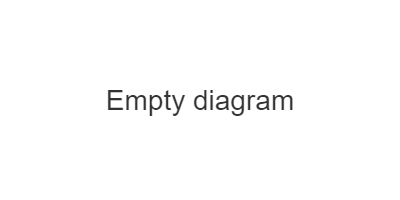
</p>

**Rendered by Mermaid:**
```mermaid
eventmodeling
```

[Open in Mermaid Live](https://mermaid.live/edit#base64:eyJjb2RlIjoiZXZlbnRtb2RlbGluZyIsIm1lcm1haWQiOnsidGhlbWUiOiJkZWZhdWx0In19)

