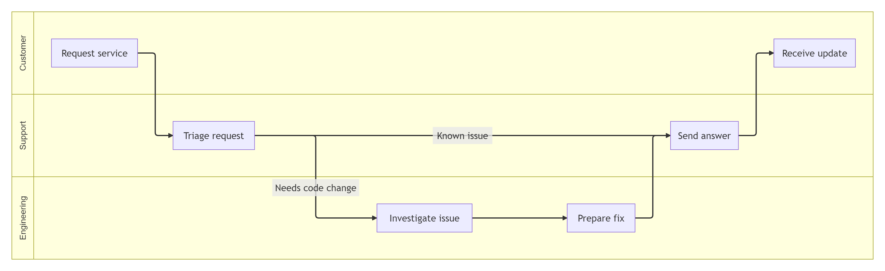
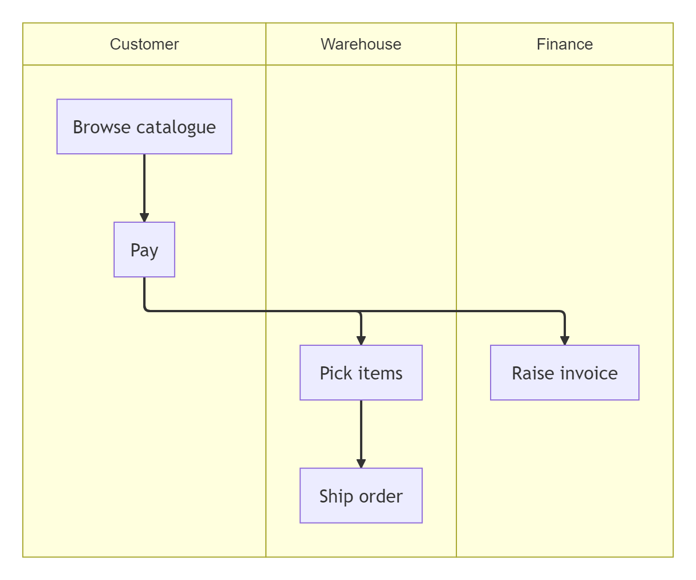
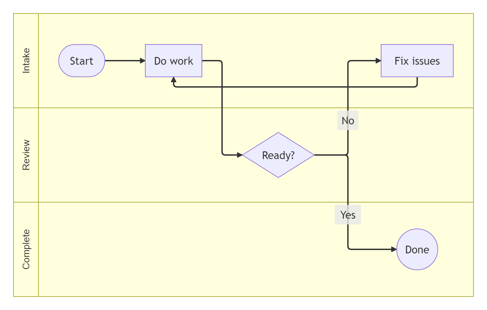
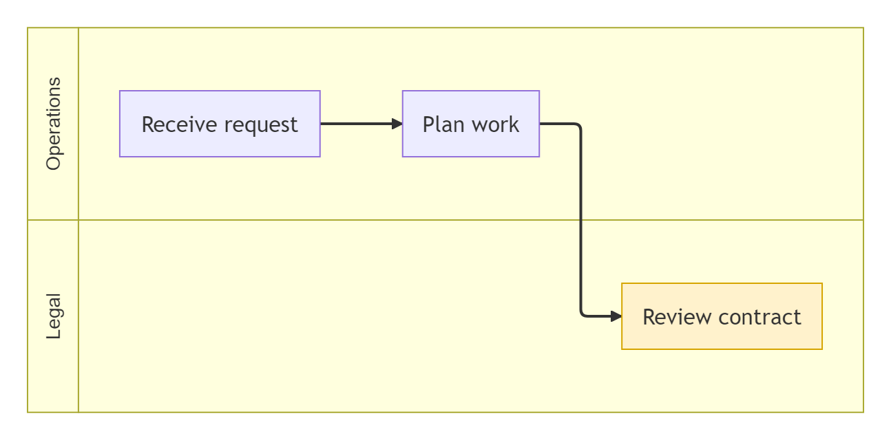
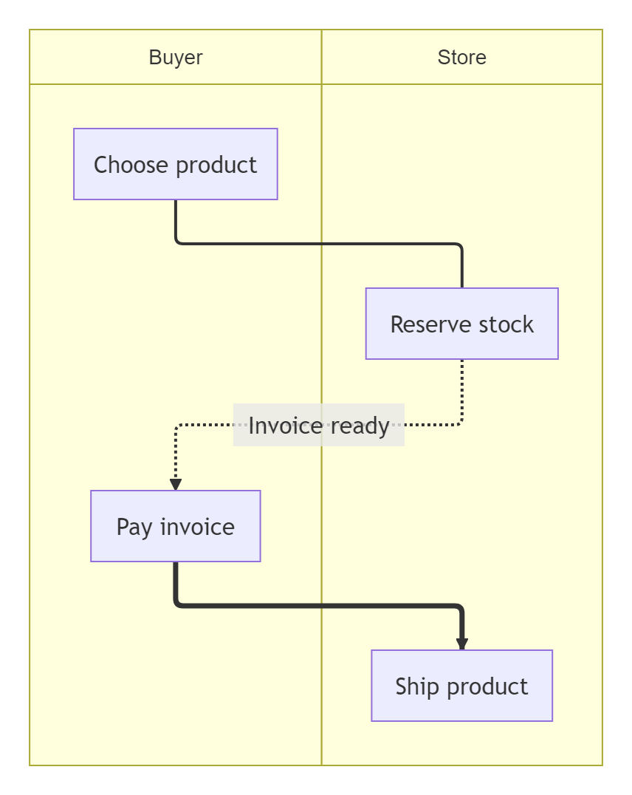
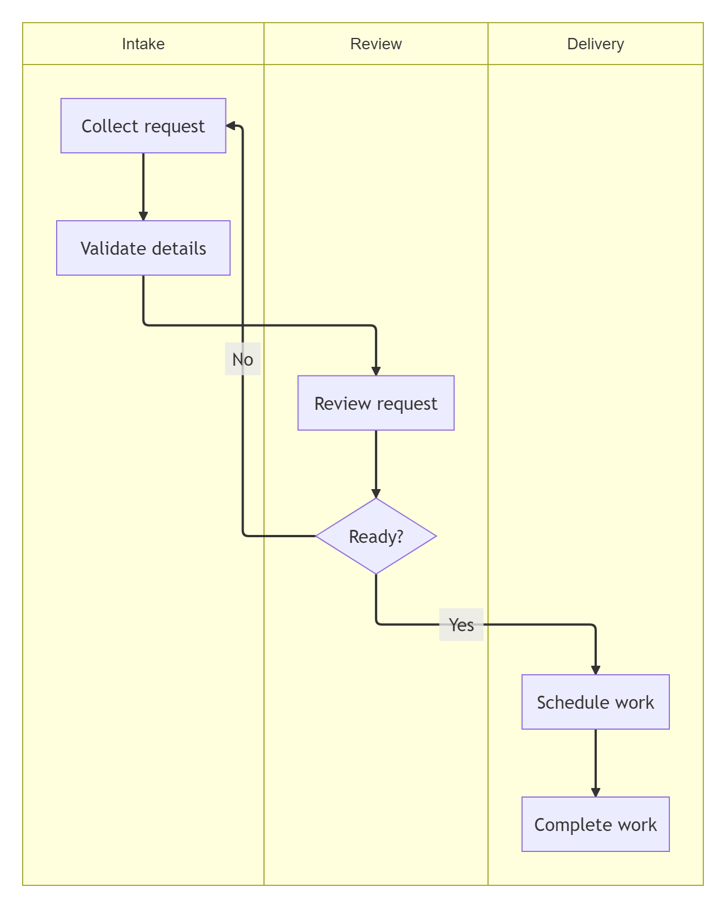
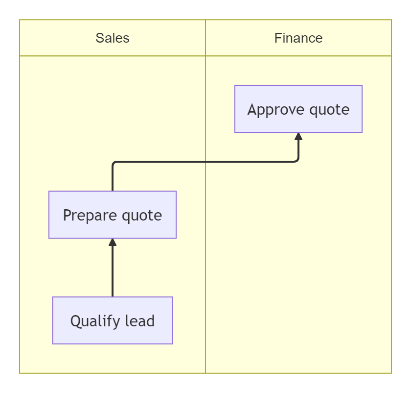
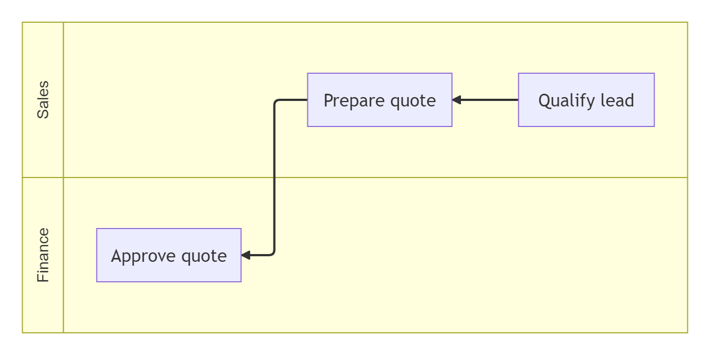
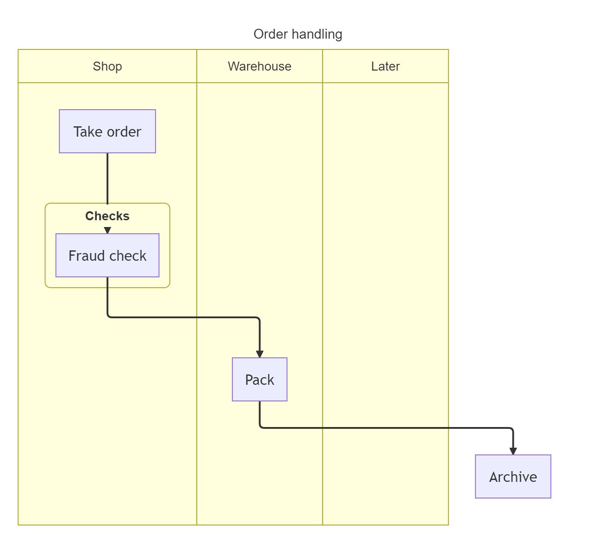
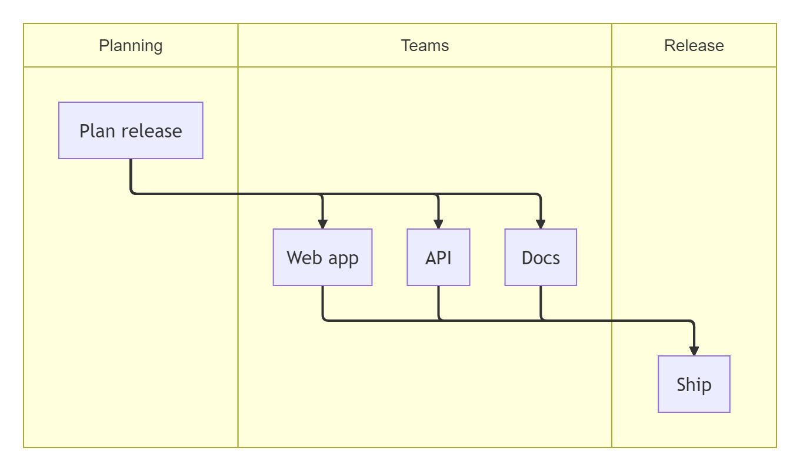

# Swimlane

## Basic

**Input:**
```
swimlane-beta LR
  subgraph Customer
    request[Request service]
    receive[Receive update]
  end

  subgraph Support
    triage[Triage request]
    answer[Send answer]
  end

  subgraph Engineering
    investigate[Investigate issue]
    fix[Prepare fix]
  end

  request --> triage
  triage -->|Known issue| answer
  triage -->|Needs code change| investigate
  investigate --> fix --> answer
  answer --> receive
```
**Rendered by Naiad:**

<p align="center">
  
</p>

**Rendered by Mermaid:**
```mermaid
swimlane-beta LR
  subgraph Customer
    request[Request service]
    receive[Receive update]
  end

  subgraph Support
    triage[Triage request]
    answer[Send answer]
  end

  subgraph Engineering
    investigate[Investigate issue]
    fix[Prepare fix]
  end

  request --> triage
  triage -->|Known issue| answer
  triage -->|Needs code change| investigate
  investigate --> fix --> answer
  answer --> receive
```

[Open in Mermaid Live](https://mermaid.live/edit#base64:eyJjb2RlIjoic3dpbWxhbmUtYmV0YSBMUlxuICBzdWJncmFwaCBDdXN0b21lclxuICAgIHJlcXVlc3RbUmVxdWVzdCBzZXJ2aWNlXVxuICAgIHJlY2VpdmVbUmVjZWl2ZSB1cGRhdGVdXG4gIGVuZFxuXG4gIHN1YmdyYXBoIFN1cHBvcnRcbiAgICB0cmlhZ2VbVHJpYWdlIHJlcXVlc3RdXG4gICAgYW5zd2VyW1NlbmQgYW5zd2VyXVxuICBlbmRcblxuICBzdWJncmFwaCBFbmdpbmVlcmluZ1xuICAgIGludmVzdGlnYXRlW0ludmVzdGlnYXRlIGlzc3VlXVxuICAgIGZpeFtQcmVwYXJlIGZpeF1cbiAgZW5kXG5cbiAgcmVxdWVzdCAtLVx1MDAzRSB0cmlhZ2VcbiAgdHJpYWdlIC0tXHUwMDNFfEtub3duIGlzc3VlfCBhbnN3ZXJcbiAgdHJpYWdlIC0tXHUwMDNFfE5lZWRzIGNvZGUgY2hhbmdlfCBpbnZlc3RpZ2F0ZVxuICBpbnZlc3RpZ2F0ZSAtLVx1MDAzRSBmaXggLS1cdTAwM0UgYW5zd2VyXG4gIGFuc3dlciAtLVx1MDAzRSByZWNlaXZlIiwibWVybWFpZCI6eyJ0aGVtZSI6ImRlZmF1bHQifX0=)

## TopToBottom

**Input:**
```
swimlane-beta
  subgraph Customer
    Browse[Browse catalogue]
    Pay[Pay]
  end
  subgraph Warehouse
    Pick[Pick items]
    Ship[Ship order]
  end
  subgraph Finance
    Invoice[Raise invoice]
  end
  Browse --> Pay
  Pay --> Pick
  Pick --> Ship
  Pay --> Invoice
```
**Rendered by Naiad:**

<p align="center">
  
</p>

**Rendered by Mermaid:**
```mermaid
swimlane-beta
  subgraph Customer
    Browse[Browse catalogue]
    Pay[Pay]
  end
  subgraph Warehouse
    Pick[Pick items]
    Ship[Ship order]
  end
  subgraph Finance
    Invoice[Raise invoice]
  end
  Browse --> Pay
  Pay --> Pick
  Pick --> Ship
  Pay --> Invoice
```

[Open in Mermaid Live](https://mermaid.live/edit#base64:eyJjb2RlIjoic3dpbWxhbmUtYmV0YVxuICBzdWJncmFwaCBDdXN0b21lclxuICAgIEJyb3dzZVtCcm93c2UgY2F0YWxvZ3VlXVxuICAgIFBheVtQYXldXG4gIGVuZFxuICBzdWJncmFwaCBXYXJlaG91c2VcbiAgICBQaWNrW1BpY2sgaXRlbXNdXG4gICAgU2hpcFtTaGlwIG9yZGVyXVxuICBlbmRcbiAgc3ViZ3JhcGggRmluYW5jZVxuICAgIEludm9pY2VbUmFpc2UgaW52b2ljZV1cbiAgZW5kXG4gIEJyb3dzZSAtLVx1MDAzRSBQYXlcbiAgUGF5IC0tXHUwMDNFIFBpY2tcbiAgUGljayAtLVx1MDAzRSBTaGlwXG4gIFBheSAtLVx1MDAzRSBJbnZvaWNlIiwibWVybWFpZCI6eyJ0aGVtZSI6ImRlZmF1bHQifX0=)

## Shapes

**Input:**
```
swimlane-beta LR
  subgraph Intake
    start([Start])
    task[Do work]
    fix[Fix issues]
  end

  subgraph Review
    decision{Ready?}
  end

  subgraph Complete
    done((Done))
  end

  start --> task --> decision
  decision -->|Yes| done
  decision -->|No| fix
  fix --> task
```
**Rendered by Naiad:**

<p align="center">
  
</p>

**Rendered by Mermaid:**
```mermaid
swimlane-beta LR
  subgraph Intake
    start([Start])
    task[Do work]
    fix[Fix issues]
  end

  subgraph Review
    decision{Ready?}
  end

  subgraph Complete
    done((Done))
  end

  start --> task --> decision
  decision -->|Yes| done
  decision -->|No| fix
  fix --> task
```

[Open in Mermaid Live](https://mermaid.live/edit#base64:eyJjb2RlIjoic3dpbWxhbmUtYmV0YSBMUlxuICBzdWJncmFwaCBJbnRha2VcbiAgICBzdGFydChbU3RhcnRdKVxuICAgIHRhc2tbRG8gd29ya11cbiAgICBmaXhbRml4IGlzc3Vlc11cbiAgZW5kXG5cbiAgc3ViZ3JhcGggUmV2aWV3XG4gICAgZGVjaXNpb257UmVhZHk/fVxuICBlbmRcblxuICBzdWJncmFwaCBDb21wbGV0ZVxuICAgIGRvbmUoKERvbmUpKVxuICBlbmRcblxuICBzdGFydCAtLVx1MDAzRSB0YXNrIC0tXHUwMDNFIGRlY2lzaW9uXG4gIGRlY2lzaW9uIC0tXHUwMDNFfFllc3wgZG9uZVxuICBkZWNpc2lvbiAtLVx1MDAzRXxOb3wgZml4XG4gIGZpeCAtLVx1MDAzRSB0YXNrIiwibWVybWFpZCI6eyJ0aGVtZSI6ImRlZmF1bHQifX0=)

## LaneLabelsAndClasses

**Input:**
```
swimlane-beta LR
  subgraph ops [Operations]
    intake[Receive request]
    plan[Plan work]
  end

  subgraph legal [Legal]
    review[Review contract]
  end

  intake --> plan --> review

  classDef attention fill:#fff2cc,stroke:#d6a500,color:#111;
  class review attention;
```
**Rendered by Naiad:**

<p align="center">
  
</p>

**Rendered by Mermaid:**
```mermaid
swimlane-beta LR
  subgraph ops [Operations]
    intake[Receive request]
    plan[Plan work]
  end

  subgraph legal [Legal]
    review[Review contract]
  end

  intake --> plan --> review

  classDef attention fill:#fff2cc,stroke:#d6a500,color:#111;
  class review attention;
```

[Open in Mermaid Live](https://mermaid.live/edit#base64:eyJjb2RlIjoic3dpbWxhbmUtYmV0YSBMUlxuICBzdWJncmFwaCBvcHMgW09wZXJhdGlvbnNdXG4gICAgaW50YWtlW1JlY2VpdmUgcmVxdWVzdF1cbiAgICBwbGFuW1BsYW4gd29ya11cbiAgZW5kXG5cbiAgc3ViZ3JhcGggbGVnYWwgW0xlZ2FsXVxuICAgIHJldmlld1tSZXZpZXcgY29udHJhY3RdXG4gIGVuZFxuXG4gIGludGFrZSAtLVx1MDAzRSBwbGFuIC0tXHUwMDNFIHJldmlld1xuXG4gIGNsYXNzRGVmIGF0dGVudGlvbiBmaWxsOiNmZmYyY2Msc3Ryb2tlOiNkNmE1MDAsY29sb3I6IzExMTtcbiAgY2xhc3MgcmV2aWV3IGF0dGVudGlvbjsiLCJtZXJtYWlkIjp7InRoZW1lIjoiZGVmYXVsdCJ9fQ==)

## EdgeStyles

**Input:**
```
swimlane-beta TB
  subgraph Buyer
    choose[Choose product]
    pay[Pay invoice]
  end

  subgraph Store
    reserve[Reserve stock]
    ship[Ship product]
  end

  choose --- reserve
  reserve -.->|Invoice ready| pay
  pay ==> ship
```
**Rendered by Naiad:**

<p align="center">
  
</p>

**Rendered by Mermaid:**
```mermaid
swimlane-beta TB
  subgraph Buyer
    choose[Choose product]
    pay[Pay invoice]
  end

  subgraph Store
    reserve[Reserve stock]
    ship[Ship product]
  end

  choose --- reserve
  reserve -.->|Invoice ready| pay
  pay ==> ship
```

[Open in Mermaid Live](https://mermaid.live/edit#base64:eyJjb2RlIjoic3dpbWxhbmUtYmV0YSBUQlxuICBzdWJncmFwaCBCdXllclxuICAgIGNob29zZVtDaG9vc2UgcHJvZHVjdF1cbiAgICBwYXlbUGF5IGludm9pY2VdXG4gIGVuZFxuXG4gIHN1YmdyYXBoIFN0b3JlXG4gICAgcmVzZXJ2ZVtSZXNlcnZlIHN0b2NrXVxuICAgIHNoaXBbU2hpcCBwcm9kdWN0XVxuICBlbmRcblxuICBjaG9vc2UgLS0tIHJlc2VydmVcbiAgcmVzZXJ2ZSAtLi1cdTAwM0V8SW52b2ljZSByZWFkeXwgcGF5XG4gIHBheSA9PVx1MDAzRSBzaGlwIiwibWVybWFpZCI6eyJ0aGVtZSI6ImRlZmF1bHQifX0=)

## BackEdge

**Input:**
```
swimlane-beta TB
  subgraph Intake
    collect[Collect request]
    validate[Validate details]
  end

  subgraph Review
    review[Review request]
    decide{Ready?}
  end

  subgraph Delivery
    schedule[Schedule work]
    complete[Complete work]
  end

  collect --> validate --> review --> decide
  decide -->|Yes| schedule --> complete
  decide -->|No| collect
```
**Rendered by Naiad:**

<p align="center">
  
</p>

**Rendered by Mermaid:**
```mermaid
swimlane-beta TB
  subgraph Intake
    collect[Collect request]
    validate[Validate details]
  end

  subgraph Review
    review[Review request]
    decide{Ready?}
  end

  subgraph Delivery
    schedule[Schedule work]
    complete[Complete work]
  end

  collect --> validate --> review --> decide
  decide -->|Yes| schedule --> complete
  decide -->|No| collect
```

[Open in Mermaid Live](https://mermaid.live/edit#base64:eyJjb2RlIjoic3dpbWxhbmUtYmV0YSBUQlxuICBzdWJncmFwaCBJbnRha2VcbiAgICBjb2xsZWN0W0NvbGxlY3QgcmVxdWVzdF1cbiAgICB2YWxpZGF0ZVtWYWxpZGF0ZSBkZXRhaWxzXVxuICBlbmRcblxuICBzdWJncmFwaCBSZXZpZXdcbiAgICByZXZpZXdbUmV2aWV3IHJlcXVlc3RdXG4gICAgZGVjaWRle1JlYWR5P31cbiAgZW5kXG5cbiAgc3ViZ3JhcGggRGVsaXZlcnlcbiAgICBzY2hlZHVsZVtTY2hlZHVsZSB3b3JrXVxuICAgIGNvbXBsZXRlW0NvbXBsZXRlIHdvcmtdXG4gIGVuZFxuXG4gIGNvbGxlY3QgLS1cdTAwM0UgdmFsaWRhdGUgLS1cdTAwM0UgcmV2aWV3IC0tXHUwMDNFIGRlY2lkZVxuICBkZWNpZGUgLS1cdTAwM0V8WWVzfCBzY2hlZHVsZSAtLVx1MDAzRSBjb21wbGV0ZVxuICBkZWNpZGUgLS1cdTAwM0V8Tm98IGNvbGxlY3QiLCJtZXJtYWlkIjp7InRoZW1lIjoiZGVmYXVsdCJ9fQ==)

## BottomToTop

**Input:**
```
swimlane-beta BT
  subgraph Sales
    lead[Qualify lead]
    quote[Prepare quote]
  end
  subgraph Finance
    approve[Approve quote]
  end
  lead --> quote --> approve
```
**Rendered by Naiad:**

<p align="center">
  
</p>

**Rendered by Mermaid:**
```mermaid
swimlane-beta BT
  subgraph Sales
    lead[Qualify lead]
    quote[Prepare quote]
  end
  subgraph Finance
    approve[Approve quote]
  end
  lead --> quote --> approve
```

[Open in Mermaid Live](https://mermaid.live/edit#base64:eyJjb2RlIjoic3dpbWxhbmUtYmV0YSBCVFxuICBzdWJncmFwaCBTYWxlc1xuICAgIGxlYWRbUXVhbGlmeSBsZWFkXVxuICAgIHF1b3RlW1ByZXBhcmUgcXVvdGVdXG4gIGVuZFxuICBzdWJncmFwaCBGaW5hbmNlXG4gICAgYXBwcm92ZVtBcHByb3ZlIHF1b3RlXVxuICBlbmRcbiAgbGVhZCAtLVx1MDAzRSBxdW90ZSAtLVx1MDAzRSBhcHByb3ZlIiwibWVybWFpZCI6eyJ0aGVtZSI6ImRlZmF1bHQifX0=)

## RightToLeft

**Input:**
```
swimlane-beta RL
  subgraph Sales
    lead[Qualify lead]
    quote[Prepare quote]
  end
  subgraph Finance
    approve[Approve quote]
  end
  lead --> quote --> approve
```
**Rendered by Naiad:**

<p align="center">
  
</p>

**Rendered by Mermaid:**
```mermaid
swimlane-beta RL
  subgraph Sales
    lead[Qualify lead]
    quote[Prepare quote]
  end
  subgraph Finance
    approve[Approve quote]
  end
  lead --> quote --> approve
```

[Open in Mermaid Live](https://mermaid.live/edit#base64:eyJjb2RlIjoic3dpbWxhbmUtYmV0YSBSTFxuICBzdWJncmFwaCBTYWxlc1xuICAgIGxlYWRbUXVhbGlmeSBsZWFkXVxuICAgIHF1b3RlW1ByZXBhcmUgcXVvdGVdXG4gIGVuZFxuICBzdWJncmFwaCBGaW5hbmNlXG4gICAgYXBwcm92ZVtBcHByb3ZlIHF1b3RlXVxuICBlbmRcbiAgbGVhZCAtLVx1MDAzRSBxdW90ZSAtLVx1MDAzRSBhcHByb3ZlIiwibWVybWFpZCI6eyJ0aGVtZSI6ImRlZmF1bHQifX0=)

## TitleNestedAndOutside

**Input:**
```
---
title: Order handling
---
swimlane-beta TB
  accTitle: Order handling
  accDescr: Orders move from the shop to the warehouse.
  subgraph Shop
    order[Take order]
    subgraph checks [Checks]
      fraud[Fraud check]
    end
  end
  subgraph Warehouse
    pack[Pack]
  end
  subgraph Later
  end
  order --> fraud --> pack --> archive[Archive]
```
**Rendered by Naiad:**

<p align="center">
  
</p>

**Rendered by Mermaid:**
```mermaid
---
title: Order handling
---
swimlane-beta TB
  accTitle: Order handling
  accDescr: Orders move from the shop to the warehouse.
  subgraph Shop
    order[Take order]
    subgraph checks [Checks]
      fraud[Fraud check]
    end
  end
  subgraph Warehouse
    pack[Pack]
  end
  subgraph Later
  end
  order --> fraud --> pack --> archive[Archive]
```

[Open in Mermaid Live](https://mermaid.live/edit#base64:eyJjb2RlIjoiLS0tXG50aXRsZTogT3JkZXIgaGFuZGxpbmdcbi0tLVxuc3dpbWxhbmUtYmV0YSBUQlxuICBhY2NUaXRsZTogT3JkZXIgaGFuZGxpbmdcbiAgYWNjRGVzY3I6IE9yZGVycyBtb3ZlIGZyb20gdGhlIHNob3AgdG8gdGhlIHdhcmVob3VzZS5cbiAgc3ViZ3JhcGggU2hvcFxuICAgIG9yZGVyW1Rha2Ugb3JkZXJdXG4gICAgc3ViZ3JhcGggY2hlY2tzIFtDaGVja3NdXG4gICAgICBmcmF1ZFtGcmF1ZCBjaGVja11cbiAgICBlbmRcbiAgZW5kXG4gIHN1YmdyYXBoIFdhcmVob3VzZVxuICAgIHBhY2tbUGFja11cbiAgZW5kXG4gIHN1YmdyYXBoIExhdGVyXG4gIGVuZFxuICBvcmRlciAtLVx1MDAzRSBmcmF1ZCAtLVx1MDAzRSBwYWNrIC0tXHUwMDNFIGFyY2hpdmVbQXJjaGl2ZV0iLCJtZXJtYWlkIjp7InRoZW1lIjoiZGVmYXVsdCJ9fQ==)

## FanOut

**Input:**
```
swimlane-beta TB
  subgraph Planning
    plan[Plan release]
  end
  subgraph Teams
    web[Web app]
    api[API]
    docs[Docs]
  end
  subgraph Release
    ship[Ship]
  end
  plan --> web & api & docs
  web & api & docs --> ship
```
**Rendered by Naiad:**

<p align="center">
  
</p>

**Rendered by Mermaid:**
```mermaid
swimlane-beta TB
  subgraph Planning
    plan[Plan release]
  end
  subgraph Teams
    web[Web app]
    api[API]
    docs[Docs]
  end
  subgraph Release
    ship[Ship]
  end
  plan --> web & api & docs
  web & api & docs --> ship
```

[Open in Mermaid Live](https://mermaid.live/edit#base64:eyJjb2RlIjoic3dpbWxhbmUtYmV0YSBUQlxuICBzdWJncmFwaCBQbGFubmluZ1xuICAgIHBsYW5bUGxhbiByZWxlYXNlXVxuICBlbmRcbiAgc3ViZ3JhcGggVGVhbXNcbiAgICB3ZWJbV2ViIGFwcF1cbiAgICBhcGlbQVBJXVxuICAgIGRvY3NbRG9jc11cbiAgZW5kXG4gIHN1YmdyYXBoIFJlbGVhc2VcbiAgICBzaGlwW1NoaXBdXG4gIGVuZFxuICBwbGFuIC0tXHUwMDNFIHdlYiBcdTAwMjYgYXBpIFx1MDAyNiBkb2NzXG4gIHdlYiBcdTAwMjYgYXBpIFx1MDAyNiBkb2NzIC0tXHUwMDNFIHNoaXAiLCJtZXJtYWlkIjp7InRoZW1lIjoiZGVmYXVsdCJ9fQ==)

