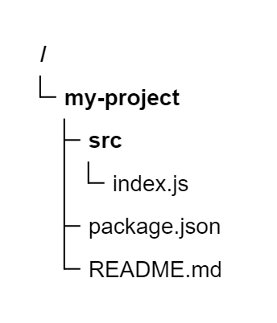
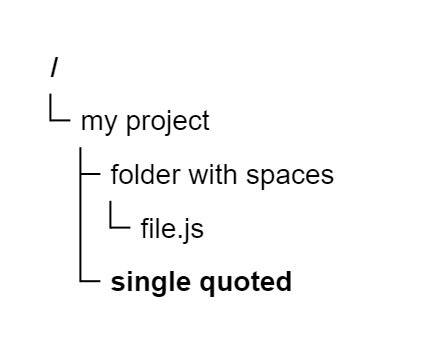
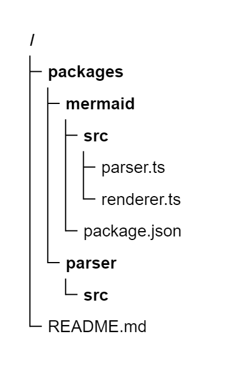
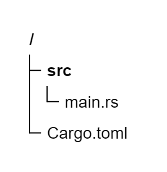
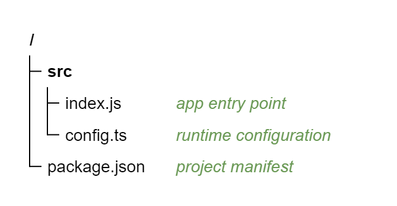
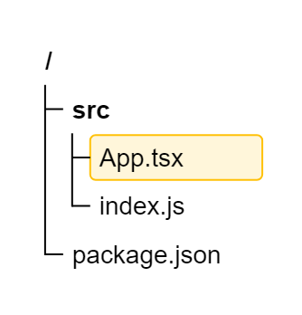
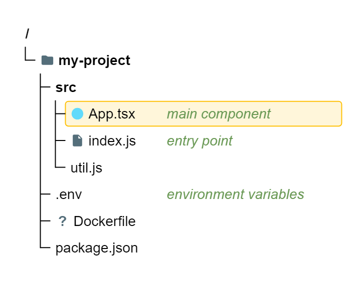
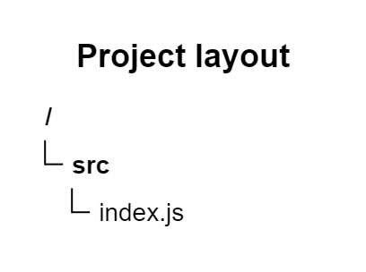
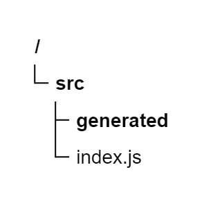

# TreeView

## Simple

**Input:**
```
treeView-beta
    my-project/
        src/
            index.js
        package.json
        README.md
```
**Rendered by Naiad:**

<p align="center">
  
</p>


[Open in Mermaid Live](https://mermaid.live/edit#base64:eyJjb2RlIjoidHJlZVZpZXctYmV0YVxuICAgIG15LXByb2plY3QvXG4gICAgICAgIHNyYy9cbiAgICAgICAgICAgIGluZGV4LmpzXG4gICAgICAgIHBhY2thZ2UuanNvblxuICAgICAgICBSRUFETUUubWQiLCJtZXJtYWlkIjp7InRoZW1lIjoiZGVmYXVsdCJ9fQ==)

## QuotedLabels

**Input:**
```
treeView-beta
    "my project"
        "folder with spaces"
            "file.js"
        'single quoted/'
```
**Rendered by Naiad:**

<p align="center">
  
</p>


[Open in Mermaid Live](https://mermaid.live/edit#base64:eyJjb2RlIjoidHJlZVZpZXctYmV0YVxuICAgIFx1MDAyMm15IHByb2plY3RcdTAwMjJcbiAgICAgICAgXHUwMDIyZm9sZGVyIHdpdGggc3BhY2VzXHUwMDIyXG4gICAgICAgICAgICBcdTAwMjJmaWxlLmpzXHUwMDIyXG4gICAgICAgIFx1MDAyN3NpbmdsZSBxdW90ZWQvXHUwMDI3IiwibWVybWFpZCI6eyJ0aGVtZSI6ImRlZmF1bHQifX0=)

## BoxDrawing

**Input:**
```
treeView-beta
├── packages/
│   ├── mermaid/
│   │   ├── src/
│   │   │   ├── parser.ts
│   │   │   └── renderer.ts
│   │   └── package.json
│   └── parser/
│       └── src/
└── README.md
```
**Rendered by Naiad:**

<p align="center">
  
</p>


[Open in Mermaid Live](https://mermaid.live/edit#base64:eyJjb2RlIjoidHJlZVZpZXctYmV0YVxuXHUyNTFDXHUyNTAwXHUyNTAwIHBhY2thZ2VzL1xuXHUyNTAyICAgXHUyNTFDXHUyNTAwXHUyNTAwIG1lcm1haWQvXG5cdTI1MDIgICBcdTI1MDIgICBcdTI1MUNcdTI1MDBcdTI1MDAgc3JjL1xuXHUyNTAyICAgXHUyNTAyICAgXHUyNTAyICAgXHUyNTFDXHUyNTAwXHUyNTAwIHBhcnNlci50c1xuXHUyNTAyICAgXHUyNTAyICAgXHUyNTAyICAgXHUyNTE0XHUyNTAwXHUyNTAwIHJlbmRlcmVyLnRzXG5cdTI1MDIgICBcdTI1MDIgICBcdTI1MTRcdTI1MDBcdTI1MDAgcGFja2FnZS5qc29uXG5cdTI1MDIgICBcdTI1MTRcdTI1MDBcdTI1MDAgcGFyc2VyL1xuXHUyNTAyICAgICAgIFx1MjUxNFx1MjUwMFx1MjUwMCBzcmMvXG5cdTI1MTRcdTI1MDBcdTI1MDAgUkVBRE1FLm1kIiwibWVybWFpZCI6eyJ0aGVtZSI6ImRlZmF1bHQifX0=)

## HeavyBoxDrawing

**Input:**
```
treeView-beta
┣━━ src/
┃   ┗━━ main.rs
┃
┗━━ Cargo.toml
```
**Rendered by Naiad:**

<p align="center">
  
</p>


[Open in Mermaid Live](https://mermaid.live/edit#base64:eyJjb2RlIjoidHJlZVZpZXctYmV0YVxuXHUyNTIzXHUyNTAxXHUyNTAxIHNyYy9cblx1MjUwMyAgIFx1MjUxN1x1MjUwMVx1MjUwMSBtYWluLnJzXG5cdTI1MDNcblx1MjUxN1x1MjUwMVx1MjUwMSBDYXJnby50b21sIiwibWVybWFpZCI6eyJ0aGVtZSI6ImRlZmF1bHQifX0=)

## Descriptions

**Input:**
```
treeView-beta
    src/
        index.js ## app entry point
        config.ts ## runtime configuration
    package.json ## project manifest
```
**Rendered by Naiad:**

<p align="center">
  
</p>


[Open in Mermaid Live](https://mermaid.live/edit#base64:eyJjb2RlIjoidHJlZVZpZXctYmV0YVxuICAgIHNyYy9cbiAgICAgICAgaW5kZXguanMgIyMgYXBwIGVudHJ5IHBvaW50XG4gICAgICAgIGNvbmZpZy50cyAjIyBydW50aW1lIGNvbmZpZ3VyYXRpb25cbiAgICBwYWNrYWdlLmpzb24gIyMgcHJvamVjdCBtYW5pZmVzdCIsIm1lcm1haWQiOnsidGhlbWUiOiJkZWZhdWx0In19)

## Highlight

**Input:**
```
treeView-beta
    src/
        App.tsx :::highlight
        index.js
    package.json
```
**Rendered by Naiad:**

<p align="center">
  
</p>


[Open in Mermaid Live](https://mermaid.live/edit#base64:eyJjb2RlIjoidHJlZVZpZXctYmV0YVxuICAgIHNyYy9cbiAgICAgICAgQXBwLnRzeCA6OjpoaWdobGlnaHRcbiAgICAgICAgaW5kZXguanNcbiAgICBwYWNrYWdlLmpzb24iLCJtZXJtYWlkIjp7InRoZW1lIjoiZGVmYXVsdCJ9fQ==)

## CombinedAnnotations

**Input:**
```
treeView-beta
    my-project/ icon(folder)
        src/
            App.tsx :::highlight icon(logos:react) ## main component
            index.js icon(file) ## entry point
            util.js icon(none)
        .env ## environment variables
        Dockerfile icon(missing:docker)
        package.json
```
**Rendered by Naiad:**

<p align="center">
  
</p>


[Open in Mermaid Live](https://mermaid.live/edit#base64:eyJjb2RlIjoidHJlZVZpZXctYmV0YVxuICAgIG15LXByb2plY3QvIGljb24oZm9sZGVyKVxuICAgICAgICBzcmMvXG4gICAgICAgICAgICBBcHAudHN4IDo6OmhpZ2hsaWdodCBpY29uKGxvZ29zOnJlYWN0KSAjIyBtYWluIGNvbXBvbmVudFxuICAgICAgICAgICAgaW5kZXguanMgaWNvbihmaWxlKSAjIyBlbnRyeSBwb2ludFxuICAgICAgICAgICAgdXRpbC5qcyBpY29uKG5vbmUpXG4gICAgICAgIC5lbnYgIyMgZW52aXJvbm1lbnQgdmFyaWFibGVzXG4gICAgICAgIERvY2tlcmZpbGUgaWNvbihtaXNzaW5nOmRvY2tlcilcbiAgICAgICAgcGFja2FnZS5qc29uIiwibWVybWFpZCI6eyJ0aGVtZSI6ImRlZmF1bHQifX0=)

## Title

**Input:**
```
treeView-beta
    title Project layout
    accTitle: Files
    accDescr: The files of the project
    src/
        index.js
```
**Rendered by Naiad:**

<p align="center">
  
</p>


[Open in Mermaid Live](https://mermaid.live/edit#base64:eyJjb2RlIjoidHJlZVZpZXctYmV0YVxuICAgIHRpdGxlIFByb2plY3QgbGF5b3V0XG4gICAgYWNjVGl0bGU6IEZpbGVzXG4gICAgYWNjRGVzY3I6IFRoZSBmaWxlcyBvZiB0aGUgcHJvamVjdFxuICAgIHNyYy9cbiAgICAgICAgaW5kZXguanMiLCJtZXJtYWlkIjp7InRoZW1lIjoiZGVmYXVsdCJ9fQ==)

## CommentsAndBlankLines

**Input:**
```
%% leading comment
treeView-beta
    %% Generated files, do not edit
    src/

        generated/
        %% a comment between nodes
        index.js
```
**Rendered by Naiad:**

<p align="center">
  
</p>


[Open in Mermaid Live](https://mermaid.live/edit#base64:eyJjb2RlIjoiJSUgbGVhZGluZyBjb21tZW50XG50cmVlVmlldy1iZXRhXG4gICAgJSUgR2VuZXJhdGVkIGZpbGVzLCBkbyBub3QgZWRpdFxuICAgIHNyYy9cblxuICAgICAgICBnZW5lcmF0ZWQvXG4gICAgICAgICUlIGEgY29tbWVudCBiZXR3ZWVuIG5vZGVzXG4gICAgICAgIGluZGV4LmpzIiwibWVybWFpZCI6eyJ0aGVtZSI6ImRlZmF1bHQifX0=)

## KeywordOnly

**Input:**
```
treeView-beta
```
**Rendered by Naiad:**

<p align="center">
  
</p>


[Open in Mermaid Live](https://mermaid.live/edit#base64:eyJjb2RlIjoidHJlZVZpZXctYmV0YSIsIm1lcm1haWQiOnsidGhlbWUiOiJkZWZhdWx0In19)

