# UseCase

## Simple

**Input:**
```
usecase-beta
direction LR
actor Customer("Customer")
systemBoundary "Order system"
  Checkout("Place order")
end
Customer --> Checkout
```
**Rendered by Naiad:**

<p align="center">
  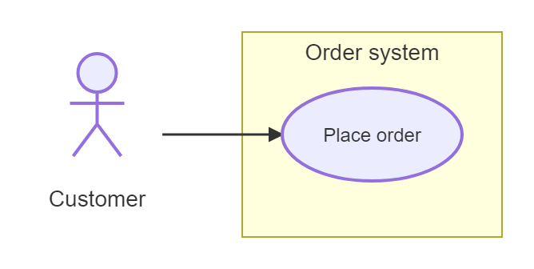
</p>


[Open in Mermaid Live](https://mermaid.live/edit#base64:eyJjb2RlIjoidXNlY2FzZS1iZXRhXG5kaXJlY3Rpb24gTFJcbmFjdG9yIEN1c3RvbWVyKFx1MDAyMkN1c3RvbWVyXHUwMDIyKVxuc3lzdGVtQm91bmRhcnkgXHUwMDIyT3JkZXIgc3lzdGVtXHUwMDIyXG4gIENoZWNrb3V0KFx1MDAyMlBsYWNlIG9yZGVyXHUwMDIyKVxuZW5kXG5DdXN0b21lciAtLVx1MDAzRSBDaGVja291dCIsIm1lcm1haWQiOnsidGhlbWUiOiJkZWZhdWx0In19)

## TwoBoundaries

**Input:**
```
usecase-beta
direction LR
actor Customer
actor Support
systemBoundary Storefront
  Browse("Browse catalogue")
  Checkout("Checkout")
end
systemBoundary Fulfilment
  Track("Track delivery")
end
Customer --> Browse
Customer --> Checkout
Customer --> Track
Support --> Track
Checkout ..> : include Browse
```
**Rendered by Naiad:**

<p align="center">
  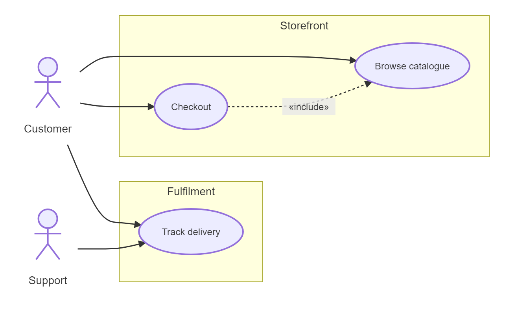
</p>


[Open in Mermaid Live](https://mermaid.live/edit#base64:eyJjb2RlIjoidXNlY2FzZS1iZXRhXG5kaXJlY3Rpb24gTFJcbmFjdG9yIEN1c3RvbWVyXG5hY3RvciBTdXBwb3J0XG5zeXN0ZW1Cb3VuZGFyeSBTdG9yZWZyb250XG4gIEJyb3dzZShcdTAwMjJCcm93c2UgY2F0YWxvZ3VlXHUwMDIyKVxuICBDaGVja291dChcdTAwMjJDaGVja291dFx1MDAyMilcbmVuZFxuc3lzdGVtQm91bmRhcnkgRnVsZmlsbWVudFxuICBUcmFjayhcdTAwMjJUcmFjayBkZWxpdmVyeVx1MDAyMilcbmVuZFxuQ3VzdG9tZXIgLS1cdTAwM0UgQnJvd3NlXG5DdXN0b21lciAtLVx1MDAzRSBDaGVja291dFxuQ3VzdG9tZXIgLS1cdTAwM0UgVHJhY2tcblN1cHBvcnQgLS1cdTAwM0UgVHJhY2tcbkNoZWNrb3V0IC4uXHUwMDNFIDogaW5jbHVkZSBCcm93c2UiLCJtZXJtYWlkIjp7InRoZW1lIjoiZGVmYXVsdCJ9fQ==)

## ActorsAndUseCases

**Input:**
```
usecase-beta
Customer --> Login
actor Customer
actor Admin("Main administrator")
Login("Sign in")
Report[Generate report]
"Reset password"
Admin --> Report
Customer --> Reset_password
```
**Rendered by Naiad:**

<p align="center">
  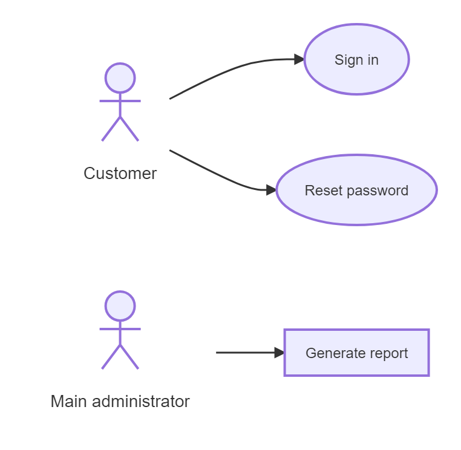
</p>


[Open in Mermaid Live](https://mermaid.live/edit#base64:eyJjb2RlIjoidXNlY2FzZS1iZXRhXG5DdXN0b21lciAtLVx1MDAzRSBMb2dpblxuYWN0b3IgQ3VzdG9tZXJcbmFjdG9yIEFkbWluKFx1MDAyMk1haW4gYWRtaW5pc3RyYXRvclx1MDAyMilcbkxvZ2luKFx1MDAyMlNpZ24gaW5cdTAwMjIpXG5SZXBvcnRbR2VuZXJhdGUgcmVwb3J0XVxuXHUwMDIyUmVzZXQgcGFzc3dvcmRcdTAwMjJcbkFkbWluIC0tXHUwMDNFIFJlcG9ydFxuQ3VzdG9tZXIgLS1cdTAwM0UgUmVzZXRfcGFzc3dvcmQiLCJtZXJtYWlkIjp7InRoZW1lIjoiZGVmYXVsdCJ9fQ==)

## ActorVariants

**Input:**
```
usecase-beta
actor Normal("Normal actor")
actor Hollow("Hollow actor")@{ type: hollow }
actor Awesome("Awesome actor")@{ type: awesome }
actor Fallback("Missing icon fallback")@{ icon: "not-registered:user" }
Normal --> Manage
Hollow --> Manage
Awesome --> Manage
Fallback --> Manage
```
**Rendered by Naiad:**

<p align="center">
  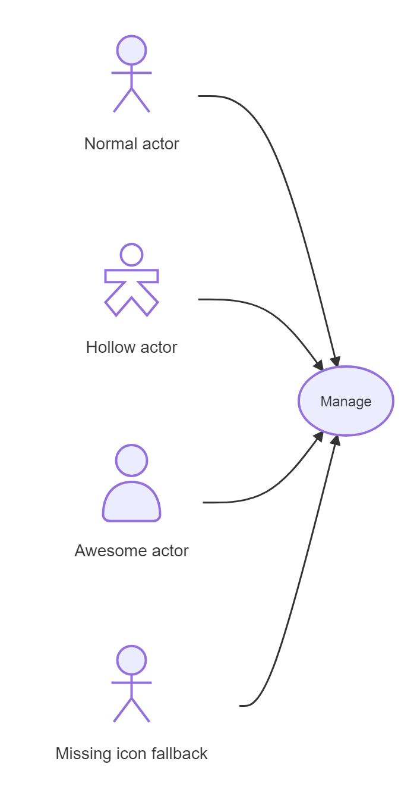
</p>


[Open in Mermaid Live](https://mermaid.live/edit#base64:eyJjb2RlIjoidXNlY2FzZS1iZXRhXG5hY3RvciBOb3JtYWwoXHUwMDIyTm9ybWFsIGFjdG9yXHUwMDIyKVxuYWN0b3IgSG9sbG93KFx1MDAyMkhvbGxvdyBhY3Rvclx1MDAyMilAeyB0eXBlOiBob2xsb3cgfVxuYWN0b3IgQXdlc29tZShcdTAwMjJBd2Vzb21lIGFjdG9yXHUwMDIyKUB7IHR5cGU6IGF3ZXNvbWUgfVxuYWN0b3IgRmFsbGJhY2soXHUwMDIyTWlzc2luZyBpY29uIGZhbGxiYWNrXHUwMDIyKUB7IGljb246IFx1MDAyMm5vdC1yZWdpc3RlcmVkOnVzZXJcdTAwMjIgfVxuTm9ybWFsIC0tXHUwMDNFIE1hbmFnZVxuSG9sbG93IC0tXHUwMDNFIE1hbmFnZVxuQXdlc29tZSAtLVx1MDAzRSBNYW5hZ2VcbkZhbGxiYWNrIC0tXHUwMDNFIE1hbmFnZSIsIm1lcm1haWQiOnsidGhlbWUiOiJkZWZhdWx0In19)

## BusinessAndStereotypes

**Input:**
```
usecase-beta
actor SalesAgent("Sales agent")@{ business: true } <<Employee>>
actor Broker@{ type: hollow, business: true }
Quote("Prepare quote")@{ business: true } <<Core>>
Archive[Archive quote] <<Record>>
SalesAgent --> Quote
Broker --> Quote
Quote --> Archive
```
**Rendered by Naiad:**

<p align="center">
  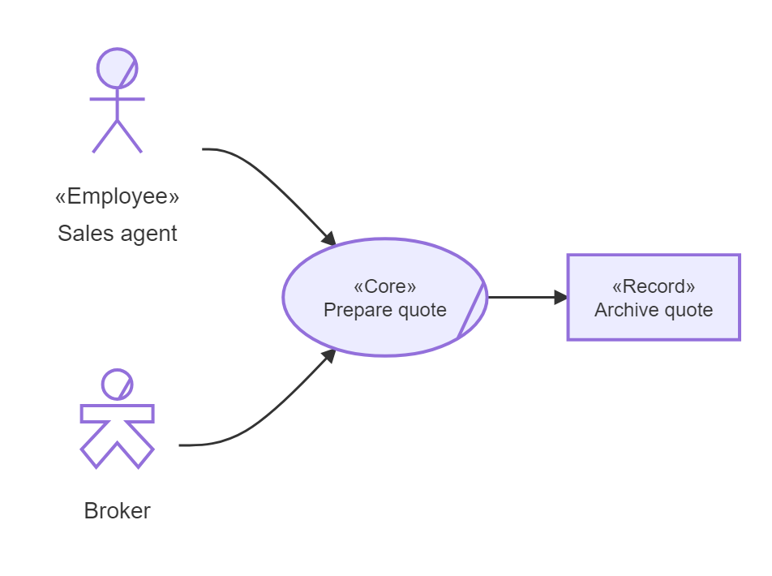
</p>


[Open in Mermaid Live](https://mermaid.live/edit#base64:eyJjb2RlIjoidXNlY2FzZS1iZXRhXG5hY3RvciBTYWxlc0FnZW50KFx1MDAyMlNhbGVzIGFnZW50XHUwMDIyKUB7IGJ1c2luZXNzOiB0cnVlIH0gXHUwMDNDXHUwMDNDRW1wbG95ZWVcdTAwM0VcdTAwM0VcbmFjdG9yIEJyb2tlckB7IHR5cGU6IGhvbGxvdywgYnVzaW5lc3M6IHRydWUgfVxuUXVvdGUoXHUwMDIyUHJlcGFyZSBxdW90ZVx1MDAyMilAeyBidXNpbmVzczogdHJ1ZSB9IFx1MDAzQ1x1MDAzQ0NvcmVcdTAwM0VcdTAwM0VcbkFyY2hpdmVbQXJjaGl2ZSBxdW90ZV0gXHUwMDNDXHUwMDNDUmVjb3JkXHUwMDNFXHUwMDNFXG5TYWxlc0FnZW50IC0tXHUwMDNFIFF1b3RlXG5Ccm9rZXIgLS1cdTAwM0UgUXVvdGVcblF1b3RlIC0tXHUwMDNFIEFyY2hpdmUiLCJtZXJtYWlkIjp7InRoZW1lIjoiZGVmYXVsdCJ9fQ==)

## Associations

**Input:**
```
usecase-beta
actor User
actor Support
Start
Finish
User --> Start
Start <-- Support
Start -- Finish
User --o Start
Start o-- Support
User --x Finish
Finish x-- Support
```
**Rendered by Naiad:**

<p align="center">
  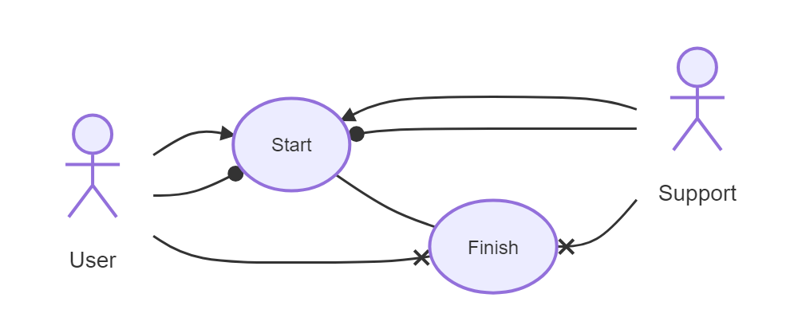
</p>


[Open in Mermaid Live](https://mermaid.live/edit#base64:eyJjb2RlIjoidXNlY2FzZS1iZXRhXG5hY3RvciBVc2VyXG5hY3RvciBTdXBwb3J0XG5TdGFydFxuRmluaXNoXG5Vc2VyIC0tXHUwMDNFIFN0YXJ0XG5TdGFydCBcdTAwM0MtLSBTdXBwb3J0XG5TdGFydCAtLSBGaW5pc2hcblVzZXIgLS1vIFN0YXJ0XG5TdGFydCBvLS0gU3VwcG9ydFxuVXNlciAtLXggRmluaXNoXG5GaW5pc2ggeC0tIFN1cHBvcnQiLCJtZXJtYWlkIjp7InRoZW1lIjoiZGVmYXVsdCJ9fQ==)

## IncludeExtendGeneralization

**Input:**
```
usecase-beta
actor Admin
actor Person
Checkout
Payment
ApplyCoupon
Admin --|> Person
Checkout ..> : include Payment
ApplyCoupon ..> : extend Checkout
ApplyCoupon --|> Checkout
```
**Rendered by Naiad:**

<p align="center">
  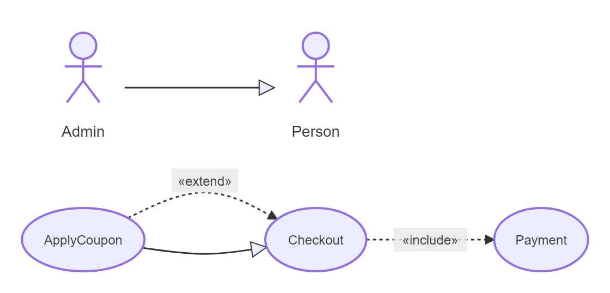
</p>


[Open in Mermaid Live](https://mermaid.live/edit#base64:eyJjb2RlIjoidXNlY2FzZS1iZXRhXG5hY3RvciBBZG1pblxuYWN0b3IgUGVyc29uXG5DaGVja291dFxuUGF5bWVudFxuQXBwbHlDb3Vwb25cbkFkbWluIC0tfFx1MDAzRSBQZXJzb25cbkNoZWNrb3V0IC4uXHUwMDNFIDogaW5jbHVkZSBQYXltZW50XG5BcHBseUNvdXBvbiAuLlx1MDAzRSA6IGV4dGVuZCBDaGVja291dFxuQXBwbHlDb3Vwb24gLS18XHUwMDNFIENoZWNrb3V0IiwibWVybWFpZCI6eyJ0aGVtZSI6ImRlZmF1bHQifX0=)

## Labels

**Input:**
```
usecase-beta
actor Reviewer("`*Reviewer*`")
Literal(**Literal markers**)
Formatted("`**Formatted label**
with a physical line break`")
Quoted("Show #quot;quoted#quot; text")
Priced[Costs 19.95 EUR — VAT included!]
Reviewer -- "`opens **form**`" --> Formatted
Reviewer -- files R&D report --> Literal
Reviewer --> Quoted
Reviewer -- "longer" ----> Priced
```
**Rendered by Naiad:**

<p align="center">
  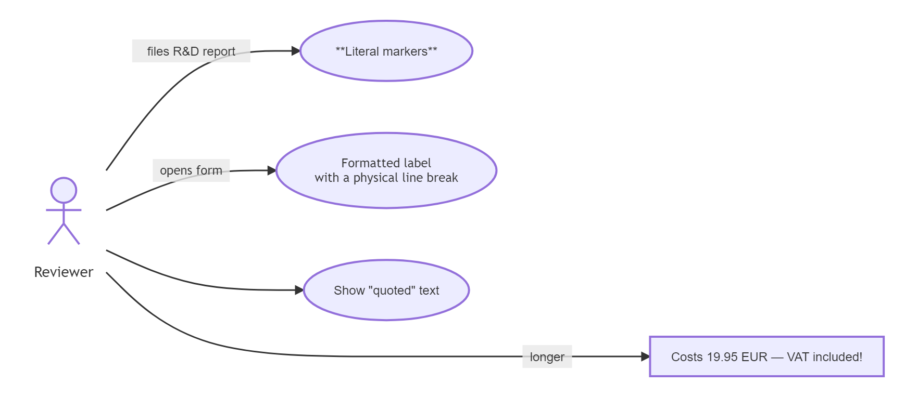
</p>


[Open in Mermaid Live](https://mermaid.live/edit#base64:eyJjb2RlIjoidXNlY2FzZS1iZXRhXG5hY3RvciBSZXZpZXdlcihcdTAwMjJcdTAwNjAqUmV2aWV3ZXIqXHUwMDYwXHUwMDIyKVxuTGl0ZXJhbCgqKkxpdGVyYWwgbWFya2VycyoqKVxuRm9ybWF0dGVkKFx1MDAyMlx1MDA2MCoqRm9ybWF0dGVkIGxhYmVsKipcbndpdGggYSBwaHlzaWNhbCBsaW5lIGJyZWFrXHUwMDYwXHUwMDIyKVxuUXVvdGVkKFx1MDAyMlNob3cgI3F1b3Q7cXVvdGVkI3F1b3Q7IHRleHRcdTAwMjIpXG5QcmljZWRbQ29zdHMgMTkuOTUgRVVSIFx1MjAxNCBWQVQgaW5jbHVkZWQhXVxuUmV2aWV3ZXIgLS0gXHUwMDIyXHUwMDYwb3BlbnMgKipmb3JtKipcdTAwNjBcdTAwMjIgLS1cdTAwM0UgRm9ybWF0dGVkXG5SZXZpZXdlciAtLSBmaWxlcyBSXHUwMDI2RCByZXBvcnQgLS1cdTAwM0UgTGl0ZXJhbFxuUmV2aWV3ZXIgLS1cdTAwM0UgUXVvdGVkXG5SZXZpZXdlciAtLSBcdTAwMjJsb25nZXJcdTAwMjIgLS0tLVx1MDAzRSBQcmljZWQiLCJtZXJtYWlkIjp7InRoZW1lIjoiZGVmYXVsdCJ9fQ==)

## Notes

**Input:**
```
usecase-beta
note for Login "`Requires an **active session**`"
note for User "Starts the workflow"
actor User
Login("Sign in")
User --> Login
```
**Rendered by Naiad:**

<p align="center">
  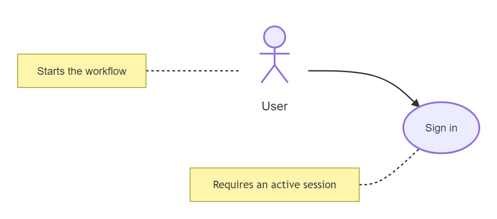
</p>


[Open in Mermaid Live](https://mermaid.live/edit#base64:eyJjb2RlIjoidXNlY2FzZS1iZXRhXG5ub3RlIGZvciBMb2dpbiBcdTAwMjJcdTAwNjBSZXF1aXJlcyBhbiAqKmFjdGl2ZSBzZXNzaW9uKipcdTAwNjBcdTAwMjJcbm5vdGUgZm9yIFVzZXIgXHUwMDIyU3RhcnRzIHRoZSB3b3JrZmxvd1x1MDAyMlxuYWN0b3IgVXNlclxuTG9naW4oXHUwMDIyU2lnbiBpblx1MDAyMilcblVzZXIgLS1cdTAwM0UgTG9naW4iLCJtZXJtYWlkIjp7InRoZW1lIjoiZGVmYXVsdCJ9fQ==)

## JsonTable

**Input:**
```
usecase-beta
Inspect("Inspect payload")
json Payload@{
  "2": "second in source",
  "1": "first after 2",
  "enabled": true,
  "count": 3,
  "missing": null,
  "colors": ["Red", "Green"],
  "address": { "city": "Oslo" },
  "items": [{ "name": "Book" }],
  "emptyObject": {},
  "emptyArray": []
}:::data
Inspect --> Payload
classDef data stroke:#3572a5
style Payload stroke-width:2px
```
**Rendered by Naiad:**

<p align="center">
  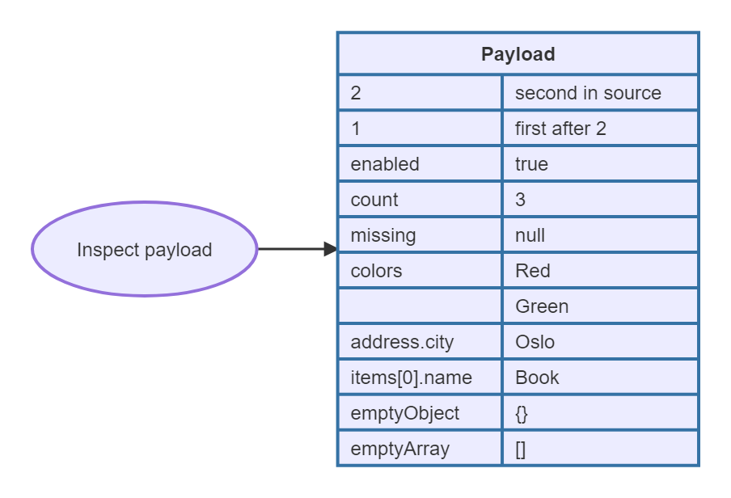
</p>


[Open in Mermaid Live](https://mermaid.live/edit#base64:eyJjb2RlIjoidXNlY2FzZS1iZXRhXG5JbnNwZWN0KFx1MDAyMkluc3BlY3QgcGF5bG9hZFx1MDAyMilcbmpzb24gUGF5bG9hZEB7XG4gIFx1MDAyMjJcdTAwMjI6IFx1MDAyMnNlY29uZCBpbiBzb3VyY2VcdTAwMjIsXG4gIFx1MDAyMjFcdTAwMjI6IFx1MDAyMmZpcnN0IGFmdGVyIDJcdTAwMjIsXG4gIFx1MDAyMmVuYWJsZWRcdTAwMjI6IHRydWUsXG4gIFx1MDAyMmNvdW50XHUwMDIyOiAzLFxuICBcdTAwMjJtaXNzaW5nXHUwMDIyOiBudWxsLFxuICBcdTAwMjJjb2xvcnNcdTAwMjI6IFtcdTAwMjJSZWRcdTAwMjIsIFx1MDAyMkdyZWVuXHUwMDIyXSxcbiAgXHUwMDIyYWRkcmVzc1x1MDAyMjogeyBcdTAwMjJjaXR5XHUwMDIyOiBcdTAwMjJPc2xvXHUwMDIyIH0sXG4gIFx1MDAyMml0ZW1zXHUwMDIyOiBbeyBcdTAwMjJuYW1lXHUwMDIyOiBcdTAwMjJCb29rXHUwMDIyIH1dLFxuICBcdTAwMjJlbXB0eU9iamVjdFx1MDAyMjoge30sXG4gIFx1MDAyMmVtcHR5QXJyYXlcdTAwMjI6IFtdXG59Ojo6ZGF0YVxuSW5zcGVjdCAtLVx1MDAzRSBQYXlsb2FkXG5jbGFzc0RlZiBkYXRhIHN0cm9rZTojMzU3MmE1XG5zdHlsZSBQYXlsb2FkIHN0cm9rZS13aWR0aDoycHgiLCJtZXJtYWlkIjp7InRoZW1lIjoiZGVmYXVsdCJ9fQ==)

## Styling

**Input:**
```
usecase-beta
actor Customer:::external
Checkout("Checkout"):::critical
systemBoundary Account
  Profile[Edit profile]
end
Customer opens@-- "starts checkout" ---> Checkout
Checkout --> Profile
classDef default stroke:#7f8ea3
classDef external,critical stroke-width:3px
class Customer,Checkout external,critical
style Checkout stroke:#c33,stroke-width:4px,fill:#fde
style Account stroke:#536878
style opens stroke:#06c,stroke-width:3px
opens@{ animation: fast }
```
**Rendered by Naiad:**

<p align="center">
  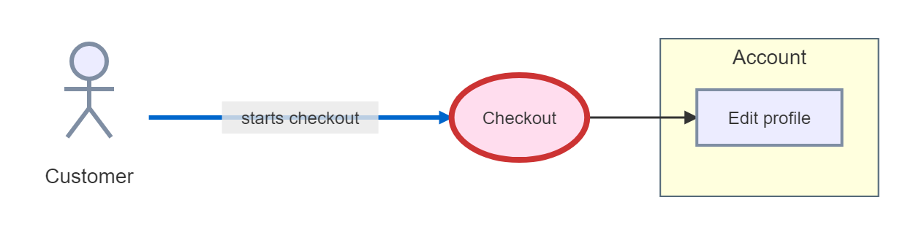
</p>


[Open in Mermaid Live](https://mermaid.live/edit#base64:eyJjb2RlIjoidXNlY2FzZS1iZXRhXG5hY3RvciBDdXN0b21lcjo6OmV4dGVybmFsXG5DaGVja291dChcdTAwMjJDaGVja291dFx1MDAyMik6Ojpjcml0aWNhbFxuc3lzdGVtQm91bmRhcnkgQWNjb3VudFxuICBQcm9maWxlW0VkaXQgcHJvZmlsZV1cbmVuZFxuQ3VzdG9tZXIgb3BlbnNALS0gXHUwMDIyc3RhcnRzIGNoZWNrb3V0XHUwMDIyIC0tLVx1MDAzRSBDaGVja291dFxuQ2hlY2tvdXQgLS1cdTAwM0UgUHJvZmlsZVxuY2xhc3NEZWYgZGVmYXVsdCBzdHJva2U6IzdmOGVhM1xuY2xhc3NEZWYgZXh0ZXJuYWwsY3JpdGljYWwgc3Ryb2tlLXdpZHRoOjNweFxuY2xhc3MgQ3VzdG9tZXIsQ2hlY2tvdXQgZXh0ZXJuYWwsY3JpdGljYWxcbnN0eWxlIENoZWNrb3V0IHN0cm9rZTojYzMzLHN0cm9rZS13aWR0aDo0cHgsZmlsbDojZmRlXG5zdHlsZSBBY2NvdW50IHN0cm9rZTojNTM2ODc4XG5zdHlsZSBvcGVucyBzdHJva2U6IzA2YyxzdHJva2Utd2lkdGg6M3B4XG5vcGVuc0B7IGFuaW1hdGlvbjogZmFzdCB9IiwibWVybWFpZCI6eyJ0aGVtZSI6ImRlZmF1bHQifX0=)

## PackageBoundaries

**Input:**
```
usecase-beta
systemBoundary sb1["Payment service"]@{ type: package }
  actor Clerk("Payment clerk")
  Authorize("Authorize payment")
  Receipt[Create receipt]
end
systemBoundary "Reporting"
  Report("Monthly report")
end
Reporting@{ type: package }
Clerk --> Authorize
Authorize --> Receipt
Receipt --> Report
```
**Rendered by Naiad:**

<p align="center">
  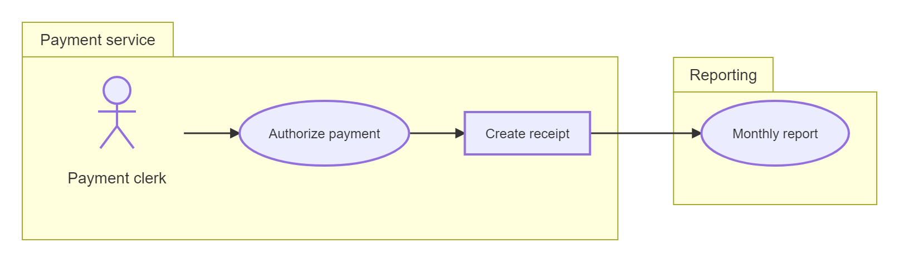
</p>


[Open in Mermaid Live](https://mermaid.live/edit#base64:eyJjb2RlIjoidXNlY2FzZS1iZXRhXG5zeXN0ZW1Cb3VuZGFyeSBzYjFbXHUwMDIyUGF5bWVudCBzZXJ2aWNlXHUwMDIyXUB7IHR5cGU6IHBhY2thZ2UgfVxuICBhY3RvciBDbGVyayhcdTAwMjJQYXltZW50IGNsZXJrXHUwMDIyKVxuICBBdXRob3JpemUoXHUwMDIyQXV0aG9yaXplIHBheW1lbnRcdTAwMjIpXG4gIFJlY2VpcHRbQ3JlYXRlIHJlY2VpcHRdXG5lbmRcbnN5c3RlbUJvdW5kYXJ5IFx1MDAyMlJlcG9ydGluZ1x1MDAyMlxuICBSZXBvcnQoXHUwMDIyTW9udGhseSByZXBvcnRcdTAwMjIpXG5lbmRcblJlcG9ydGluZ0B7IHR5cGU6IHBhY2thZ2UgfVxuQ2xlcmsgLS1cdTAwM0UgQXV0aG9yaXplXG5BdXRob3JpemUgLS1cdTAwM0UgUmVjZWlwdFxuUmVjZWlwdCAtLVx1MDAzRSBSZXBvcnQiLCJtZXJtYWlkIjp7InRoZW1lIjoiZGVmYXVsdCJ9fQ==)

## TopDown

**Input:**
```
usecase-beta
direction TB
actor Customer
actor Clerk
systemBoundary Shop
  Browse("Browse catalogue")
  Order("Place order")
  Pay("Pay")
end
Customer --> Browse
Customer --> Order
Order ..> : include Pay
Clerk --> Order
```
**Rendered by Naiad:**

<p align="center">
  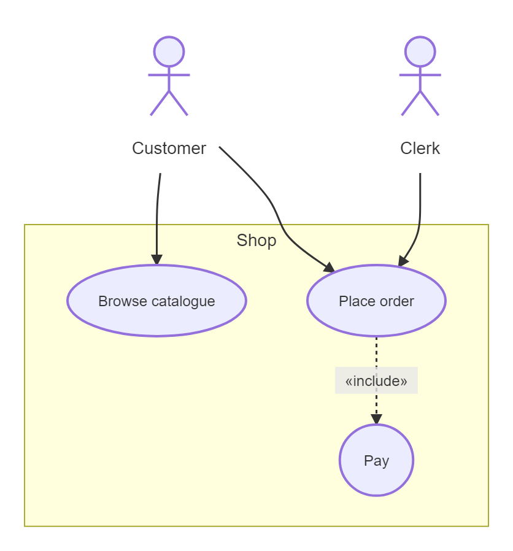
</p>


[Open in Mermaid Live](https://mermaid.live/edit#base64:eyJjb2RlIjoidXNlY2FzZS1iZXRhXG5kaXJlY3Rpb24gVEJcbmFjdG9yIEN1c3RvbWVyXG5hY3RvciBDbGVya1xuc3lzdGVtQm91bmRhcnkgU2hvcFxuICBCcm93c2UoXHUwMDIyQnJvd3NlIGNhdGFsb2d1ZVx1MDAyMilcbiAgT3JkZXIoXHUwMDIyUGxhY2Ugb3JkZXJcdTAwMjIpXG4gIFBheShcdTAwMjJQYXlcdTAwMjIpXG5lbmRcbkN1c3RvbWVyIC0tXHUwMDNFIEJyb3dzZVxuQ3VzdG9tZXIgLS1cdTAwM0UgT3JkZXJcbk9yZGVyIC4uXHUwMDNFIDogaW5jbHVkZSBQYXlcbkNsZXJrIC0tXHUwMDNFIE9yZGVyIiwibWVybWFpZCI6eyJ0aGVtZSI6ImRlZmF1bHQifX0=)

## FrontMatterTitle

**Input:**
```
---
title: Account access
---
usecase-beta
accTitle: Account access use cases
accDescr {
  A customer signs in and can reset a password.
}
%% Actors are declared explicitly.
actor Customer

SignIn("Sign in")
Reset("Reset password")
Customer --> SignIn
Customer --> Reset
```
**Rendered by Naiad:**

<p align="center">
  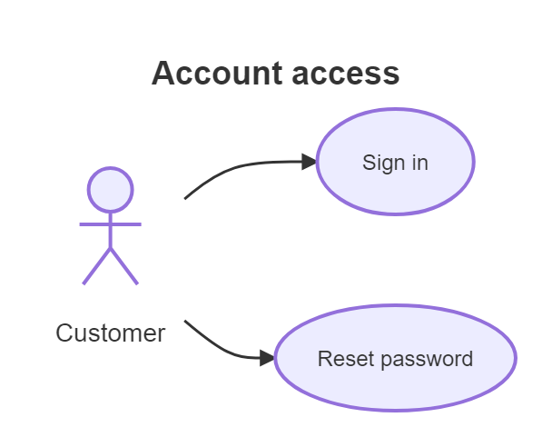
</p>


[Open in Mermaid Live](https://mermaid.live/edit#base64:eyJjb2RlIjoiLS0tXG50aXRsZTogQWNjb3VudCBhY2Nlc3Ncbi0tLVxudXNlY2FzZS1iZXRhXG5hY2NUaXRsZTogQWNjb3VudCBhY2Nlc3MgdXNlIGNhc2VzXG5hY2NEZXNjciB7XG4gIEEgY3VzdG9tZXIgc2lnbnMgaW4gYW5kIGNhbiByZXNldCBhIHBhc3N3b3JkLlxufVxuJSUgQWN0b3JzIGFyZSBkZWNsYXJlZCBleHBsaWNpdGx5LlxuYWN0b3IgQ3VzdG9tZXJcblxuU2lnbkluKFx1MDAyMlNpZ24gaW5cdTAwMjIpXG5SZXNldChcdTAwMjJSZXNldCBwYXNzd29yZFx1MDAyMilcbkN1c3RvbWVyIC0tXHUwMDNFIFNpZ25JblxuQ3VzdG9tZXIgLS1cdTAwM0UgUmVzZXQiLCJtZXJtYWlkIjp7InRoZW1lIjoiZGVmYXVsdCJ9fQ==)

## CompleteExample

**Input:**
```
usecase-beta
direction LR
accTitle: Online ordering use cases
accDescr {
  A customer places an order through the storefront.
  Staff review the order and inspect its data.
}
actor Customer("Customer")
actor Staff("Order staff")@{ type: hollow, business: true } <<Employee>>
systemBoundary ordering["Ordering System"]@{ type: package }:::system
  Browse("Browse products")
  Checkout("Checkout") <<Core>>:::critical
  Payment("Process payment")
  Review[Review order]
end
json OrderData@{
  "status": "pending",
  "items": [{ "name": "Book", "quantity": 1 }],
  "total": 29.95
}:::data
note for Checkout "`Validates the **cart** before payment`"
Customer starts@-- "places order" ---> Checkout
Customer --> Browse
Checkout pays@..> : include Payment
Staff --> Review
Review --> OrderData
classDef system stroke:#c8a02a,stroke-width:2px
classDef critical stroke:#c33,stroke-width:3px
classDef data stroke:#3572a5
starts@{ animation: fast }
style pays stroke:#6b46c1,stroke-width:2px
```
**Rendered by Naiad:**

<p align="center">
  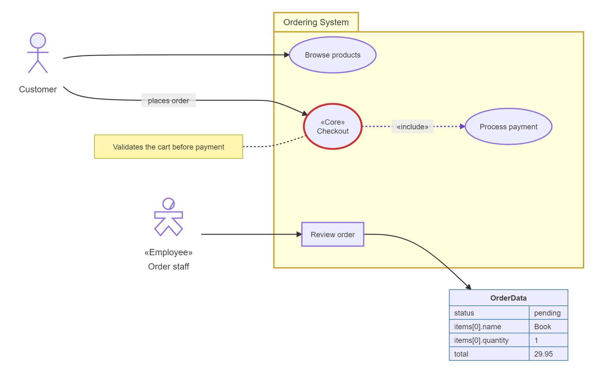
</p>


[Open in Mermaid Live](https://mermaid.live/edit#base64:eyJjb2RlIjoidXNlY2FzZS1iZXRhXG5kaXJlY3Rpb24gTFJcbmFjY1RpdGxlOiBPbmxpbmUgb3JkZXJpbmcgdXNlIGNhc2VzXG5hY2NEZXNjciB7XG4gIEEgY3VzdG9tZXIgcGxhY2VzIGFuIG9yZGVyIHRocm91Z2ggdGhlIHN0b3JlZnJvbnQuXG4gIFN0YWZmIHJldmlldyB0aGUgb3JkZXIgYW5kIGluc3BlY3QgaXRzIGRhdGEuXG59XG5hY3RvciBDdXN0b21lcihcdTAwMjJDdXN0b21lclx1MDAyMilcbmFjdG9yIFN0YWZmKFx1MDAyMk9yZGVyIHN0YWZmXHUwMDIyKUB7IHR5cGU6IGhvbGxvdywgYnVzaW5lc3M6IHRydWUgfSBcdTAwM0NcdTAwM0NFbXBsb3llZVx1MDAzRVx1MDAzRVxuc3lzdGVtQm91bmRhcnkgb3JkZXJpbmdbXHUwMDIyT3JkZXJpbmcgU3lzdGVtXHUwMDIyXUB7IHR5cGU6IHBhY2thZ2UgfTo6OnN5c3RlbVxuICBCcm93c2UoXHUwMDIyQnJvd3NlIHByb2R1Y3RzXHUwMDIyKVxuICBDaGVja291dChcdTAwMjJDaGVja291dFx1MDAyMikgXHUwMDNDXHUwMDNDQ29yZVx1MDAzRVx1MDAzRTo6OmNyaXRpY2FsXG4gIFBheW1lbnQoXHUwMDIyUHJvY2VzcyBwYXltZW50XHUwMDIyKVxuICBSZXZpZXdbUmV2aWV3IG9yZGVyXVxuZW5kXG5qc29uIE9yZGVyRGF0YUB7XG4gIFx1MDAyMnN0YXR1c1x1MDAyMjogXHUwMDIycGVuZGluZ1x1MDAyMixcbiAgXHUwMDIyaXRlbXNcdTAwMjI6IFt7IFx1MDAyMm5hbWVcdTAwMjI6IFx1MDAyMkJvb2tcdTAwMjIsIFx1MDAyMnF1YW50aXR5XHUwMDIyOiAxIH1dLFxuICBcdTAwMjJ0b3RhbFx1MDAyMjogMjkuOTVcbn06OjpkYXRhXG5ub3RlIGZvciBDaGVja291dCBcdTAwMjJcdTAwNjBWYWxpZGF0ZXMgdGhlICoqY2FydCoqIGJlZm9yZSBwYXltZW50XHUwMDYwXHUwMDIyXG5DdXN0b21lciBzdGFydHNALS0gXHUwMDIycGxhY2VzIG9yZGVyXHUwMDIyIC0tLVx1MDAzRSBDaGVja291dFxuQ3VzdG9tZXIgLS1cdTAwM0UgQnJvd3NlXG5DaGVja291dCBwYXlzQC4uXHUwMDNFIDogaW5jbHVkZSBQYXltZW50XG5TdGFmZiAtLVx1MDAzRSBSZXZpZXdcblJldmlldyAtLVx1MDAzRSBPcmRlckRhdGFcbmNsYXNzRGVmIHN5c3RlbSBzdHJva2U6I2M4YTAyYSxzdHJva2Utd2lkdGg6MnB4XG5jbGFzc0RlZiBjcml0aWNhbCBzdHJva2U6I2MzMyxzdHJva2Utd2lkdGg6M3B4XG5jbGFzc0RlZiBkYXRhIHN0cm9rZTojMzU3MmE1XG5zdGFydHNAeyBhbmltYXRpb246IGZhc3QgfVxuc3R5bGUgcGF5cyBzdHJva2U6IzZiNDZjMSxzdHJva2Utd2lkdGg6MnB4IiwibWVybWFpZCI6eyJ0aGVtZSI6ImRlZmF1bHQifX0=)

## Empty

**Input:**
```
usecase-beta
```
**Rendered by Naiad:**

<p align="center">
  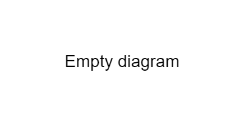
</p>


[Open in Mermaid Live](https://mermaid.live/edit#base64:eyJjb2RlIjoidXNlY2FzZS1iZXRhIiwibWVybWFpZCI6eyJ0aGVtZSI6ImRlZmF1bHQifX0=)

