# Venn

## TwoSets

**Input:**
```
venn-beta
  title "Team overlap"
  set Frontend
  set Backend
  union Frontend,Backend["APIs"]
```
**Rendered by Naiad:**

<p align="center">
  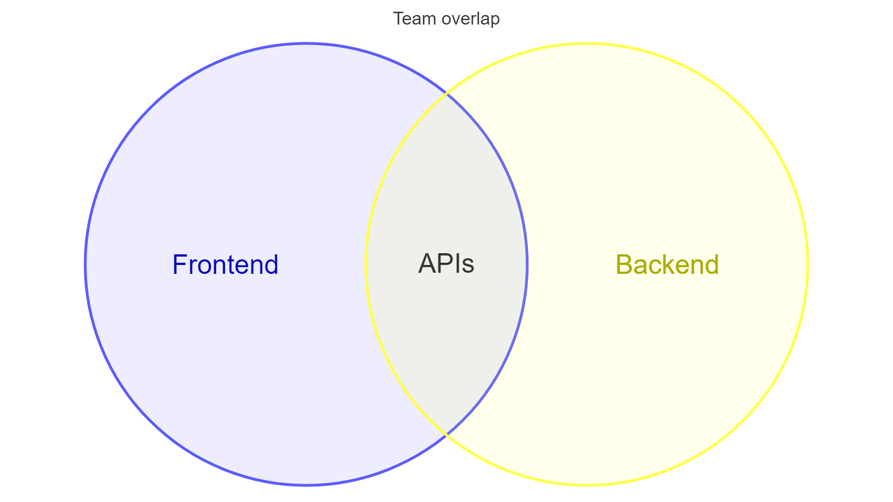
</p>


[Open in Mermaid Live](https://mermaid.live/edit#base64:eyJjb2RlIjoidmVubi1iZXRhXG4gIHRpdGxlIFx1MDAyMlRlYW0gb3ZlcmxhcFx1MDAyMlxuICBzZXQgRnJvbnRlbmRcbiAgc2V0IEJhY2tlbmRcbiAgdW5pb24gRnJvbnRlbmQsQmFja2VuZFtcdTAwMjJBUElzXHUwMDIyXSIsIm1lcm1haWQiOnsidGhlbWUiOiJkZWZhdWx0In19)

## ThreeSetsWithTitle

**Input:**
```
venn-beta
  title What makes a good feature
  set Desirable
  set Feasible
  set Viable
  union Desirable,Feasible["Buildable"]
  union Feasible,Viable["Sustainable"]
  union Desirable,Viable["Marketable"]
  union Desirable,Feasible,Viable["Ship it"]
```
**Rendered by Naiad:**

<p align="center">
  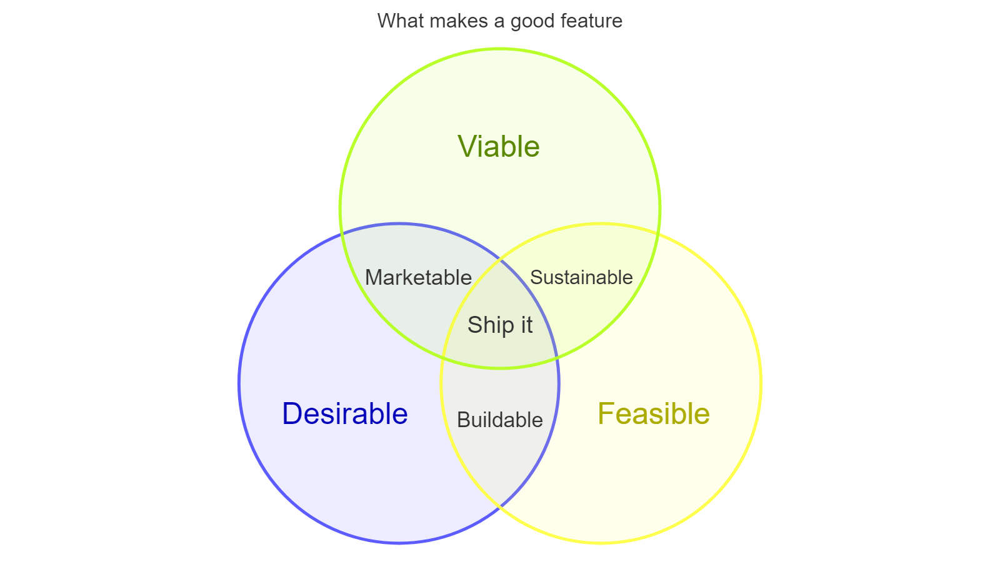
</p>


[Open in Mermaid Live](https://mermaid.live/edit#base64:eyJjb2RlIjoidmVubi1iZXRhXG4gIHRpdGxlIFdoYXQgbWFrZXMgYSBnb29kIGZlYXR1cmVcbiAgc2V0IERlc2lyYWJsZVxuICBzZXQgRmVhc2libGVcbiAgc2V0IFZpYWJsZVxuICB1bmlvbiBEZXNpcmFibGUsRmVhc2libGVbXHUwMDIyQnVpbGRhYmxlXHUwMDIyXVxuICB1bmlvbiBGZWFzaWJsZSxWaWFibGVbXHUwMDIyU3VzdGFpbmFibGVcdTAwMjJdXG4gIHVuaW9uIERlc2lyYWJsZSxWaWFibGVbXHUwMDIyTWFya2V0YWJsZVx1MDAyMl1cbiAgdW5pb24gRGVzaXJhYmxlLEZlYXNpYmxlLFZpYWJsZVtcdTAwMjJTaGlwIGl0XHUwMDIyXSIsIm1lcm1haWQiOnsidGhlbWUiOiJkZWZhdWx0In19)

## HigherArityUnion

**Input:**
```
venn-beta
  set Desirable
  set Feasible
  set Viable
  union Desirable,Feasible,Viable["Innovation"]
```
**Rendered by Naiad:**

<p align="center">
  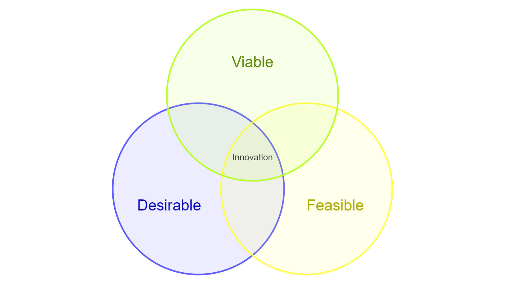
</p>


[Open in Mermaid Live](https://mermaid.live/edit#base64:eyJjb2RlIjoidmVubi1iZXRhXG4gIHNldCBEZXNpcmFibGVcbiAgc2V0IEZlYXNpYmxlXG4gIHNldCBWaWFibGVcbiAgdW5pb24gRGVzaXJhYmxlLEZlYXNpYmxlLFZpYWJsZVtcdTAwMjJJbm5vdmF0aW9uXHUwMDIyXSIsIm1lcm1haWQiOnsidGhlbWUiOiJkZWZhdWx0In19)

## Sizes

**Input:**
```
venn-beta
  set A["Alpha"]:20
  set B["Beta"]:12
  union A,B["AB"]:3
```
**Rendered by Naiad:**

<p align="center">
  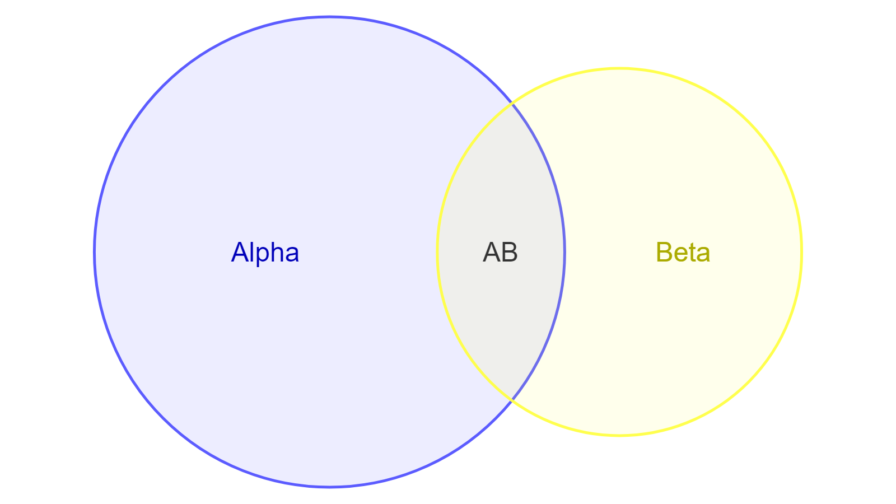
</p>


[Open in Mermaid Live](https://mermaid.live/edit#base64:eyJjb2RlIjoidmVubi1iZXRhXG4gIHNldCBBW1x1MDAyMkFscGhhXHUwMDIyXToyMFxuICBzZXQgQltcdTAwMjJCZXRhXHUwMDIyXToxMlxuICB1bmlvbiBBLEJbXHUwMDIyQUJcdTAwMjJdOjMiLCJtZXJtYWlkIjp7InRoZW1lIjoiZGVmYXVsdCJ9fQ==)

## TextNodes

**Input:**
```
venn-beta
  set A["Frontend"]
    text A1["React"]
    text A2["Design Systems"]
  set B["Backend"]
    text B1["API"]
  union A,B["Shared"]
    text AB1["OpenAPI"]
```
**Rendered by Naiad:**

<p align="center">
  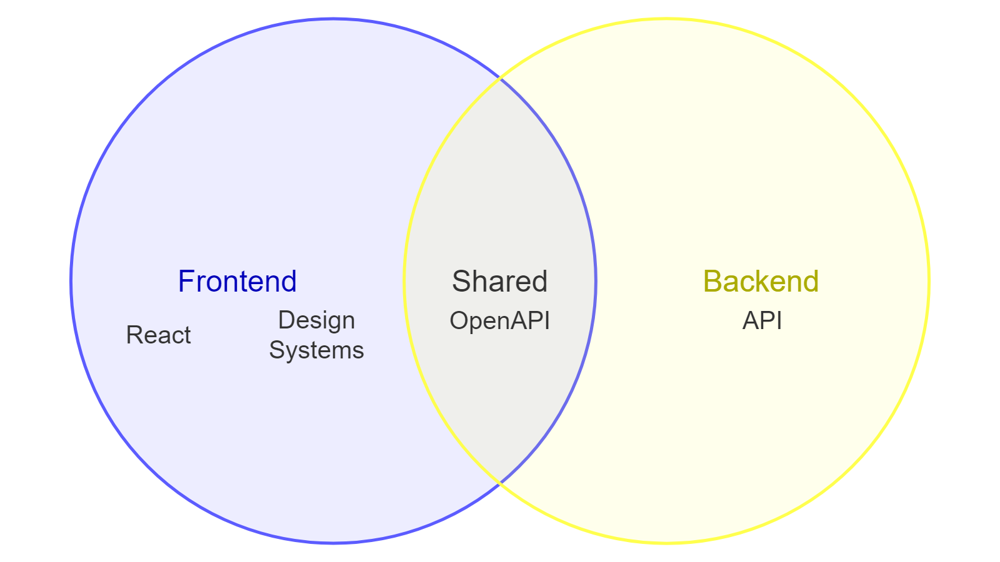
</p>


[Open in Mermaid Live](https://mermaid.live/edit#base64:eyJjb2RlIjoidmVubi1iZXRhXG4gIHNldCBBW1x1MDAyMkZyb250ZW5kXHUwMDIyXVxuICAgIHRleHQgQTFbXHUwMDIyUmVhY3RcdTAwMjJdXG4gICAgdGV4dCBBMltcdTAwMjJEZXNpZ24gU3lzdGVtc1x1MDAyMl1cbiAgc2V0IEJbXHUwMDIyQmFja2VuZFx1MDAyMl1cbiAgICB0ZXh0IEIxW1x1MDAyMkFQSVx1MDAyMl1cbiAgdW5pb24gQSxCW1x1MDAyMlNoYXJlZFx1MDAyMl1cbiAgICB0ZXh0IEFCMVtcdTAwMjJPcGVuQVBJXHUwMDIyXSIsIm1lcm1haWQiOnsidGhlbWUiOiJkZWZhdWx0In19)

## Styles

**Input:**
```
venn-beta
  set A["Alpha"]:20
    text A1["React"]
    text A2["Design Systems"]
  set B["Beta"]:12
  union A,B["AB"]:3
  style A fill:#ff6b6b
  style A,B color:#333
  style A1 color:red
```
**Rendered by Naiad:**

<p align="center">
  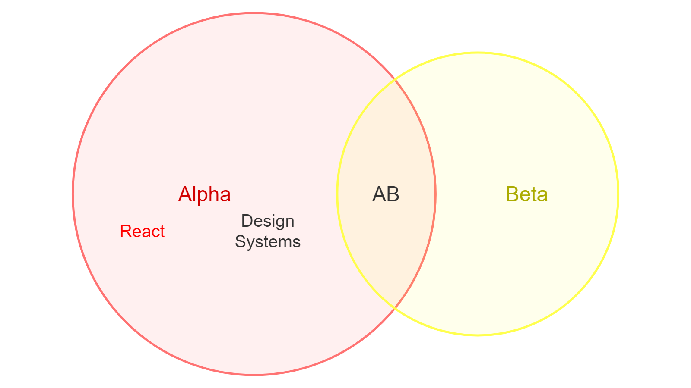
</p>


[Open in Mermaid Live](https://mermaid.live/edit#base64:eyJjb2RlIjoidmVubi1iZXRhXG4gIHNldCBBW1x1MDAyMkFscGhhXHUwMDIyXToyMFxuICAgIHRleHQgQTFbXHUwMDIyUmVhY3RcdTAwMjJdXG4gICAgdGV4dCBBMltcdTAwMjJEZXNpZ24gU3lzdGVtc1x1MDAyMl1cbiAgc2V0IEJbXHUwMDIyQmV0YVx1MDAyMl06MTJcbiAgdW5pb24gQSxCW1x1MDAyMkFCXHUwMDIyXTozXG4gIHN0eWxlIEEgZmlsbDojZmY2YjZiXG4gIHN0eWxlIEEsQiBjb2xvcjojMzMzXG4gIHN0eWxlIEExIGNvbG9yOnJlZCIsIm1lcm1haWQiOnsidGhlbWUiOiJkZWZhdWx0In19)

## StyledUnionAndStroke

**Input:**
```
venn-beta
  set A
  set B
  union A,B["Both"]
  style A,B fill:#ffd700, color:#000
  style B stroke:#000, stroke-width:4, fill-opacity:0.3
```
**Rendered by Naiad:**

<p align="center">
  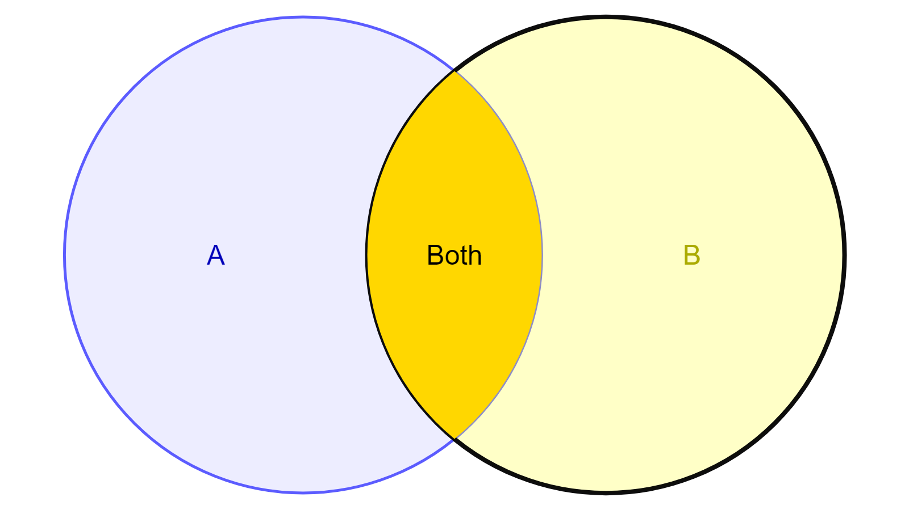
</p>


[Open in Mermaid Live](https://mermaid.live/edit#base64:eyJjb2RlIjoidmVubi1iZXRhXG4gIHNldCBBXG4gIHNldCBCXG4gIHVuaW9uIEEsQltcdTAwMjJCb3RoXHUwMDIyXVxuICBzdHlsZSBBLEIgZmlsbDojZmZkNzAwLCBjb2xvcjojMDAwXG4gIHN0eWxlIEIgc3Ryb2tlOiMwMDAsIHN0cm9rZS13aWR0aDo0LCBmaWxsLW9wYWNpdHk6MC4zIiwibWVybWFpZCI6eyJ0aGVtZSI6ImRlZmF1bHQifX0=)

## SingleSet

**Input:**
```
venn-beta
  set Everything
```
**Rendered by Naiad:**

<p align="center">
  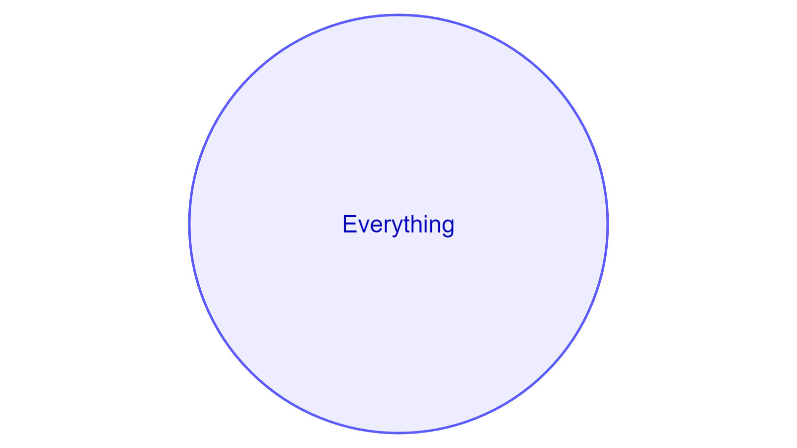
</p>


[Open in Mermaid Live](https://mermaid.live/edit#base64:eyJjb2RlIjoidmVubi1iZXRhXG4gIHNldCBFdmVyeXRoaW5nIiwibWVybWFpZCI6eyJ0aGVtZSI6ImRlZmF1bHQifX0=)

## DisjointSets

**Input:**
```
venn-beta
  set Cats
  set Dogs
  set Fish:5
```
**Rendered by Naiad:**

<p align="center">
  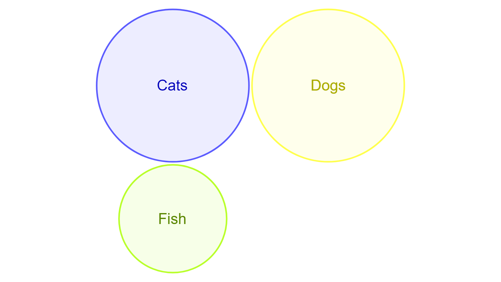
</p>


[Open in Mermaid Live](https://mermaid.live/edit#base64:eyJjb2RlIjoidmVubi1iZXRhXG4gIHNldCBDYXRzXG4gIHNldCBEb2dzXG4gIHNldCBGaXNoOjUiLCJtZXJtYWlkIjp7InRoZW1lIjoiZGVmYXVsdCJ9fQ==)

## ManySets

**Input:**
```
venn-beta
  title Programming languages
  set Python
  set JavaScript
  set Rust
  set Go
  set Haskell:6
  union Python,JavaScript["Scripting"]
  union JavaScript,Rust["WebAssembly"]
  union Rust,Go["Systems"]
  union Go,Python["Tooling"]
  union Rust,Haskell["Type nerds"]
```
**Rendered by Naiad:**

<p align="center">
  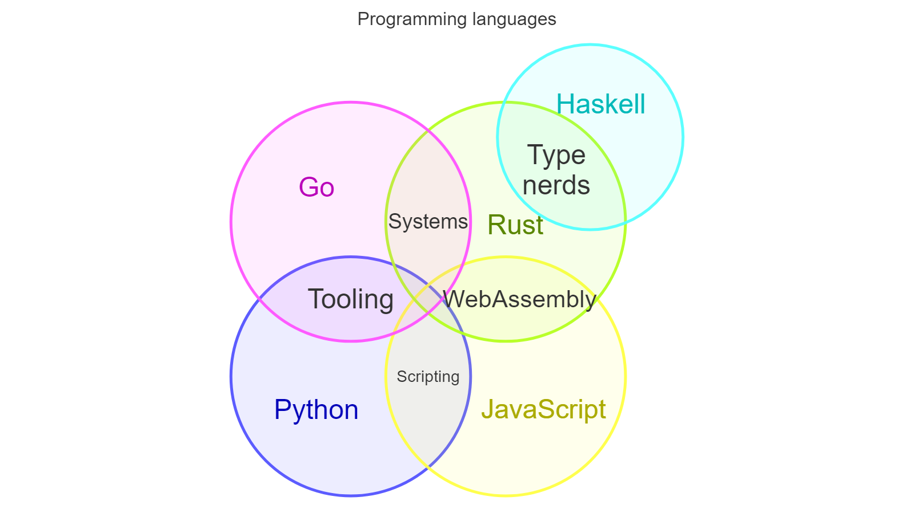
</p>


[Open in Mermaid Live](https://mermaid.live/edit#base64:eyJjb2RlIjoidmVubi1iZXRhXG4gIHRpdGxlIFByb2dyYW1taW5nIGxhbmd1YWdlc1xuICBzZXQgUHl0aG9uXG4gIHNldCBKYXZhU2NyaXB0XG4gIHNldCBSdXN0XG4gIHNldCBHb1xuICBzZXQgSGFza2VsbDo2XG4gIHVuaW9uIFB5dGhvbixKYXZhU2NyaXB0W1x1MDAyMlNjcmlwdGluZ1x1MDAyMl1cbiAgdW5pb24gSmF2YVNjcmlwdCxSdXN0W1x1MDAyMldlYkFzc2VtYmx5XHUwMDIyXVxuICB1bmlvbiBSdXN0LEdvW1x1MDAyMlN5c3RlbXNcdTAwMjJdXG4gIHVuaW9uIEdvLFB5dGhvbltcdTAwMjJUb29saW5nXHUwMDIyXVxuICB1bmlvbiBSdXN0LEhhc2tlbGxbXHUwMDIyVHlwZSBuZXJkc1x1MDAyMl0iLCJtZXJtYWlkIjp7InRoZW1lIjoiZGVmYXVsdCJ9fQ==)

## LongLabels

**Input:**
```
venn-beta
  title A rather long title for a diagram about overlapping areas of responsibility
  set Ops["Operations and infrastructure engineering"]
  set Dev["Product development and feature delivery"]
  union Ops,Dev["Continuous delivery pipelines and observability"]
    text P1["Deployment automation tooling"]
```
**Rendered by Naiad:**

<p align="center">
  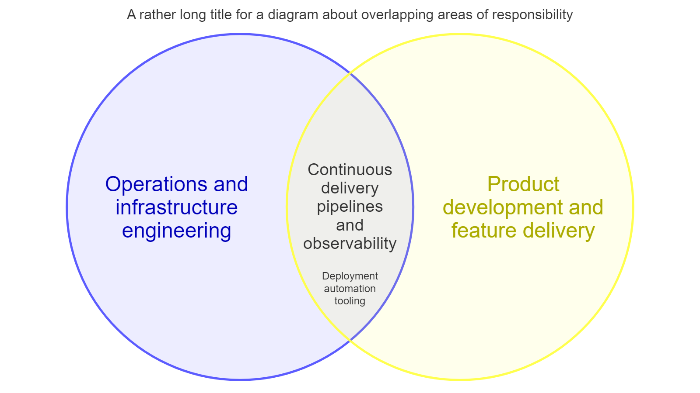
</p>


[Open in Mermaid Live](https://mermaid.live/edit#base64:eyJjb2RlIjoidmVubi1iZXRhXG4gIHRpdGxlIEEgcmF0aGVyIGxvbmcgdGl0bGUgZm9yIGEgZGlhZ3JhbSBhYm91dCBvdmVybGFwcGluZyBhcmVhcyBvZiByZXNwb25zaWJpbGl0eVxuICBzZXQgT3BzW1x1MDAyMk9wZXJhdGlvbnMgYW5kIGluZnJhc3RydWN0dXJlIGVuZ2luZWVyaW5nXHUwMDIyXVxuICBzZXQgRGV2W1x1MDAyMlByb2R1Y3QgZGV2ZWxvcG1lbnQgYW5kIGZlYXR1cmUgZGVsaXZlcnlcdTAwMjJdXG4gIHVuaW9uIE9wcyxEZXZbXHUwMDIyQ29udGludW91cyBkZWxpdmVyeSBwaXBlbGluZXMgYW5kIG9ic2VydmFiaWxpdHlcdTAwMjJdXG4gICAgdGV4dCBQMVtcdTAwMjJEZXBsb3ltZW50IGF1dG9tYXRpb24gdG9vbGluZ1x1MDAyMl0iLCJtZXJtYWlkIjp7InRoZW1lIjoiZGVmYXVsdCJ9fQ==)

## Empty

**Input:**
```
venn-beta
  title Nothing yet
```
**Rendered by Naiad:**

<p align="center">
  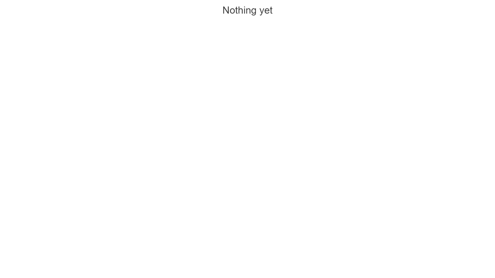
</p>


[Open in Mermaid Live](https://mermaid.live/edit#base64:eyJjb2RlIjoidmVubi1iZXRhXG4gIHRpdGxlIE5vdGhpbmcgeWV0IiwibWVybWFpZCI6eyJ0aGVtZSI6ImRlZmF1bHQifX0=)

