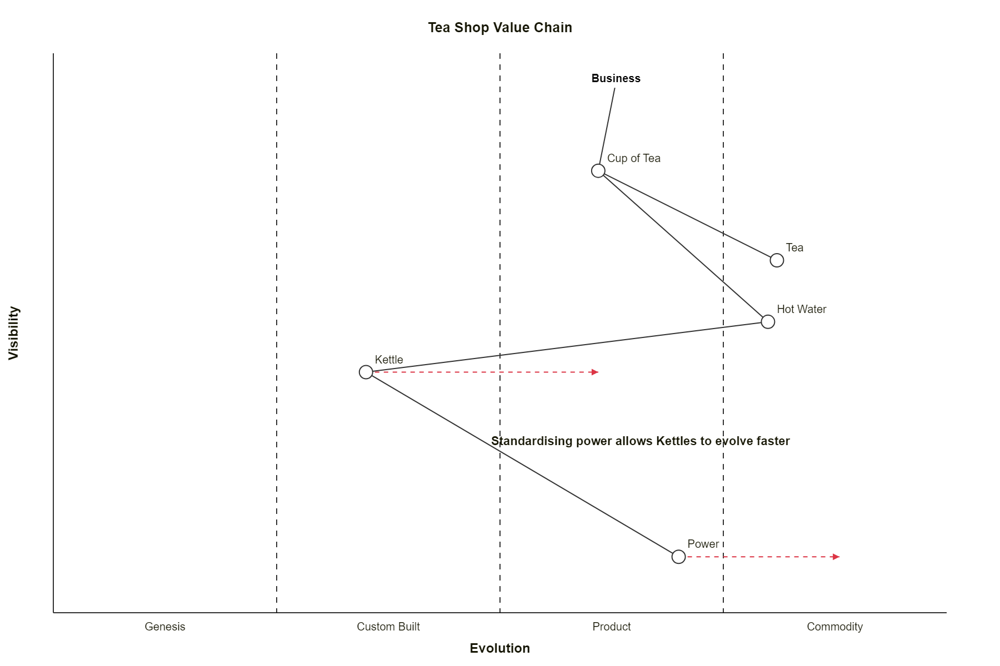
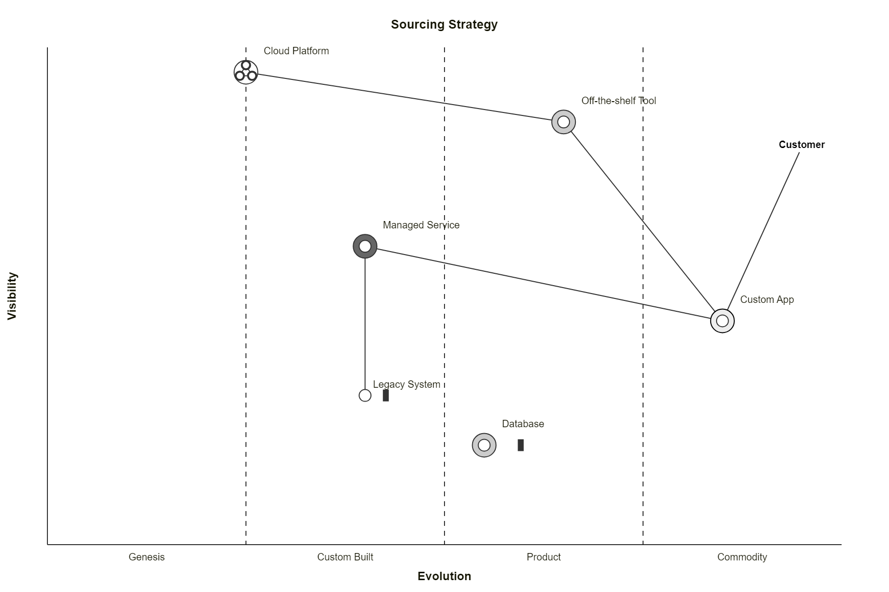
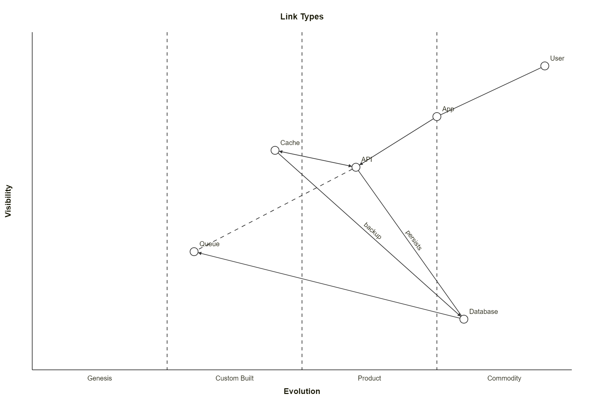
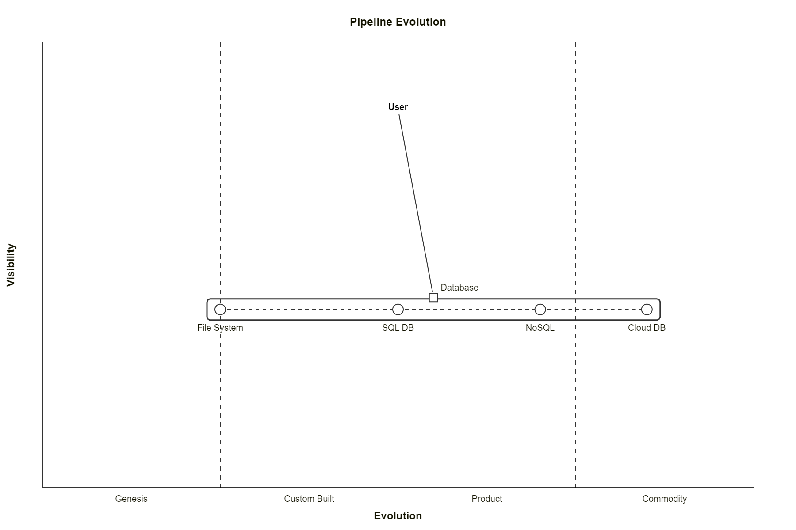
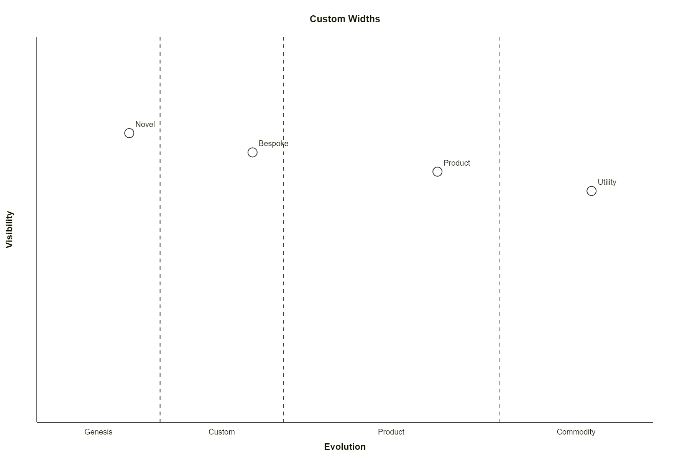
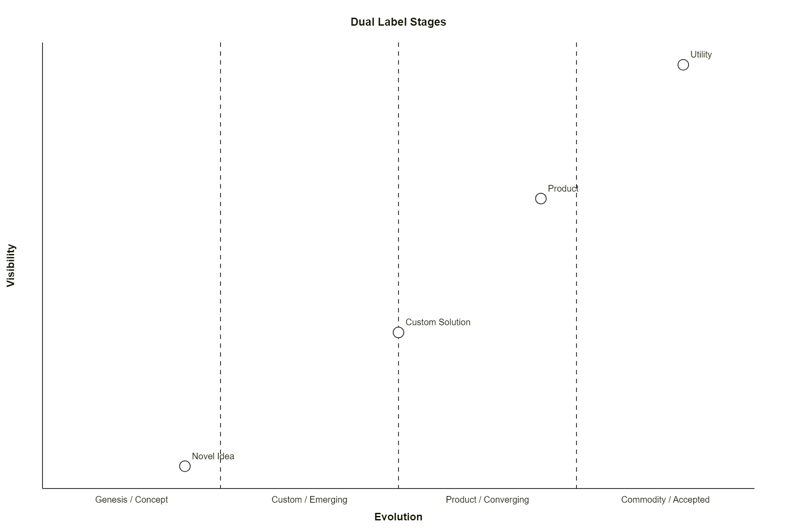
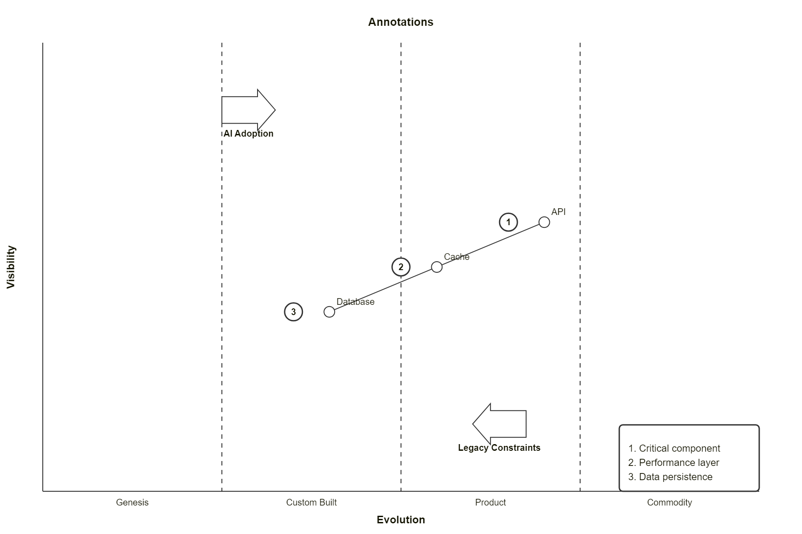
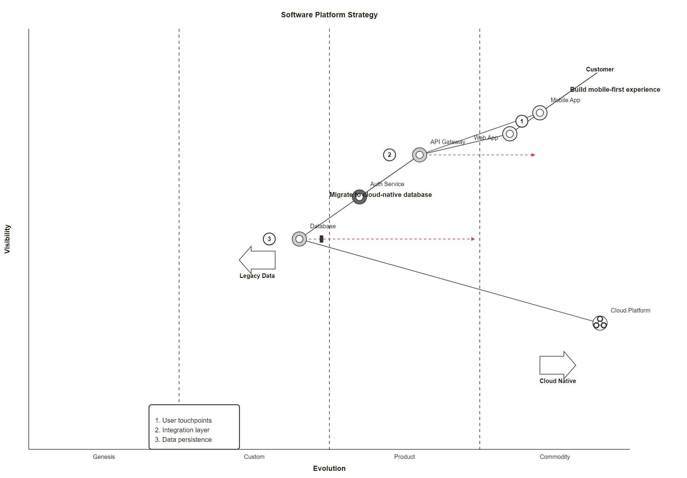
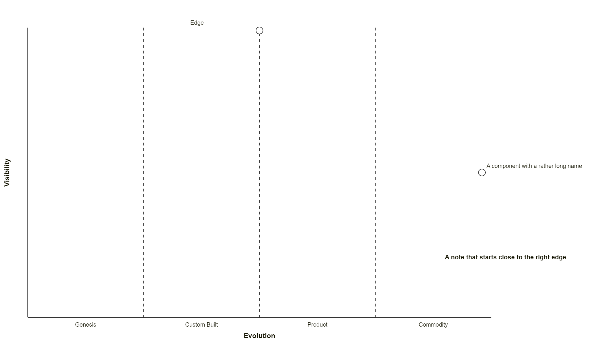
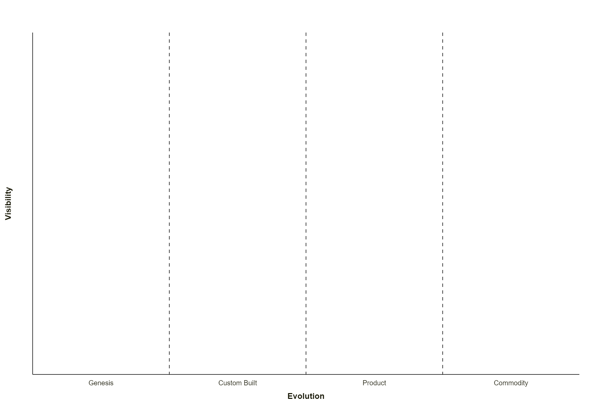

# Wardley

## TeaShop

**Input:**
```
wardley-beta
title Tea Shop Value Chain

anchor Business [0.95, 0.63]
component Cup of Tea [0.79, 0.61]
component Tea [0.63, 0.81]
component Hot Water [0.52, 0.80]
component Kettle [0.43, 0.35]
component Power [0.10, 0.70]

Business -> Cup of Tea
Cup of Tea -> Tea
Cup of Tea -> Hot Water
Hot Water -> Kettle
Kettle -> Power

evolve Kettle 0.62
evolve Power 0.89

note "Standardising power allows Kettles to evolve faster" [0.30, 0.49]
```
**Rendered by Naiad:**

<p align="center">
  
</p>


[Open in Mermaid Live](https://mermaid.live/edit#base64:eyJjb2RlIjoid2FyZGxleS1iZXRhXG50aXRsZSBUZWEgU2hvcCBWYWx1ZSBDaGFpblxuXG5hbmNob3IgQnVzaW5lc3MgWzAuOTUsIDAuNjNdXG5jb21wb25lbnQgQ3VwIG9mIFRlYSBbMC43OSwgMC42MV1cbmNvbXBvbmVudCBUZWEgWzAuNjMsIDAuODFdXG5jb21wb25lbnQgSG90IFdhdGVyIFswLjUyLCAwLjgwXVxuY29tcG9uZW50IEtldHRsZSBbMC40MywgMC4zNV1cbmNvbXBvbmVudCBQb3dlciBbMC4xMCwgMC43MF1cblxuQnVzaW5lc3MgLVx1MDAzRSBDdXAgb2YgVGVhXG5DdXAgb2YgVGVhIC1cdTAwM0UgVGVhXG5DdXAgb2YgVGVhIC1cdTAwM0UgSG90IFdhdGVyXG5Ib3QgV2F0ZXIgLVx1MDAzRSBLZXR0bGVcbktldHRsZSAtXHUwMDNFIFBvd2VyXG5cbmV2b2x2ZSBLZXR0bGUgMC42MlxuZXZvbHZlIFBvd2VyIDAuODlcblxubm90ZSBcdTAwMjJTdGFuZGFyZGlzaW5nIHBvd2VyIGFsbG93cyBLZXR0bGVzIHRvIGV2b2x2ZSBmYXN0ZXJcdTAwMjIgWzAuMzAsIDAuNDldIiwibWVybWFpZCI6eyJ0aGVtZSI6ImRlZmF1bHQifX0=)

## SourcingStrategyAndInertia

**Input:**
```
wardley-beta
title Sourcing Strategy

anchor Customer [0.80, 0.95]
component Custom App [0.45, 0.85] (build)
component Off-the-shelf Tool [0.85, 0.65] (buy)
component Managed Service [0.60, 0.40] (outsource)
component Cloud Platform [0.95, 0.25] (market)
component Legacy System [0.30, 0.40] (inertia)
component Database [0.20, 0.55] (buy) (inertia)

Customer -> Custom App
Custom App -> Off-the-shelf Tool
Custom App -> Managed Service
Off-the-shelf Tool -> Cloud Platform
Managed Service -> Legacy System
```
**Rendered by Naiad:**

<p align="center">
  
</p>


[Open in Mermaid Live](https://mermaid.live/edit#base64:eyJjb2RlIjoid2FyZGxleS1iZXRhXG50aXRsZSBTb3VyY2luZyBTdHJhdGVneVxuXG5hbmNob3IgQ3VzdG9tZXIgWzAuODAsIDAuOTVdXG5jb21wb25lbnQgQ3VzdG9tIEFwcCBbMC40NSwgMC44NV0gKGJ1aWxkKVxuY29tcG9uZW50IE9mZi10aGUtc2hlbGYgVG9vbCBbMC44NSwgMC42NV0gKGJ1eSlcbmNvbXBvbmVudCBNYW5hZ2VkIFNlcnZpY2UgWzAuNjAsIDAuNDBdIChvdXRzb3VyY2UpXG5jb21wb25lbnQgQ2xvdWQgUGxhdGZvcm0gWzAuOTUsIDAuMjVdIChtYXJrZXQpXG5jb21wb25lbnQgTGVnYWN5IFN5c3RlbSBbMC4zMCwgMC40MF0gKGluZXJ0aWEpXG5jb21wb25lbnQgRGF0YWJhc2UgWzAuMjAsIDAuNTVdIChidXkpIChpbmVydGlhKVxuXG5DdXN0b21lciAtXHUwMDNFIEN1c3RvbSBBcHBcbkN1c3RvbSBBcHAgLVx1MDAzRSBPZmYtdGhlLXNoZWxmIFRvb2xcbkN1c3RvbSBBcHAgLVx1MDAzRSBNYW5hZ2VkIFNlcnZpY2Vcbk9mZi10aGUtc2hlbGYgVG9vbCAtXHUwMDNFIENsb3VkIFBsYXRmb3JtXG5NYW5hZ2VkIFNlcnZpY2UgLVx1MDAzRSBMZWdhY3kgU3lzdGVtIiwibWVybWFpZCI6eyJ0aGVtZSI6ImRlZmF1bHQifX0=)

## LinkTypes

**Input:**
```
wardley-beta
title Link Types

component User [0.90, 0.95]
component App [0.75, 0.75]
component API [0.60, 0.60]
component Cache [0.65, 0.45]
component Database [0.15, 0.80]
component Queue [0.35, 0.30]

User -> App
App +> API
API -> Database; persists
API +<> Cache
Cache +'backup'> Database
API -.-> Queue
Queue +< Database
```
**Rendered by Naiad:**

<p align="center">
  
</p>


[Open in Mermaid Live](https://mermaid.live/edit#base64:eyJjb2RlIjoid2FyZGxleS1iZXRhXG50aXRsZSBMaW5rIFR5cGVzXG5cbmNvbXBvbmVudCBVc2VyIFswLjkwLCAwLjk1XVxuY29tcG9uZW50IEFwcCBbMC43NSwgMC43NV1cbmNvbXBvbmVudCBBUEkgWzAuNjAsIDAuNjBdXG5jb21wb25lbnQgQ2FjaGUgWzAuNjUsIDAuNDVdXG5jb21wb25lbnQgRGF0YWJhc2UgWzAuMTUsIDAuODBdXG5jb21wb25lbnQgUXVldWUgWzAuMzUsIDAuMzBdXG5cblVzZXIgLVx1MDAzRSBBcHBcbkFwcCBcdTAwMkJcdTAwM0UgQVBJXG5BUEkgLVx1MDAzRSBEYXRhYmFzZTsgcGVyc2lzdHNcbkFQSSBcdTAwMkJcdTAwM0NcdTAwM0UgQ2FjaGVcbkNhY2hlIFx1MDAyQlx1MDAyN2JhY2t1cFx1MDAyN1x1MDAzRSBEYXRhYmFzZVxuQVBJIC0uLVx1MDAzRSBRdWV1ZVxuUXVldWUgXHUwMDJCXHUwMDNDIERhdGFiYXNlIiwibWVybWFpZCI6eyJ0aGVtZSI6ImRlZmF1bHQifX0=)

## Pipeline

**Input:**
```
wardley-beta
title Pipeline Evolution

anchor User [0.85, 0.50]
component Database [0.40, 0.60]

pipeline Database {
  component "File System" [0.25]
  component "SQL DB" [0.50]
  component "NoSQL" [0.70]
  component "Cloud DB" [0.85]
}

User -> Database
"SQL DB" -> Database
```
**Rendered by Naiad:**

<p align="center">
  
</p>


[Open in Mermaid Live](https://mermaid.live/edit#base64:eyJjb2RlIjoid2FyZGxleS1iZXRhXG50aXRsZSBQaXBlbGluZSBFdm9sdXRpb25cblxuYW5jaG9yIFVzZXIgWzAuODUsIDAuNTBdXG5jb21wb25lbnQgRGF0YWJhc2UgWzAuNDAsIDAuNjBdXG5cbnBpcGVsaW5lIERhdGFiYXNlIHtcbiAgY29tcG9uZW50IFx1MDAyMkZpbGUgU3lzdGVtXHUwMDIyIFswLjI1XVxuICBjb21wb25lbnQgXHUwMDIyU1FMIERCXHUwMDIyIFswLjUwXVxuICBjb21wb25lbnQgXHUwMDIyTm9TUUxcdTAwMjIgWzAuNzBdXG4gIGNvbXBvbmVudCBcdTAwMjJDbG91ZCBEQlx1MDAyMiBbMC44NV1cbn1cblxuVXNlciAtXHUwMDNFIERhdGFiYXNlXG5cdTAwMjJTUUwgREJcdTAwMjIgLVx1MDAzRSBEYXRhYmFzZSIsIm1lcm1haWQiOnsidGhlbWUiOiJkZWZhdWx0In19)

## CustomStageWidths

**Input:**
```
wardley-beta
title Custom Widths

evolution Genesis@0.2 -> Custom@0.4 -> Product@0.75 -> Commodity@1.0

component Novel [0.75, 0.15]
component Bespoke [0.70, 0.35]
component Product [0.65, 0.65]
component Utility [0.60, 0.90]
```
**Rendered by Naiad:**

<p align="center">
  
</p>


[Open in Mermaid Live](https://mermaid.live/edit#base64:eyJjb2RlIjoid2FyZGxleS1iZXRhXG50aXRsZSBDdXN0b20gV2lkdGhzXG5cbmV2b2x1dGlvbiBHZW5lc2lzQDAuMiAtXHUwMDNFIEN1c3RvbUAwLjQgLVx1MDAzRSBQcm9kdWN0QDAuNzUgLVx1MDAzRSBDb21tb2RpdHlAMS4wXG5cbmNvbXBvbmVudCBOb3ZlbCBbMC43NSwgMC4xNV1cbmNvbXBvbmVudCBCZXNwb2tlIFswLjcwLCAwLjM1XVxuY29tcG9uZW50IFByb2R1Y3QgWzAuNjUsIDAuNjVdXG5jb21wb25lbnQgVXRpbGl0eSBbMC42MCwgMC45MF0iLCJtZXJtYWlkIjp7InRoZW1lIjoiZGVmYXVsdCJ9fQ==)

## DualLabelStages

**Input:**
```
wardley-beta
title Dual Label Stages

evolution Genesis / Concept -> Custom / Emerging -> Product / Converging -> Commodity / Accepted

component Novel Idea [0.05, 0.20]
component Custom Solution [0.35, 0.50]
component Product [0.65, 0.70]
component Utility [0.95, 0.90]
```
**Rendered by Naiad:**

<p align="center">
  
</p>


[Open in Mermaid Live](https://mermaid.live/edit#base64:eyJjb2RlIjoid2FyZGxleS1iZXRhXG50aXRsZSBEdWFsIExhYmVsIFN0YWdlc1xuXG5ldm9sdXRpb24gR2VuZXNpcyAvIENvbmNlcHQgLVx1MDAzRSBDdXN0b20gLyBFbWVyZ2luZyAtXHUwMDNFIFByb2R1Y3QgLyBDb252ZXJnaW5nIC1cdTAwM0UgQ29tbW9kaXR5IC8gQWNjZXB0ZWRcblxuY29tcG9uZW50IE5vdmVsIElkZWEgWzAuMDUsIDAuMjBdXG5jb21wb25lbnQgQ3VzdG9tIFNvbHV0aW9uIFswLjM1LCAwLjUwXVxuY29tcG9uZW50IFByb2R1Y3QgWzAuNjUsIDAuNzBdXG5jb21wb25lbnQgVXRpbGl0eSBbMC45NSwgMC45MF0iLCJtZXJtYWlkIjp7InRoZW1lIjoiZGVmYXVsdCJ9fQ==)

## AnnotationsAndForces

**Input:**
```
wardley-beta
title Annotations

component API [0.60, 0.70]
component Cache [0.50, 0.55]
component Database [0.40, 0.40]

API -> Cache
Cache -> Database

annotations [0.10, 0.90]
annotation 1,[0.60, 0.65] "Critical component"
annotation 2,[0.50, 0.50] "Performance layer"
annotation 3,[0.40, 0.35] "Data persistence"

accelerator "AI Adoption" [0.85, 0.25]
deaccelerator "Legacy Constraints" [0.15, 0.60]
```
**Rendered by Naiad:**

<p align="center">
  
</p>


[Open in Mermaid Live](https://mermaid.live/edit#base64:eyJjb2RlIjoid2FyZGxleS1iZXRhXG50aXRsZSBBbm5vdGF0aW9uc1xuXG5jb21wb25lbnQgQVBJIFswLjYwLCAwLjcwXVxuY29tcG9uZW50IENhY2hlIFswLjUwLCAwLjU1XVxuY29tcG9uZW50IERhdGFiYXNlIFswLjQwLCAwLjQwXVxuXG5BUEkgLVx1MDAzRSBDYWNoZVxuQ2FjaGUgLVx1MDAzRSBEYXRhYmFzZVxuXG5hbm5vdGF0aW9ucyBbMC4xMCwgMC45MF1cbmFubm90YXRpb24gMSxbMC42MCwgMC42NV0gXHUwMDIyQ3JpdGljYWwgY29tcG9uZW50XHUwMDIyXG5hbm5vdGF0aW9uIDIsWzAuNTAsIDAuNTBdIFx1MDAyMlBlcmZvcm1hbmNlIGxheWVyXHUwMDIyXG5hbm5vdGF0aW9uIDMsWzAuNDAsIDAuMzVdIFx1MDAyMkRhdGEgcGVyc2lzdGVuY2VcdTAwMjJcblxuYWNjZWxlcmF0b3IgXHUwMDIyQUkgQWRvcHRpb25cdTAwMjIgWzAuODUsIDAuMjVdXG5kZWFjY2VsZXJhdG9yIFx1MDAyMkxlZ2FjeSBDb25zdHJhaW50c1x1MDAyMiBbMC4xNSwgMC42MF0iLCJtZXJtYWlkIjp7InRoZW1lIjoiZGVmYXVsdCJ9fQ==)

## CompleteExample

**Input:**
```
wardley-beta
title Software Platform Strategy
size [1100, 800]

evolution Genesis@0.25 -> Custom@0.5 -> Product@0.75 -> Commodity@1.0

anchor Customer [0.90, 0.95]

component "Mobile App" [0.80, 0.85] (build)
component "Web App" [0.75, 0.80] label [-60, 10] (build)
component "API Gateway" [0.70, 0.65] (buy)
component "Auth Service" [0.60, 0.55] (outsource)
component "Database" [0.50, 0.45] (buy) (inertia)
component "Cloud Platform" [0.30, 0.95] (market)

Customer -> "Mobile App"
Customer -> "Web App"
"Mobile App" -> "API Gateway"
"Web App" -> "API Gateway"
"API Gateway" -> "Auth Service"
"API Gateway" -> "Database"
"Database" -> "Cloud Platform"

evolve "API Gateway" 0.85
evolve "Database" 0.75

accelerator "Cloud Native" [0.20, 0.85]
deaccelerator "Legacy Data" [0.45, 0.35]

annotations [0.10, 0.20]
annotation 1,[0.78, 0.82] "User touchpoints"
annotation 2,[0.70, 0.60] "Integration layer"
annotation 3,[0.50, 0.40] "Data persistence"

note "Build mobile-first experience" [0.85, 0.90]
note "Migrate to cloud-native database" [0.60, 0.50]
```
**Rendered by Naiad:**

<p align="center">
  
</p>


[Open in Mermaid Live](https://mermaid.live/edit#base64:eyJjb2RlIjoid2FyZGxleS1iZXRhXG50aXRsZSBTb2Z0d2FyZSBQbGF0Zm9ybSBTdHJhdGVneVxuc2l6ZSBbMTEwMCwgODAwXVxuXG5ldm9sdXRpb24gR2VuZXNpc0AwLjI1IC1cdTAwM0UgQ3VzdG9tQDAuNSAtXHUwMDNFIFByb2R1Y3RAMC43NSAtXHUwMDNFIENvbW1vZGl0eUAxLjBcblxuYW5jaG9yIEN1c3RvbWVyIFswLjkwLCAwLjk1XVxuXG5jb21wb25lbnQgXHUwMDIyTW9iaWxlIEFwcFx1MDAyMiBbMC44MCwgMC44NV0gKGJ1aWxkKVxuY29tcG9uZW50IFx1MDAyMldlYiBBcHBcdTAwMjIgWzAuNzUsIDAuODBdIGxhYmVsIFstNjAsIDEwXSAoYnVpbGQpXG5jb21wb25lbnQgXHUwMDIyQVBJIEdhdGV3YXlcdTAwMjIgWzAuNzAsIDAuNjVdIChidXkpXG5jb21wb25lbnQgXHUwMDIyQXV0aCBTZXJ2aWNlXHUwMDIyIFswLjYwLCAwLjU1XSAob3V0c291cmNlKVxuY29tcG9uZW50IFx1MDAyMkRhdGFiYXNlXHUwMDIyIFswLjUwLCAwLjQ1XSAoYnV5KSAoaW5lcnRpYSlcbmNvbXBvbmVudCBcdTAwMjJDbG91ZCBQbGF0Zm9ybVx1MDAyMiBbMC4zMCwgMC45NV0gKG1hcmtldClcblxuQ3VzdG9tZXIgLVx1MDAzRSBcdTAwMjJNb2JpbGUgQXBwXHUwMDIyXG5DdXN0b21lciAtXHUwMDNFIFx1MDAyMldlYiBBcHBcdTAwMjJcblx1MDAyMk1vYmlsZSBBcHBcdTAwMjIgLVx1MDAzRSBcdTAwMjJBUEkgR2F0ZXdheVx1MDAyMlxuXHUwMDIyV2ViIEFwcFx1MDAyMiAtXHUwMDNFIFx1MDAyMkFQSSBHYXRld2F5XHUwMDIyXG5cdTAwMjJBUEkgR2F0ZXdheVx1MDAyMiAtXHUwMDNFIFx1MDAyMkF1dGggU2VydmljZVx1MDAyMlxuXHUwMDIyQVBJIEdhdGV3YXlcdTAwMjIgLVx1MDAzRSBcdTAwMjJEYXRhYmFzZVx1MDAyMlxuXHUwMDIyRGF0YWJhc2VcdTAwMjIgLVx1MDAzRSBcdTAwMjJDbG91ZCBQbGF0Zm9ybVx1MDAyMlxuXG5ldm9sdmUgXHUwMDIyQVBJIEdhdGV3YXlcdTAwMjIgMC44NVxuZXZvbHZlIFx1MDAyMkRhdGFiYXNlXHUwMDIyIDAuNzVcblxuYWNjZWxlcmF0b3IgXHUwMDIyQ2xvdWQgTmF0aXZlXHUwMDIyIFswLjIwLCAwLjg1XVxuZGVhY2NlbGVyYXRvciBcdTAwMjJMZWdhY3kgRGF0YVx1MDAyMiBbMC40NSwgMC4zNV1cblxuYW5ub3RhdGlvbnMgWzAuMTAsIDAuMjBdXG5hbm5vdGF0aW9uIDEsWzAuNzgsIDAuODJdIFx1MDAyMlVzZXIgdG91Y2hwb2ludHNcdTAwMjJcbmFubm90YXRpb24gMixbMC43MCwgMC42MF0gXHUwMDIySW50ZWdyYXRpb24gbGF5ZXJcdTAwMjJcbmFubm90YXRpb24gMyxbMC41MCwgMC40MF0gXHUwMDIyRGF0YSBwZXJzaXN0ZW5jZVx1MDAyMlxuXG5ub3RlIFx1MDAyMkJ1aWxkIG1vYmlsZS1maXJzdCBleHBlcmllbmNlXHUwMDIyIFswLjg1LCAwLjkwXVxubm90ZSBcdTAwMjJNaWdyYXRlIHRvIGNsb3VkLW5hdGl2ZSBkYXRhYmFzZVx1MDAyMiBbMC42MCwgMC41MF0iLCJtZXJtYWlkIjp7InRoZW1lIjoiZGVmYXVsdCJ9fQ==)

## LabelsBeyondCanvas

**Input:**
```
wardley-beta
%% a comment after the keyword
component A component with a rather long name [0.50, 0.98] %% trailing comment
component Edge [0.99, 0.50] label [-120, -10]
note "A note that starts close to the right edge" [0.20, 0.90]
```
**Rendered by Naiad:**

<p align="center">
  
</p>


[Open in Mermaid Live](https://mermaid.live/edit#base64:eyJjb2RlIjoid2FyZGxleS1iZXRhXG4lJSBhIGNvbW1lbnQgYWZ0ZXIgdGhlIGtleXdvcmRcbmNvbXBvbmVudCBBIGNvbXBvbmVudCB3aXRoIGEgcmF0aGVyIGxvbmcgbmFtZSBbMC41MCwgMC45OF0gJSUgdHJhaWxpbmcgY29tbWVudFxuY29tcG9uZW50IEVkZ2UgWzAuOTksIDAuNTBdIGxhYmVsIFstMTIwLCAtMTBdXG5ub3RlIFx1MDAyMkEgbm90ZSB0aGF0IHN0YXJ0cyBjbG9zZSB0byB0aGUgcmlnaHQgZWRnZVx1MDAyMiBbMC4yMCwgMC45MF0iLCJtZXJtYWlkIjp7InRoZW1lIjoiZGVmYXVsdCJ9fQ==)

## Empty

**Input:**
```
wardley-beta
```
**Rendered by Naiad:**

<p align="center">
  
</p>


[Open in Mermaid Live](https://mermaid.live/edit#base64:eyJjb2RlIjoid2FyZGxleS1iZXRhIiwibWVybWFpZCI6eyJ0aGVtZSI6ImRlZmF1bHQifX0=)

