# ZenUML

## AsyncMessages

**Input:**
```
zenuml
    title Demo
    Alice->John: Hello John, how are you?
    John->Alice: Great!
    Alice->John: See you later!
```
**Rendered by Naiad:**

<p align="center">
  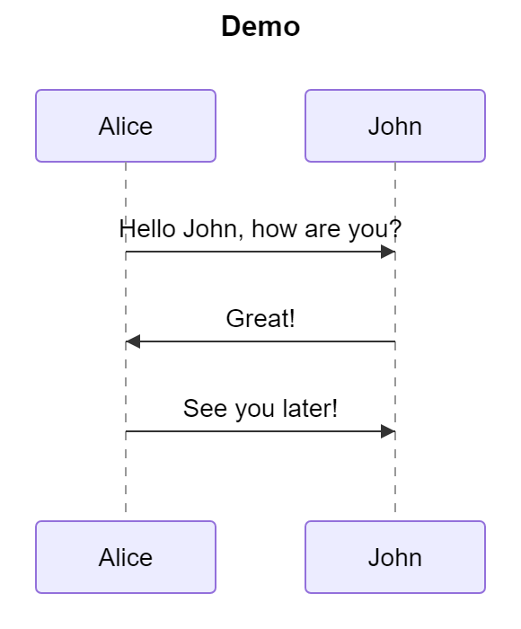
</p>

**Rendered by Mermaid:**
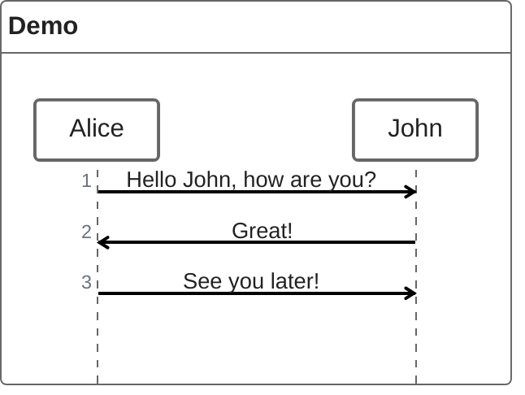

[Open in Mermaid Live](https://mermaid.live/edit#base64:eyJjb2RlIjoiemVudW1sXG4gICAgdGl0bGUgRGVtb1xuICAgIEFsaWNlLVx1MDAzRUpvaG46IEhlbGxvIEpvaG4sIGhvdyBhcmUgeW91P1xuICAgIEpvaG4tXHUwMDNFQWxpY2U6IEdyZWF0IVxuICAgIEFsaWNlLVx1MDAzRUpvaG46IFNlZSB5b3UgbGF0ZXIhIiwibWVybWFpZCI6eyJ0aGVtZSI6ImRlZmF1bHQifX0=)

## ParticipantsAnnotatorsAndAliases

**Input:**
```
zenuml
    @Actor Alice
    @Database Bob
    J as John
    J->Alice: Hi Alice
    Alice->Bob: Hi Bob
```
**Rendered by Naiad:**

<p align="center">
  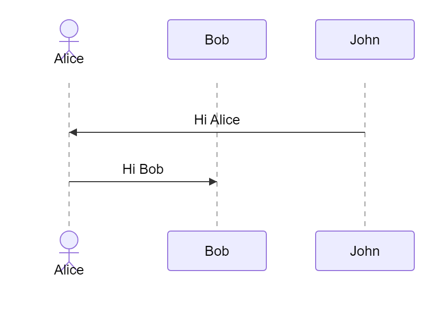
</p>

**Rendered by Mermaid:**
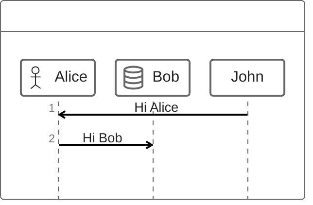

[Open in Mermaid Live](https://mermaid.live/edit#base64:eyJjb2RlIjoiemVudW1sXG4gICAgQEFjdG9yIEFsaWNlXG4gICAgQERhdGFiYXNlIEJvYlxuICAgIEogYXMgSm9oblxuICAgIEotXHUwMDNFQWxpY2U6IEhpIEFsaWNlXG4gICAgQWxpY2UtXHUwMDNFQm9iOiBIaSBCb2IiLCJtZXJtYWlkIjp7InRoZW1lIjoiZGVmYXVsdCJ9fQ==)

## SyncMessages

**Input:**
```
zenuml
    title Sync message
    A.SyncMessage
    A.SyncMessage(with, parameters) {
      B.nestedSyncMessage()
    }
```
**Rendered by Naiad:**

<p align="center">
  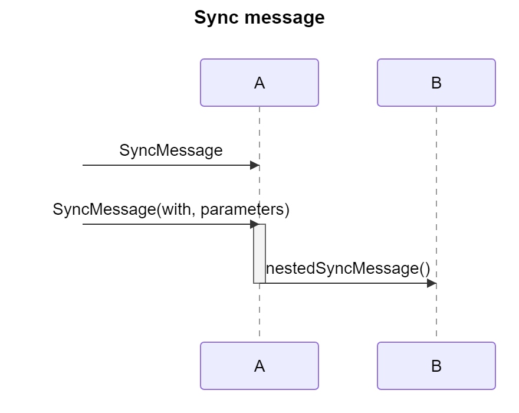
</p>

**Rendered by Mermaid:**
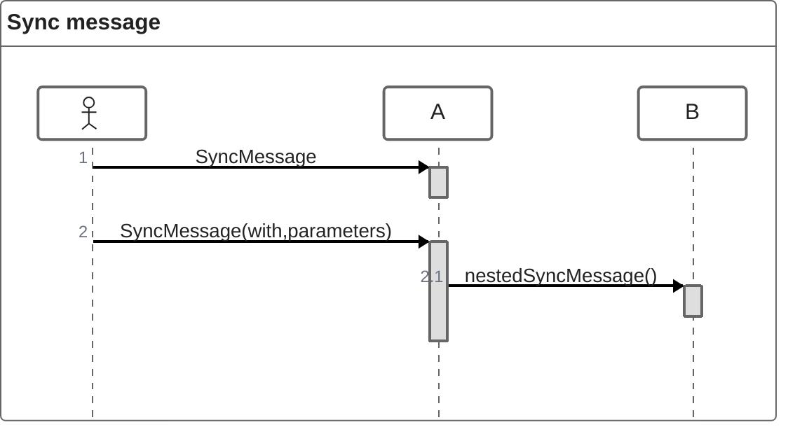

[Open in Mermaid Live](https://mermaid.live/edit#base64:eyJjb2RlIjoiemVudW1sXG4gICAgdGl0bGUgU3luYyBtZXNzYWdlXG4gICAgQS5TeW5jTWVzc2FnZVxuICAgIEEuU3luY01lc3NhZ2Uod2l0aCwgcGFyYW1ldGVycykge1xuICAgICAgQi5uZXN0ZWRTeW5jTWVzc2FnZSgpXG4gICAgfSIsIm1lcm1haWQiOnsidGhlbWUiOiJkZWZhdWx0In19)

## CreationAndReplies

**Input:**
```
zenuml
    Client->Service.handle() {
        repo = new Repository(connection)
        SomeType order = repo.load(id)
        return order
    }
```
**Rendered by Naiad:**

<p align="center">
  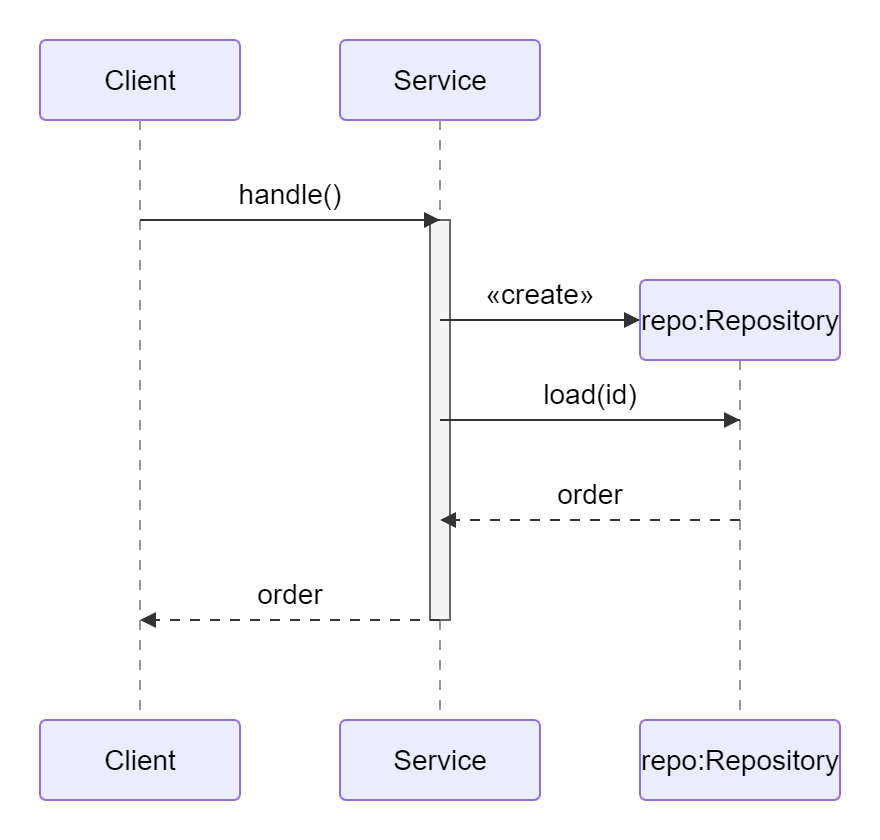
</p>

**Rendered by Mermaid:**
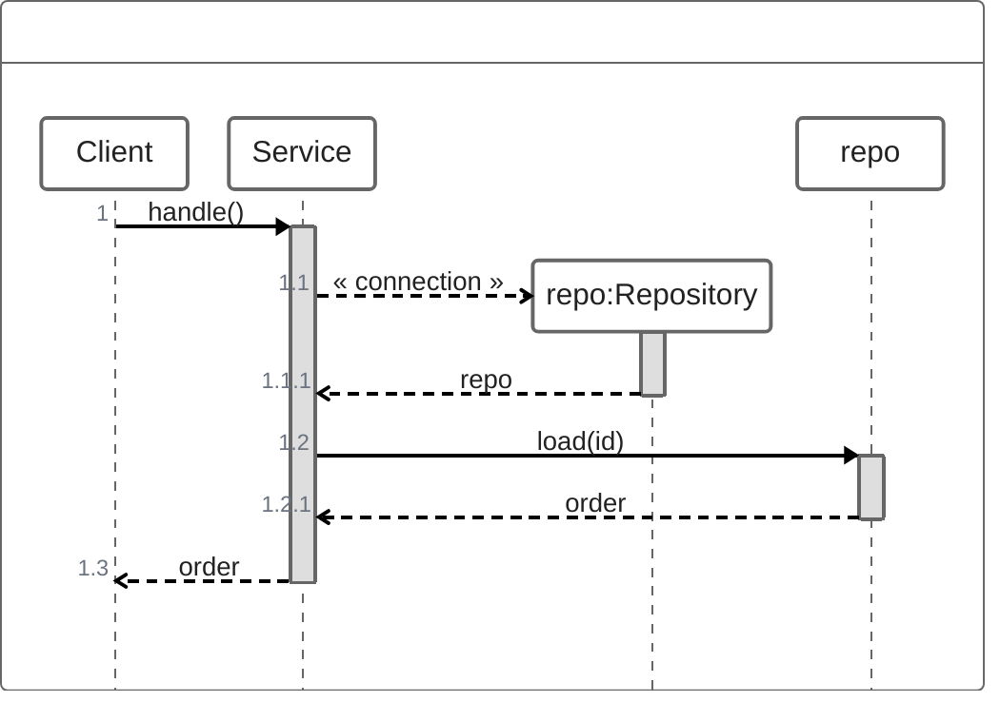

[Open in Mermaid Live](https://mermaid.live/edit#base64:eyJjb2RlIjoiemVudW1sXG4gICAgQ2xpZW50LVx1MDAzRVNlcnZpY2UuaGFuZGxlKCkge1xuICAgICAgICByZXBvID0gbmV3IFJlcG9zaXRvcnkoY29ubmVjdGlvbilcbiAgICAgICAgU29tZVR5cGUgb3JkZXIgPSByZXBvLmxvYWQoaWQpXG4gICAgICAgIHJldHVybiBvcmRlclxuICAgIH0iLCJtZXJtYWlkIjp7InRoZW1lIjoiZGVmYXVsdCJ9fQ==)

## ReplyMessages

**Input:**
```
zenuml
    title Reply message
    Client->A.method() {
      B.method() {
        if(condition) {
          return x1
          // return early
          @return
          A->Client: x11
        }
      }
      return x2
    }
```
**Rendered by Naiad:**

<p align="center">
  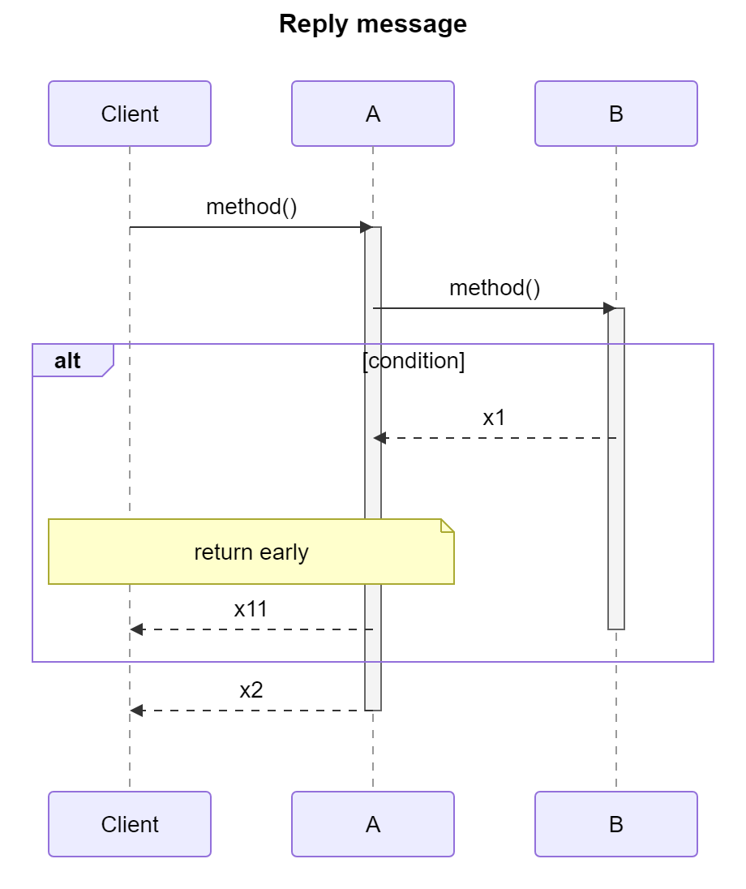
</p>

**Rendered by Mermaid:**
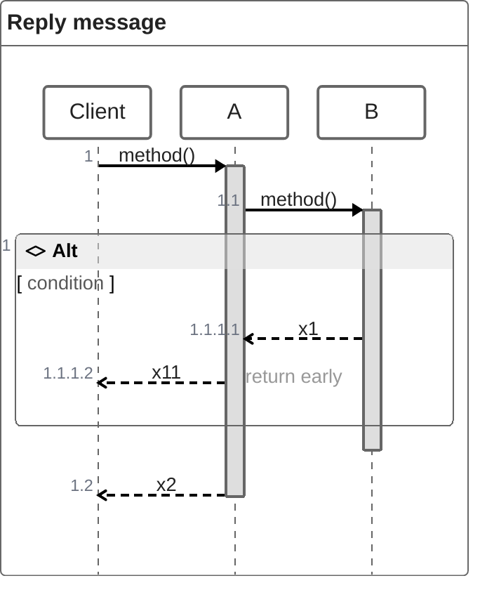

[Open in Mermaid Live](https://mermaid.live/edit#base64:eyJjb2RlIjoiemVudW1sXG4gICAgdGl0bGUgUmVwbHkgbWVzc2FnZVxuICAgIENsaWVudC1cdTAwM0VBLm1ldGhvZCgpIHtcbiAgICAgIEIubWV0aG9kKCkge1xuICAgICAgICBpZihjb25kaXRpb24pIHtcbiAgICAgICAgICByZXR1cm4geDFcbiAgICAgICAgICAvLyByZXR1cm4gZWFybHlcbiAgICAgICAgICBAcmV0dXJuXG4gICAgICAgICAgQS1cdTAwM0VDbGllbnQ6IHgxMVxuICAgICAgICB9XG4gICAgICB9XG4gICAgICByZXR1cm4geDJcbiAgICB9IiwibWVybWFpZCI6eyJ0aGVtZSI6ImRlZmF1bHQifX0=)

## Fragments

**Input:**
```
zenuml
    Alice->Bob: Hello Bob, how are you?
    if(is_sick) {
      Bob->Alice: Not so good :(
    } else if(is_tired) {
      Bob->Alice: Sleepy
    } else {
      Bob->Alice: Feeling fresh like a daisy
    }
    opt {
      Bob->Alice: Thanks for asking
    }
    while(true) {
      John->Alice: Great!
    }
    par {
        Alice->Bob: Hello guys!
        Alice->John: Hello guys!
    }
```
**Rendered by Naiad:**

<p align="center">
  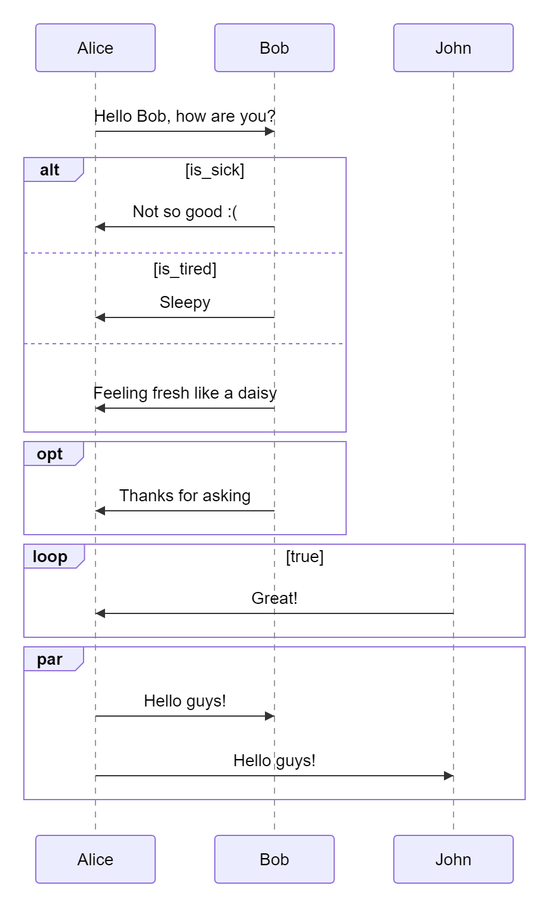
</p>

**Rendered by Mermaid:**
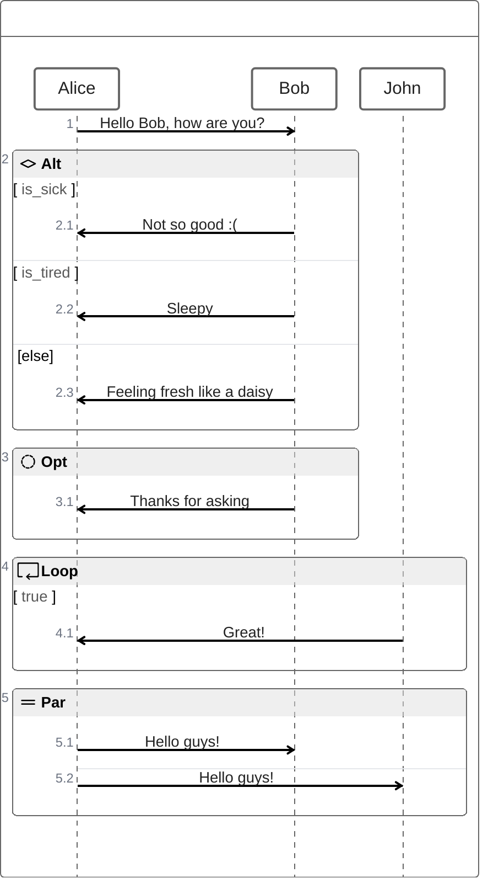

[Open in Mermaid Live](https://mermaid.live/edit#base64:eyJjb2RlIjoiemVudW1sXG4gICAgQWxpY2UtXHUwMDNFQm9iOiBIZWxsbyBCb2IsIGhvdyBhcmUgeW91P1xuICAgIGlmKGlzX3NpY2spIHtcbiAgICAgIEJvYi1cdTAwM0VBbGljZTogTm90IHNvIGdvb2QgOihcbiAgICB9IGVsc2UgaWYoaXNfdGlyZWQpIHtcbiAgICAgIEJvYi1cdTAwM0VBbGljZTogU2xlZXB5XG4gICAgfSBlbHNlIHtcbiAgICAgIEJvYi1cdTAwM0VBbGljZTogRmVlbGluZyBmcmVzaCBsaWtlIGEgZGFpc3lcbiAgICB9XG4gICAgb3B0IHtcbiAgICAgIEJvYi1cdTAwM0VBbGljZTogVGhhbmtzIGZvciBhc2tpbmdcbiAgICB9XG4gICAgd2hpbGUodHJ1ZSkge1xuICAgICAgSm9obi1cdTAwM0VBbGljZTogR3JlYXQhXG4gICAgfVxuICAgIHBhciB7XG4gICAgICAgIEFsaWNlLVx1MDAzRUJvYjogSGVsbG8gZ3V5cyFcbiAgICAgICAgQWxpY2UtXHUwMDNFSm9objogSGVsbG8gZ3V5cyFcbiAgICB9IiwibWVybWFpZCI6eyJ0aGVtZSI6ImRlZmF1bHQifX0=)

## TryCatchFinally

**Input:**
```
zenuml
    try {
      Consumer->API: Book something
      API->BookingService: Start booking process
    } catch(BookingError) {
      API->Consumer: show failure
    } finally {
      API->BookingService: rollback status
    }
```
**Rendered by Naiad:**

<p align="center">
  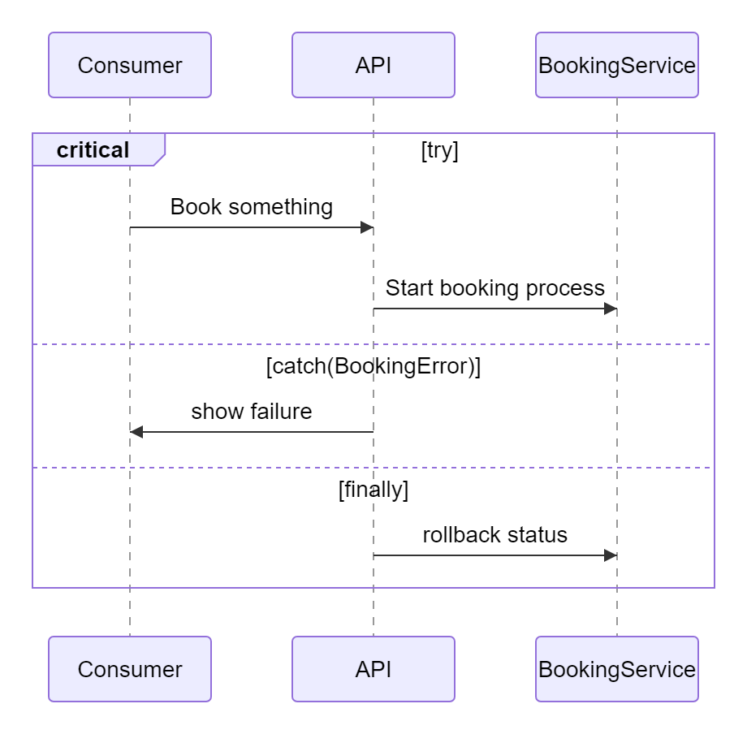
</p>

**Rendered by Mermaid:**
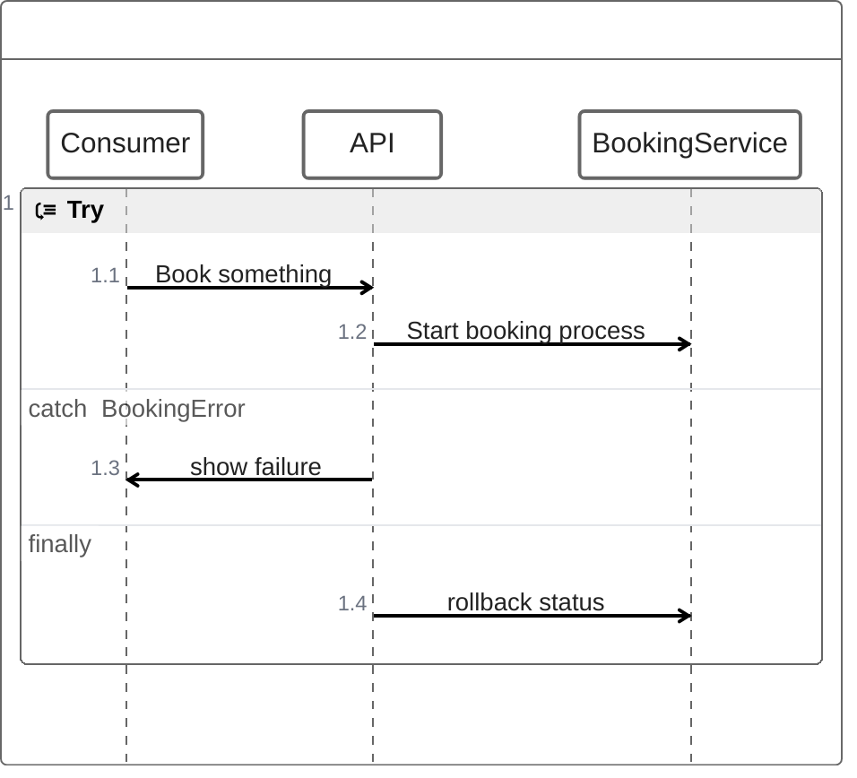

[Open in Mermaid Live](https://mermaid.live/edit#base64:eyJjb2RlIjoiemVudW1sXG4gICAgdHJ5IHtcbiAgICAgIENvbnN1bWVyLVx1MDAzRUFQSTogQm9vayBzb21ldGhpbmdcbiAgICAgIEFQSS1cdTAwM0VCb29raW5nU2VydmljZTogU3RhcnQgYm9va2luZyBwcm9jZXNzXG4gICAgfSBjYXRjaChCb29raW5nRXJyb3IpIHtcbiAgICAgIEFQSS1cdTAwM0VDb25zdW1lcjogc2hvdyBmYWlsdXJlXG4gICAgfSBmaW5hbGx5IHtcbiAgICAgIEFQSS1cdTAwM0VCb29raW5nU2VydmljZTogcm9sbGJhY2sgc3RhdHVzXG4gICAgfSIsIm1lcm1haWQiOnsidGhlbWUiOiJkZWZhdWx0In19)

## Comments

**Input:**
```
zenuml
    // a comment on a participant will not be rendered
    BookService
    // a comment on a message.
    // **Markdown** is supported.
    BookService.getBook()
```
**Rendered by Naiad:**

<p align="center">
  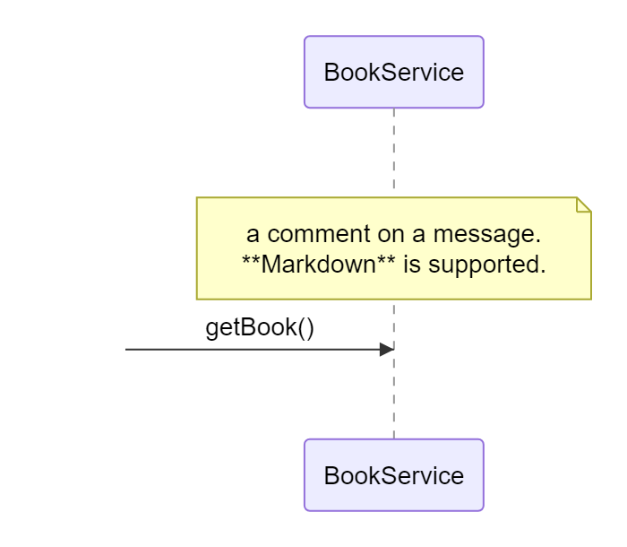
</p>

**Rendered by Mermaid:**
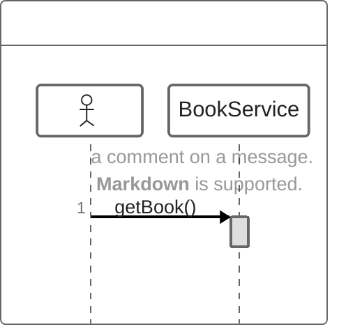

[Open in Mermaid Live](https://mermaid.live/edit#base64:eyJjb2RlIjoiemVudW1sXG4gICAgLy8gYSBjb21tZW50IG9uIGEgcGFydGljaXBhbnQgd2lsbCBub3QgYmUgcmVuZGVyZWRcbiAgICBCb29rU2VydmljZVxuICAgIC8vIGEgY29tbWVudCBvbiBhIG1lc3NhZ2UuXG4gICAgLy8gKipNYXJrZG93bioqIGlzIHN1cHBvcnRlZC5cbiAgICBCb29rU2VydmljZS5nZXRCb29rKCkiLCJtZXJtYWlkIjp7InRoZW1lIjoiZGVmYXVsdCJ9fQ==)

